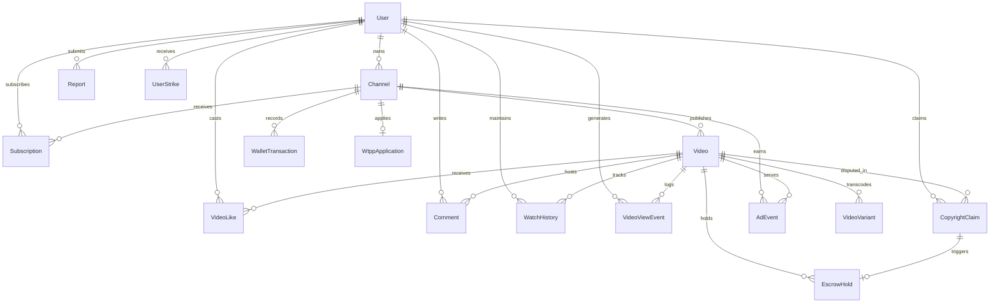

# WATCHTUBE — PROJECT TECHNICAL AUDIT, BASELINE & PROGRESS TRACKING

**Audit Date:** November 4, 2026  
**Last Updated:** November 9, 2026 (Task 2B.1: Disposable Baseline Simulation Verified; Production Still Blocked)
**Auditor / Engineer:** Senior Software Architect & Full-Stack Engineer  
**Repository Branch:** `main` (commit `12713d8`)  
**Repository Remote:** `https://github.com/0789667675/watchtube.git`  
**Reference Specification:** *WatchTube Master Technical Specification & Architecture Blueprint v2.0*  

---

## 1. Project Identity and Purpose

**WatchTube** is a high-performance video-sharing, creator discovery, and monetization platform tailored for the East African market (primary launch: Rwanda) and architected for rapid continental expansion. The platform is engineered mobile-first to deliver ultra-smooth streaming over cellular data connections (3G/4G) with low data consumption, local creator payouts via MTN Mobile Money and Airtel Money, transparent revenue sharing (WTPP), and dual high-contrast themes (Obsidian Dark & Porcelain Light).

---

## 2. Actual Repository Root and Structure

### 2.1 File System Discovery
- **Workspace Directory:** `D:\watchtube`
- **Actual Git Monorepo Root:** `D:\watchtube\watchtube`
- *Note:* The workspace has a nested structure where `D:\watchtube` contains a top-level `node_modules` and the inner `watchtube` directory containing the active `.git` repository, application packages, and configuration files.

### 2.2 Actual Directory Tree (Excluding `node_modules`, `.git`, `.next`, `dist`, `build`)

```
D:\watchtube\watchtube\
├── .env.example                           # Root monorepo master environment template (Task 1)
├── WATCHTUBE_PROGRESS.md                  # Root audit & progress documentation
├── WATCHTUBE_TASK_LOG.md                  # Task execution & continuity log (Task 1)
├── AGENTS.md                              # Coding standards & Cloudflare R2 guidelines
├── package.json                           # Turborepo root package definition
├── pnpm-lock.yaml                         # Monorepo lockfile
├── pnpm-workspace.yaml                    # Defines apps/* and packages/*
├── README.md
├── turbo.json                             # Build pipeline tasks (build, lint, test, dev)
├── patch_layout.js                        # Historical patching script
├── patch_monetization.js                  # Historical patching script
├── patch_monetization_fix.js              # Historical patching script
├── patch_telemetry.js                     # Historical patching script
├── patch_telemetry_fix.js                 # Historical patching script
├── patch_video_player.js                  # Historical patching script
├── patch_watch_page.js                    # Historical patching script
├── apps/
│   ├── api/                               # Express.js REST API
│   │   ├── .env.example                   # API environment configuration template (Task 1)
│   │   ├── package.json
│   │   ├── tsconfig.json
│   │   └── src/
│   │       ├── index.ts                   # Entrypoint & video upload/verify routes
│   │       ├── middleware/
│   │       │   ├── admin.ts               # Admin / Moderator RBAC gate
│   │       │   └── auth.ts                # JWT authentication middleware
│   │       ├── routes/
│   │       │   ├── admin.route.ts         # Reports, WTPP review, claims, escrow, ads
│   │       │   ├── analytics.route.ts     # Telemetry heartbeat, raw/valid views, history
│   │       │   ├── auth.route.ts          # Register, login, logout, /me
│   │       │   ├── channel.route.ts       # Channel creation & handle retrieval
│   │       │   ├── feed.route.ts          # Search & Trending feed
│   │       │   ├── interaction.route.ts   # Likes, cursor-paginated comments, subs
│   │       │   ├── monetization.route.ts  # Ad events, VAST config, 50/50 reconcile
│   │       │   ├── studio.route.ts        # Creator analytics & performance
│   │       │   ├── trust.route.ts         # Reports, copyright claims, WTPP apply/status
│   │       │   └── wallet.route.ts        # Ledger, balance, MoMo/Airtel payout requests
│   │       └── services/
│   │           └── storage.service.ts     # Cloudflare R2 presigned PUTs & HeadObject
│   ├── web/                               # Vite + React 19 Client SPA
│   │   ├── package.json
│   │   ├── vite.config.ts
│   │   ├── tailwind.config.ts             # Obsidian Dark / Porcelain Light / Emerald / Amber
│   │   ├── postcss.config.js
│   │   ├── index.html
│   │   ├── .oxlintrc.json
│   │   ├── tsconfig.json
│   │   ├── tsconfig.app.json
│   │   ├── tsconfig.node.json
│   │   ├── public/
│   │   │   ├── favicon.svg
│   │   │   └── icons.svg
│   │   └── src/
│   │       ├── main.tsx
│   │       ├── App.tsx                    # React Router v7 routes
│   │       ├── App.css
│   │       ├── index.css
│   │       ├── components/
│   │       │   ├── brand/
│   │       │   │   └── ApertureLogo.tsx   # 8-bladed camera aperture shutter emblem
│   │       │   ├── layout/
│   │       │   │   ├── BottomNav.tsx      # Mobile bottom tab navigation (<md)
│   │       │   │   ├── Header.tsx         # Top search, auth, and studio navigation
│   │       │   │   └── Layout.tsx         # Root responsive layout
│   │       │   ├── modals/
│   │       │   │   └── ReportModal.tsx    # User report modal dialog
│   │       │   ├── player/
│   │       │   │   └── VideoPlayer.tsx    # HLS.js player, emerald scrub, data saver, ads
│   │       │   ├── studio/
│   │       │   │   ├── ChannelOnboardingModal.tsx # Channel creation modal
│   │       │   │   └── UploadModal.tsx    # Drag-and-drop video upload sheet
│   │       │   └── video/
│   │       │       └── VideoCard.tsx      # Video card with 16:9 aspect ratio
│   │       └── pages/
│   │           ├── HomePage.tsx           # Category pills & responsive video feed
│   │           ├── WatchPage.tsx          # Video watch view, comments, and up-next
│   │           ├── SearchPage.tsx         # Video search results
│   │           ├── SubscriptionsPage.tsx  # Subscribed channels feed
│   │           ├── TrendingPage.tsx       # Trending velocity feed
│   │           ├── auth/
│   │           │   ├── LoginPage.tsx      # User login form
│   │           │   └── RegisterPage.tsx   # User registration form
│   │           ├── studio/
│   │           │   ├── StudioLayout.tsx   # Creator studio navigation shell
│   │           │   ├── DashboardPage.tsx  # KPI summary, performance, MoMo payout
│   │           │   ├── ContentPage.tsx    # Video asset management list
│   │           │   └── MonetizationPage.tsx # WTPP eligibility tracker & application
│   │           └── admin/
│   │               ├── AdminDashboard.tsx # Moderation queue, WTPP review, disputes
│   │               └── RevenuePage.tsx    # 50/50 reconciliation & escrow releases
│   └── worker/                            # BullMQ + FFmpeg Media Worker
│       ├── .env.example                   # Worker environment configuration template (Task 1)
│       ├── package.json
│       ├── tsconfig.json
│       └── src/
│           ├── worker.ts                  # BullMQ worker (Windows temp path + job isolation) (Task 1)
│           └── services/
│               ├── storage.service.ts     # R2 download & public asset upload
│               └── transcode.service.ts   # fluent-ffmpeg HLS + EBU R128 loudnorm
└── packages/
    ├── config/                            # Shared ESLint, Prettier, tsconfig bases
    ├── database/                          # Prisma schema & database client
    │   ├── .env.example                   # Database environment configuration template (Task 1)
    │   ├── package.json
    │   ├── tsconfig.json
    │   ├── prisma/
      │   │   └── schema.prisma              # 18 PostgreSQL models & 15 enums
    │   └── src/
    │       └── index.ts                   # Global singleton Prisma client instance
    └── types/                             # Shared TypeScript interfaces & DTOs
        ├── package.json
        ├── tsconfig.json
        └── index.ts                       # 4-line stub interface
```

---

## 3. Current Branch and Git Status

- **Current Branch:** `main` (tracked to `origin/main`)
- **Working Tree State:** Modified with preserved local improvements and Task 1 deliverables.
- **Tracked Modifications:**
  - `packages/database/package.json` (preserved: updated `@types/node` dependency)
  - `packages/database/src/index.ts` (preserved: safe `globalThis` PrismaClient initialization)
  - `pnpm-lock.yaml` (preserved: updated lockfile)
  - `apps/worker/src/worker.ts` (Task 1: Windows-compatible temp directory & job isolation)
- **New Untracked Files:**
  - `.env.example` (Root monorepo master template)
  - `apps/api/.env.example` (API configuration template)
  - `apps/worker/.env.example` (Worker configuration template)
  - `packages/database/.env.example` (Database configuration template)
  - `WATCHTUBE_PROGRESS.md` (Audit & progress documentation)
  - `WATCHTUBE_TASK_LOG.md` (Task log)
- **Untracked Historical Scripts:** All 7 root patch scripts (`patch_*.js`) preserved.

---

## 4. Actual Technology Stack

| Layer | Component | Declared / Installed | Status in Codebase | Verified Working? |
|---|---|---|---|---|
| **Runtime & Tooling** | Node.js | v26.4.0 (System) | Runtime engine | Yes |
| | pnpm | v12.16.1 (System, root specifier `pnpm@10.30.3`) | Package manager | Yes |
| | Turborepo | v2.11.10 | Monorepo orchestrator | Yes (5 tasks pass) |
| | TypeScript | `^5.0.0` / `^5.6.0` / `~7.0.2` | Configured across all packages | Yes |
| **Web Frontend** | Vite | v8.3.5 | Bundler & dev server | Yes |
| | React | v19.3.1 | Core UI library | Yes |
| | React Router DOM | v7.18.5 | Client routing SPA | Yes |
| | TanStack Query | v5.0.0 | Server-state management | Configured |
| | Tailwind CSS | v3.4.0 | Utility CSS styling | Yes |
| | Lucide React | v1.65.0 | Vector iconography | Yes |
| | HLS.js | v1.7.4 | HLS adaptive streaming client | Yes |
| | React Hook Form & Resolvers | v7.91.0 / v6.0.2 | Form state management | Yes |
| | Oxlint | v1.89.0 | Static linter | Yes (0 errors, 8 warnings) |
| **Backend API** | Express | v4.18.0 | REST HTTP API framework | Yes (Compiles cleanly) |
| | Helmet | v7.0.0 | Security header middleware | Configured |
| | Cookie-Parser | v1.4.7 | Cookie parsing middleware | Configured |
| | JWT (`jsonwebtoken`) | v9.0.3 | Token generation & validation | Configured |
| | bcryptjs | v3.0.3 | Password hashing | Configured (Replaces Argon2id) |
| | Zod | v3.0.0 | Schema validation contracts | Configured & used |
| | BullMQ | v4.0.0 | Redis-backed job queues | Configured |
| | ioredis | v5.0.0 | Redis client connection | Configured |
| | AWS SDK S3 & Pre-signer | v3.0.0 | Cloudflare R2 / S3 storage | Configured |
| **Worker / Media** | fluent-ffmpeg | v2.1.3 | FFmpeg orchestration | Configured (Binary missing) |
| | BullMQ | v4.0.0 | Queue worker consumer | Configured |
| | OS Temp Scratch | Native `os.tmpdir()` | Cross-platform temporary processing | **Verified Working (Task 1)** |
| **Database** | Prisma ORM | v5.22.0 | PostgreSQL schema & client | Configured & compiled |
| | PostgreSQL | 18.6 (live configured database) | Database provider | Reachable; migration deployment blocked by Prisma P3005 |
| **Mobile Apps** | React Native / Expo | Blueprint: Expo SDK 52 | Mobile clients | **Not Found (0%)** |
| **Design System** | `@watchtube/ui` | Blueprint: Shared UI pkg | Design system | **Not Found (0%)** |

---

## 5. Database Architecture

The schema is defined in `packages/database/prisma/schema.prisma` targeting PostgreSQL. It comprises **18 models** and **15 enums/types**:

### Relational Entity Graph



---

## 6. Audit of the 30 Subsystems

| # | Subsystem | Code Location | Status | Evidence & Observations |
|---|---|---|---|---|
| 1 | Monorepo & Foundation | Root, `turbo.json`, `pnpm-workspace.yaml` | **IMPLEMENTED & VERIFIED** | Turborepo passes `pnpm build` across 5 packages in 24.31s. |
| 2 | Registration & Auth | `apps/api/src/routes/auth.route.ts` | **IMPLEMENTED BUT NOT VERIFIED** | Register, Login, Logout, /me routes with JWT cookie & bcryptjs. Requires live DB to run. |
| 3 | Sessions & RBAC | `apps/api/src/middleware/auth.ts`, `admin.ts` | **PARTIALLY IMPLEMENTED** | Role checks implemented. Missing Redis-backed session revocation and refresh token rotation. |
| 4 | Profiles & Channels | `apps/api/src/routes/channel.route.ts` | **PARTIALLY IMPLEMENTED** | Channel creation and handle search exist. Channel page customization, avatar/banner uploads missing. |
| 5 | Video Upload & Ingestion | `apps/api/src/index.ts`, `UploadModal.tsx` | **PARTIALLY IMPLEMENTED** | Pre-signed upload intent & S3 verification exist on API. Frontend modal currently runs a local timer simulation. |
| 6 | Video Storage (Cloudflare R2) | `apps/api/src/services/storage.service.ts` | **BLOCKED BY MISSING CONFIG** | S3Client configured with R2 endpoints. Environment templates documented in Task 1. |
| 7 | FFmpeg Processing | `apps/worker/src/worker.ts`, `transcode.service.ts` | **PARTIALLY IMPLEMENTED** | Worker updated with Windows temp path & job isolation (Task 1). FFmpeg binaries missing from PATH. |
| 8 | HLS Adaptive Streaming | `apps/worker/src/worker.ts` | **PARTIALLY IMPLEMENTED** | Generates 360p, 720p, 1080p ABR renditions and master playlist. Missing 144p, 240p, 480p from blueprint. |
| 9 | Video Playback | `apps/web/src/components/player/VideoPlayer.tsx` | **IMPLEMENTED & VERIFIED** | HLS.js custom chrome, Virunga emerald scrubber, Data-Saver button, level selector, builds with 0 errors. |
| 10 | Home Discovery Feed | `apps/web/src/pages/HomePage.tsx`, API `/videos` | **PARTIALLY IMPLEMENTED** | API `/api/v1/videos` supports pagination. Frontend currently renders hardcoded `MOCK_VIDEOS`. |
| 11 | Search & Categories | `apps/api/src/routes/feed.route.ts` | **PARTIALLY IMPLEMENTED** | Prisma `contains` query on title/desc/channel. Missing PostgreSQL Full-Text GIN index and search suggestions. |
| 12 | Likes & Comments | `apps/api/src/routes/interaction.route.ts` | **PARTIALLY IMPLEMENTED** | Cursor-paginated comments, threaded replies, and likes API complete. Frontend UI is currently mock/local state. |
| 13 | Subscriptions & History | `apps/api/src/routes/interaction.route.ts` | **PARTIALLY IMPLEMENTED** | Transactional subscribe/unsubscribe and subscription feed complete in API. Frontend not yet wired. |
| 14 | Creator Studio | `apps/web/src/pages/studio/*` | **PARTIALLY IMPLEMENTED** | Studio Layout, Dashboard, Content, and Monetization pages implemented in `apps/web` (not standalone app). |
| 15 | Creator Analytics | `apps/api/src/routes/studio.route.ts` | **PARTIALLY IMPLEMENTED** | Calculates total views, total watch hours from valid views, and subscriber count. 28-day retention curves missing. |
| 16 | Raw vs Valid View Tracking | `apps/api/src/routes/analytics.route.ts` | **IMPLEMENTED BUT NOT VERIFIED** | Validates >=15s or 50% watch time, enforces 30-min session/user deduplication before incrementing views. |
| 17 | Anti-Fraud Mechanisms | `apps/api/src/routes/analytics.route.ts` | **PARTIALLY IMPLEMENTED** | View de-duplication window and IP hash logging present. Device fingerprinting and replay defense missing. |
| 18 | Trust, Moderation, Reports | `apps/api/src/routes/trust.route.ts`, `admin.route.ts` | **IMPLEMENTED BUT NOT VERIFIED** | User reporting, copyright claims, admin dispute review, 90-day strikes, and escrow holds fully coded. |
| 19 | WTPP Creator Onboarding | `apps/api/src/routes/trust.route.ts`, `admin.route.ts` | **IMPLEMENTED BUT NOT VERIFIED** | Exact blueprint rules: 1,000 subscribers, 4,000 watch hours, 0 strikes. Admin approval toggles monetization. |
| 20 | Ads & Monetization Sandbox | `apps/api/src/routes/monetization.route.ts` | **IMPLEMENTED BUT NOT VERIFIED** | Dynamic VAST provider config, ad event tracking, escrow isolation for disputes, 50/50 pool reconciliation. |
| 21 | Creator Wallet & Ledger | `apps/api/src/routes/wallet.route.ts` | **PARTIALLY IMPLEMENTED** | Single-table transaction ledger with balance tracking and BigInt precision. Enterprise multi-account double-entry pending. |
| 22 | MTN Mobile Money | `apps/api/src/routes/wallet.route.ts` | **PARTIALLY IMPLEMENTED** | Enum and request parameter accepted in payout route. Actual MTN MoMo API client integration not written. |
| 23 | Airtel Money | `apps/api/src/routes/wallet.route.ts` | **PARTIALLY IMPLEMENTED** | Enum and request parameter accepted in payout route. Actual Airtel Money API client integration not written. |
| 24 | Creator Payouts | `apps/api/src/routes/wallet.route.ts`, `DashboardPage.tsx` | **PARTIALLY IMPLEMENTED** | Payout request creates PENDING transaction and debits balance. 25,000 RWF minimum threshold check missing. |
| 25 | Viewer Mobile App | Blueprint `apps/mobile` | **NOT IMPLEMENTED** | Not found in repository. |
| 26 | Creator Studio Mobile App | Blueprint `apps/studio-mobile` | **NOT IMPLEMENTED** | Not found in repository. |
| 27 | Internationalization (Kinyarwanda) | Blueprint i18n core | **NOT IMPLEMENTED** | No i18n framework configured in `apps/web`. |
| 28 | Responsive Interfaces | `BottomNav.tsx`, `Layout.tsx`, `WatchPage.tsx` | **IMPLEMENTED & VERIFIED** | Breakpoints configured, mobile bottom nav bar, edge-to-edge player on small screens, desktop cinema mode. |
| 29 | Security & Performance | Express middleware, Prisma singleton | **PARTIALLY IMPLEMENTED** | Helmet, Zod validation, and bcryptjs in place. Rate-limiting, CORS origin locking, and Redis caching missing. |
| 30 | Production Deployment | Docker, PgBouncer, Nginx, Cloudflare | **NOT IMPLEMENTED** | Docker files not found. Docker CLI is not installed on host machine. |

---

## 7. Verification Results & Command Executions

1. **`pnpm --filter @watchtube/worker build` (Post-Task 1)**
   - Command: `tsc` in `apps/worker`
   - Result: Exit code `0` (Success).
2. **`pnpm build` (Root Turborepo Build Post-Task 1)**
   - Command: `turbo run build`
   - Result: Exit code `0` (5 successful tasks: `@watchtube/types`, `@watchtube/database`, `@watchtube/web`, `@watchtube/worker`, `@watchtube/api` in 24.31s).
3. **Windows Node.js Path Resolution Verification**
   - Command: Verified `os.tmpdir()` and `path.join(base, 'video-uuid_job-1')`.
   - Result: Resolves to valid Windows absolute path under `%LOCALAPPDATA%\Temp\watchtube`.
4. **Environment Template Leak Verification**
   - Verified `.env.example` templates across root, `apps/api`, `apps/worker`, and `packages/database`.
   - Result: Zero real secrets or production credentials present. Placeholders only.

---

## 8. Current Blockers and Technical Risks

1. **Local Services & Infrastructure (last checked November 9, 2026):**
   - PostgreSQL 18.6 is reachable through the existing configuration. The live database still contains only the empty legacy `User` table and has no `_prisma_migrations` history. `prisma migrate deploy` stopped with P3005 because the schema is non-empty; no migration DDL was applied. See Task 2B below.
   - Redis connectivity was not checked as part of Task 2A.
   - Docker was reported as unavailable during Task 1; not rechecked in Task 2A.
2. **Missing Media Processing Binaries:**
   - FFmpeg and ffprobe are not installed in the Windows system PATH, preventing transcode execution in `apps/worker`.
3. **Zero Automated Tests:**
   - There are zero unit, integration, or end-to-end tests across all packages.

---

## 9. Recommended Implementation Sequence

1. **Phase 1: Environment & Infrastructure Baseline (In Progress - Tasks 1, 1B & 1C Complete)**
   - [x] Task 1: Document and author `.env.example` configurations for `apps/api`, `apps/worker`, and `packages/database`.
   - [x] Task 1B: Worker temporary directory hardening (UUID validation, `fs.mkdtemp` isolation, path containment, cleanup preservation) and centralized JWT production security (`apps/api/src/config/jwt.ts`).
   - [x] Task 1C: Strengthened JWT secret validation to 32 characters in production; protected public media URL generation against missing domains.
   - [x] Configure gitignored local `.env` files with external database, Redis, and Cloudflare R2 credentials.
   - [x] Confirm PostgreSQL connectivity and inspect the live schema (Task 2A).
   - [ ] Establish migration history; Task 2B is blocked at Prisma P3005 and requires a separately reviewed baseline approach. No seed data was created.
2. **Phase 2: Platform Testing Infrastructure**
   - Establish unit and integration testing framework (`vitest` / `supertest`) across `apps/api` and `apps/web`.
   - Write automated tests for auth, channel creation, and view telemetry de-duplication.
3. **Phase 3: Frontend-to-Backend API Integration**
   - Replace mock data in `HomePage.tsx`, `WatchPage.tsx`, and `SearchPage.tsx` with TanStack Query hooks consuming `/api/v1/*`.
   - Connect `UploadModal.tsx` to `/api/v1/videos/upload-intent` and `/verify-upload`.
4. **Phase 4: Media Processing Worker Hardening**
   - Add missing low-bandwidth renditions (144p, 240p, 480p) to transcode ladder.
5. **Phase 5: Financial & Payment Engine Hardening**
   - Enforce 25,000 RWF minimum withdrawal threshold in `wallet.route.ts`.
   - Implement MTN Rwanda MoMo Disbursement API integration and webhook verification.
6. **Phase 6: Native Mobile Applications & Localization**
   - Scaffold Expo SDK 52 apps sharing types and design tokens.
   - Introduce Kinyarwanda language support via `react-i18next`.

---

## 10. Exact Next Task to Implement

**Task 2B status:** Owner-authorized migration attempt stopped at Prisma P3005 before DDL. The migration SQL is prepared, but the live database is unchanged and migration history is not established. Any future baseline/resolve procedure requires review and approval; do not retry deployment or alter the database under this task.

- **Historical gate:** Task 2A was read-only; owner approval for Task 2B was recorded before its migration attempt.

---

## TASK 2A: Read-only Database Connectivity & Existing Schema Inspection

**Date:** November 9, 2026  
**Status:** COMPLETED — READ-ONLY; OWNER APPROVAL RECORDED BEFORE TASK 2B

### Scope and preservation
- Inspected the Prisma schema, migration inventory, current environment-file locations, and PostgreSQL metadata.
- No database writes, migrations, seeds, `db push`, resets, or schema modifications were run.
- Existing `.env` files were not edited and no credential values were printed.
- Pre-existing modified and untracked files, including all historical `patch_*.js` scripts, were preserved. `git status --short` after the checks matched the pre-check status.

### Prisma schema inventory
- **18 models:** `User`, `Channel`, `Video`, `VideoVariant`, `WalletTransaction`, `VideoLike`, `Subscription`, `Comment`, `WatchHistory`, `VideoViewEvent`, `Report`, `CopyrightClaim`, `UserStrike`, `WtppApplication`, `AdEvent`, `RevenueReconciliation`, `EscrowHold`, `AdProviderConfig`.
- **15 enums:**
   - `Role`: `VIEWER`, `CREATOR`, `MODERATOR`, `ADMIN`.
   - `UserStatus`: `GOOD_STANDING`, `WARNING`, `RESTRICTED`, `SUSPENDED`.
   - `VideoStatus`: `DRAFT`, `UPLOADING`, `PROCESSING`, `READY`, `REJECTED`.
   - `Visibility`: `PUBLIC`, `UNLISTED`, `PRIVATE`.
   - `TransactionType`: `HOLD`, `REVENUE_CREDIT`, `PAYOUT`, `ADJUSTMENT`.
   - `WalletStatus`: `PENDING`, `AVAILABLE`, `PAID`, `FAILED`.
   - `ReportReason`: `SPAM`, `HARASSMENT`, `COPYRIGHT`, `HATE_SPEECH`, `MISLEADING`, `OTHER`.
   - `ReportTargetType`: `VIDEO`, `COMMENT`, `CHANNEL`.
   - `ReportStatus`: `OPEN`, `UNDER_REVIEW`, `ACTION_TAKEN`, `DISMISSED`.
   - `CopyrightClaimStatus`: `OPEN`, `UNDER_REVIEW`, `APPROVED_TAKEDOWN`, `REJECTED`, `DISPUTED`.
   - `StrikeType`: `WARNING`, `VIDEO_REMOVAL`, `MONETIZATION_HOLD`, `SUSPENSION`.
   - `WtppApplicationStatus`: `NOT_APPLIED`, `PENDING`, `APPROVED`, `REJECTED`.
   - `AdEventType`: `AD_REQUEST`, `AD_SERVED`, `AD_VIEWABLE`, `AD_CLICK`.
   - `ReconStatus`: `ESTIMATED`, `REPORTED`, `FINALIZED`, `DISTRIBUTED`.
   - `EscrowStatus`: `HELD`, `RELEASED_TO_CREATOR`, `TRANSFERRED_TO_CLAIMANT`, `REFUNDED`.
- **Scalar fields by model** (relation fields are listed separately below):
   - `User`: `id`, `email`, `passwordHash`, `role`, `status`, `createdAt`, `updatedAt`.
   - `Channel`: `id`, `userId`, `handle`, `name`, `description`, `avatarUrl`, `bannerUrl`, `subscriberCount`, `isVerified`, `createdAt`, `isMonetized`.
   - `Video`: `id`, `channelId`, `title`, `description`, `rawStorageKey`, `status`, `visibility`, `duration`, `viewsCount`, `thumbnailUrl`, `lowBandwidthReady`, `createdAt`, `publishedAt`.
   - `VideoVariant`: `id`, `videoId`, `resolution`, `bitrate`, `playlistUrl`.
   - `WalletTransaction`: `id`, `channelId`, `transactionType`, `amountCents`, `balanceAfterCents`, `referenceId`, `createdAt`, `status`.
   - `VideoLike`: `id`, `userId`, `videoId`, `isDislike`, `createdAt`.
   - `Subscription`: `id`, `subscriberId`, `channelId`, `createdAt`.
   - `Comment`: `id`, `videoId`, `userId`, `parentId`, `content`, `likesCount`, `isPinned`, `createdAt`, `updatedAt`.
   - `WatchHistory`: `id`, `userId`, `videoId`, `lastPositionSeconds`, `completed`, `updatedAt`.
   - `VideoViewEvent`: `id`, `videoId`, `userId`, `sessionId`, `watchDurationSeconds`, `isValidView`, `ipHash`, `createdAt`.
   - `Report`: `id`, `reporterId`, `targetType`, `targetId`, `reason`, `details`, `status`, `createdAt`, `resolvedAt`.
   - `CopyrightClaim`: `id`, `claimantId`, `videoId`, `description`, `proofUrl`, `status`, `createdAt`, `resolvedAt`.
   - `UserStrike`: `id`, `userId`, `reason`, `strikeType`, `expiresAt`, `createdAt`.
   - `WtppApplication`: `id`, `channelId`, `status`, `channelWatchHours`, `subscriberCount`, `taxId`, `nationalIdOrPassport`, `reviewerNotes`, `submittedAt`, `reviewedAt`.
   - `AdEvent`: `id`, `videoId`, `channelId`, `eventType`, `provider`, `grossRevenueCents`, `ipHash`, `createdAt`.
   - `RevenueReconciliation`: `id`, `monthYear`, `grossProviderRevenueCents`, `platformShareCents`, `creatorPoolCents`, `status`, `finalizedAt`, `createdAt`.
   - `EscrowHold`: `id`, `videoId`, `claimId`, `heldAmountCents`, `status`, `createdAt`, `resolvedAt`.
   - `AdProviderConfig`: `id`, `name`, `vastTagUrl`, `priority`, `isEnabled`, `format`, `createdAt`, `updatedAt`.
- **Relations / foreign-key mappings:** `Channel.userId -> User.id`; `Video.channelId -> Channel.id`; `VideoVariant.videoId -> Video.id`; `WalletTransaction.channelId -> Channel.id`; `VideoLike.userId -> User.id` and `videoId -> Video.id`; `Subscription.subscriberId -> User.id` and `channelId -> Channel.id`; `Comment.videoId -> Video.id`, `userId -> User.id`, and nullable `parentId -> Comment.id` (self-relation); `WatchHistory.userId -> User.id` and `videoId -> Video.id`; `VideoViewEvent.videoId -> Video.id` and nullable `userId -> User.id`; nullable `Report.reporterId -> User.id`; `CopyrightClaim.claimantId -> User.id` and `videoId -> Video.id`; `UserStrike.userId -> User.id`; unique `WtppApplication.channelId -> Channel.id` (one-to-one); `AdEvent.videoId -> Video.id` and `channelId -> Channel.id`; `EscrowHold.videoId -> Video.id` and unique `claimId -> CopyrightClaim.id` (one-to-one). `RevenueReconciliation` and `AdProviderConfig` have no model relations. The inverse collection and optional relation fields are declared on the related models.
- **Primary keys:** Every model declares `id String @id @default(uuid()) @db.Uuid`.
- **Unique constraints:** `User.email`; `Channel.handle`; `WalletTransaction.referenceId`; `AdProviderConfig.name`; `WtppApplication.channelId`; `EscrowHold.claimId`; composite `(VideoLike.userId, VideoLike.videoId)`, `(Subscription.subscriberId, Subscription.channelId)`, and `(WatchHistory.userId, WatchHistory.videoId)`.
- **Foreign keys:** Relation fields declare references for all listed model relations, including the self-reference on `Comment.parentId`. Required versus optional relations follow the corresponding nullable FK fields in the schema.
- No explicit `@@index` or `@index` declarations are present. Unique constraints and primary keys imply their corresponding unique indexes in PostgreSQL. No explicit check constraints are declared in the Prisma schema.

### Migrations and live database
- No migration files or `packages/database/prisma/migrations` directory exist in the repository. The live database also has no `_prisma_migrations` table, so there is no recorded Prisma migration history to inspect.
- Existing configuration reaches PostgreSQL **18.6**. Read-only catalog checks found one public base table, `User`, and it is empty.
- The live `User` table has columns `email` (text, not null), `createdAt` and `updatedAt` (timestamp without time zone, not null), `id` (text, not null), and `name` (nullable text). Its constraints are a primary key on `id` and not-null checks; its indexes are the unique primary-key index on `id` and unique index on `email`.
- **Schema drift:** This live table is not the current Prisma `User` model, which declares UUID `id`, `passwordHash`, `role`, `status`, and no `name` field. No other tables from the current schema exist in the inspected `public` schema. The table contains no rows; this report did not attempt to reconcile it.

### Environment resolution and Prisma checks
- Existing `.env` files are present at repository root and `packages/database`; no `packages/database/prisma/.env` exists. Both files define `DATABASE_URL`, and their parsed targets match when comparing scheme, host, port, database path, and query while excluding credentials.
- Prisma `validate` from the database package loaded its local `.env`, loaded `packages/database/prisma/schema.prisma`, and succeeded. A root-working-directory validation using the package Prisma launcher also succeeded without a duplicate-env conflict message. The package and root invocations therefore both validate; callers should keep the working directory in mind because dotenv selection is location-dependent.
- `prisma generate` succeeded with Prisma Client 5.22.0 at the generator's default `node_modules` location. No authored source path or schema output path was targeted.
- Validation and generation exit codes: `0` and `0`, respectively. The database inspection used `SET TRANSACTION READ ONLY` and SELECTs only.

### Task gate
Task 2A was completed read-only and reviewed/approved before Task 2B. The Task 2B outcome is recorded below.

---

## TASK 2B: Safe Database Initialization & Migration Baseline

**Date:** November 9, 2026  
**Status:** BLOCKED — `prisma migrate deploy` stopped with P3005; no schema migration applied

### Pre-migration findings
- The configured target was confirmed by matching root/package environment targets without exposing credentials and by matching the connected database path internally. Server: PostgreSQL 18.6. Prisma CLI/client: 5.22.0.
- The only non-system schema is `public`; the only extension is `plpgsql` 1.0. Before deployment, the only base table was `public."User"` (zero rows). Its five columns were `email` text NOT NULL; `createdAt` timestamp without time zone NOT NULL DEFAULT `CURRENT_TIMESTAMP`; `updatedAt` timestamp without time zone NOT NULL; `id` text NOT NULL; and nullable `name` text. It had primary key `User_pkey`, unique index `User_email_key`, and four not-null constraints. No foreign keys, dependent views/materialized views, noninternal triggers, or migration-related objects were found.
- PostgreSQL client utilities are version **18.4**. A custom-format backup was created outside the repository at `C:\Users\sam\AppData\Local\WatchTubeBackups\watchtube_task2b_20261109_081805.dump`. `pg_dump` exited `0`; `pg_restore --list` exited `0`, reported 9 TOC entries, and contained the `public` schema, `User` table, and `User` table-data entry. Size: 3,481 bytes. SHA-256: `BBA3AFD7FCF5F93EE1D218AA36D23B33D832A2B90153A21FC7BF1C9D4A573BB3`. The archive was not test-restored.

### Migration design and files
- Prisma 5.22.0 generated the initial SQL from the current schema. The reviewed SQL creates 18 tables, 15 enum types, 9 unique indexes, and 24 foreign keys; it contains no `DROP` or `TRUNCATE` statements.
- Migration directory: `packages/database/prisma/migrations/20261109082031_init_preserve_legacy_user/`.
- Files created: `migration.sql` and `packages/database/prisma/migrations/migration_lock.toml` (`provider = "postgresql"`). The migration renames the legacy table to `User_legacy_20261109`, renames its primary-key constraint/index and unique email index to avoid name collisions, then creates the Prisma schema in an explicit transaction. This was reviewed against the live catalog; no dependencies were found.

### Apply and post-failure state
- Prisma schema validation passed (exit `0`) before deployment. `prisma migrate deploy` stopped with **P3005** because the target schema is non-empty. Prisma did not apply the migration.
- Per the failure rule, no baseline/resolve operation, retry, reset, `db push`, seed, manual DDL, or other repair was attempted.
- Post-failure read-only verification found the same sole `public."User"` table, the same five columns/defaults, same two indexes, and zero rows. No `User_legacy_20261109` or `_prisma_migrations` table exists. Database state is unchanged.
- Migration status, post-apply Prisma Client generation, database package build/tests, and schema-parity checks were not run because migration application failed. No full schema parity or migration success is claimed.
- No `.env`, application, worker, frontend, package source, or lock files were modified. `WATCHTUBE_ARCHITECTURE.md` is absent, so it was not edited. Parent workspace report mirrors were also updated.

### Current gate
**Database and migrations are not complete.** The next action is blocked pending a separately reviewed existing-database baseline approach; do not retry deployment or use `migrate resolve` without explicit review/approval.

---

## TASK 2B.1: Backup Restore Verification & Migration Baseline Investigation

**Date:** November 9, 2026  
**Status:** INVESTIGATION COMPLETE; PRODUCTION UNCHANGED; BASELINE APPROACH VERIFIED ON DISPOSABLE COPY

### Backup restore
- The existing backup `C:\Users\sam\AppData\Local\WatchTubeBackups\watchtube_task2b_20261109_081805.dump` exists and SHA-256 matches `BBA3AFD7FCF5F93EE1D218AA36D23B33D832A2B90153A21FC7BF1C9D4A573BB3`.
- PostgreSQL 18.4 `pg_restore --list` succeeded with 9 TOC entries, including the public schema, legacy `User` table, and its table-data section.
- A new PostgreSQL 18.4 cluster was initialized under `C:\Users\sam\AppData\Local\Temp\watchtube_task2b1_pg_5fdee570a4854203a1dd3d8843f7c6b5`, bound only to loopback at port 49165. The backup restored into a newly created disposable database using `pg_restore --single-transaction`; exit code `0`.
- Restored `User` matched the production snapshot: five columns and defaults, primary key, four not-null constraints, unique email index, and zero rows. The disposable server is stopped; its data directory was retained outside the repository.

### Prisma 5.22 baseline semantics and simulation
- The observed P3005 means Prisma Migrate found a non-empty schema without migration history and refused to assume the existing objects match the migration set. The production attempt applied no DDL.
- Installed `prisma migrate resolve --help` describes baselining an existing database; `--applied <migration>` records the named migration as applied. The disposable simulation confirmed it creates a successful history row with zero applied SQL steps and does not execute the baseline SQL.
- A baseline SQL artifact was derived from `pg_dump --schema-only` of the restored database. The psql-only `\restrict`/`\unrestrict` wrapper directives were omitted from the temporary Prisma migration; the actual legacy table, constraint, and index definitions came from the restored catalog.
- In a temporary Prisma project outside Git, the restored database accepted `migrate resolve --applied 20261109070000_baseline_legacy_user`; status then showed the later `20261109082031_init_preserve_legacy_user` as pending. `migrate deploy` applied that later migration successfully. Final `migrate status` reported up to date; `prisma validate` passed.
- Disposable catalog verification: 18/18 expected model tables, 15 enum types (62 labels), 24 foreign keys, and all expected keys/indexes. Both migration history rows are finished, not rolled back; the baseline has 0 SQL steps and the schema migration has 1. All 18 model tables and the archived table are empty. The archive retains its original five columns/default, PK and not-null constraints, and both unique indexes.
- Prisma's read-only schema diff from the disposable database to the current Prisma schema emitted only `DROP TABLE "User_legacy_20261109";`, the expected difference for an intentionally preserved out-of-schema archive. This SQL was inspected and not executed. No other schema drift was reported.

### Recommendation and production gate
- Evidence supports a two-stage strategy: add an earlier baseline migration that accurately represents the existing legacy database, mark only that baseline as applied on the existing database, then deploy the existing later schema-creation migration. The existing migration's archive rename and current schema creation succeeded in the disposable simulation.
- **Recommendation only; not run in production:** a follow-up must review the baseline SQL and backup, then explicitly authorize the production `migrate resolve --applied <baseline>` step followed by `migrate deploy`, with pre/post catalog checks. Never mark the current schema-creation migration as applied on the legacy database.
- Final production read-only check still found only the original `User` table (5 columns, 2 indexes, 0 rows); no archive or `_prisma_migrations` table. No production modification, credential exposure, `.env` edit, source edit, or new repository migration file occurred in Task 2B.1.
- Database and migrations remain **incomplete** until the separately authorized production baseline and migration are applied and verified. `WATCHTUBE_ARCHITECTURE.md` is absent.

---

## TASK 2B.2: Finalize Legacy Baseline Migration Artifact

**Date:** November 10, 2026  
**Status:** BLOCKED — stopped before either migration path because restored backup row count conflicts with Task 2B.1 evidence

### Evidence and stop condition
- Inspected the current Prisma schema, the complete migration inventory, both Task 2B/2B.1 histories, and the saved Task 2B.1 baseline/diff evidence. The migration history already present consists of `20261109082031_init_preserve_legacy_user`; it was not edited.
- Rechecked `C:\Users\sam\AppData\Local\WatchTubeBackups\watchtube_task2b_20261109_081805.dump`: 3,481 bytes and SHA-256 `BBA3AFD7FCF5F93EE1D218AA36D23B33D832A2B90153A21FC7BF1C9D4A573BB3`, matching the previously recorded hash. Its schema-only evidence contains only `public."User"` with five columns, its primary key, and the unique email index.
- Restored that backup into a new loopback-only PostgreSQL 18.4 disposable cluster at `127.0.0.1:49168`, database `watchtube_legacy_path_a`. The first transactional restore stopped on an absent ACL role; the failed transaction left zero public tables. Retrying with `pg_restore --single-transaction --no-owner --no-acl` succeeded.
- Actual restored catalog: `email text NOT NULL`; `createdAt timestamp(3) without time zone NOT NULL DEFAULT CURRENT_TIMESTAMP`; `updatedAt timestamp(3) without time zone NOT NULL`; `id text NOT NULL`; nullable `name text`; primary key on `id`; unique btree index on `email`. **The restored table has 1 row**, contradicting Task 2B and 2B.1's recorded 0 rows. No row contents were read or exposed.
- Stopped immediately before `migrate resolve`, `migrate deploy`, Path A, or Path B. A read-only check confirmed only the restored `User` table exists, with no archive and no `_prisma_migrations`. The temporary PostgreSQL cluster is stopped and its data directory retained at `C:\Users\sam\AppData\Local\Temp\watchtube_task2b2_pg_20261110_0757`.
- `prisma validate --schema prisma/schema.prisma` passed with `DATABASE_URL` explicitly pointed at the disposable loopback database. Migration status, migration replay, and schema diff were not run for either path because the evidence mismatch triggers the required stop. Production was not contacted or modified.

### Baseline artifact
- Added `packages/database/prisma/migrations/20261109070000_baseline_legacy_user/migration.sql`, ordered before the existing schema-creation migration. It contains only the verified legacy table, primary key, and unique email index; it does not create current application tables or insert data.
- This is the exact legacy schema DDL, not the table's row data. `migrate resolve --applied 20261109070000_baseline_legacy_user` records the baseline without executing its SQL; on a fresh database `migrate deploy` would execute the baseline and then the existing schema-creation migration.
- Production readiness is **not established** until the zero-versus-one-row discrepancy is reconciled and both disposable paths pass independently. Database and migrations remain unchecked/incomplete.

### Conditional production command order (NOT RUN; do not execute until the blocker is resolved and production is separately authorized)
From PowerShell, with `$env:DATABASE_URL` securely set to the intended production target (do not echo it; no `.env` file is changed). Run each line separately and stop on any nonzero exit or unexpected output:

```powershell
Set-Location 'D:\watchtube\watchtube\packages\database'
pnpm exec prisma validate --schema prisma/schema.prisma
& 'C:\Program Files\PostgreSQL\18\bin\psql.exe' -X -v ON_ERROR_STOP=1 -d "$env:DATABASE_URL" -c 'SELECT current_database(), current_schema(); SELECT count(*) AS legacy_user_rows FROM public."User"; SELECT column_name, data_type, datetime_precision, is_nullable, column_default FROM information_schema.columns WHERE table_schema=''public'' AND table_name=''User'' ORDER BY ordinal_position; SELECT indexname, indexdef FROM pg_indexes WHERE schemaname=''public'' AND tablename=''User'' ORDER BY indexname; SELECT to_regclass(''public._prisma_migrations'') IS NULL AS no_migration_history;'
pnpm exec prisma migrate resolve --applied 20261109070000_baseline_legacy_user --schema prisma/schema.prisma
& 'C:\Program Files\PostgreSQL\18\bin\psql.exe' -X -v ON_ERROR_STOP=1 -d "$env:DATABASE_URL" -c 'SELECT migration_name, applied_steps_count, finished_at IS NOT NULL AS finished FROM public."_prisma_migrations" ORDER BY started_at; SELECT count(*) AS legacy_user_rows FROM public."User"; SELECT column_name, data_type, datetime_precision, is_nullable, column_default FROM information_schema.columns WHERE table_schema=''public'' AND table_name=''User'' ORDER BY ordinal_position; SELECT indexname, indexdef FROM pg_indexes WHERE schemaname=''public'' AND tablename=''User'' ORDER BY indexname;'
pnpm exec prisma migrate status --schema prisma/schema.prisma
pnpm exec prisma migrate deploy --schema prisma/schema.prisma
pnpm exec prisma migrate status --schema prisma/schema.prisma
& 'C:\Program Files\PostgreSQL\18\bin\psql.exe' -X -v ON_ERROR_STOP=1 -d "$env:DATABASE_URL" -c 'SELECT migration_name, applied_steps_count, finished_at IS NOT NULL AS finished FROM public."_prisma_migrations" ORDER BY started_at; SELECT count(*) AS archived_user_rows FROM public."User_legacy_20261109"; SELECT count(*) AS current_model_tables FROM pg_tables WHERE schemaname=''public'' AND tablename NOT IN (''_prisma_migrations'', ''User_legacy_20261109''); SELECT column_name, data_type, datetime_precision, is_nullable, column_default FROM information_schema.columns WHERE table_schema=''public'' AND table_name=''User_legacy_20261109'' ORDER BY ordinal_position; SELECT indexname, indexdef FROM pg_indexes WHERE schemaname=''public'' AND tablename=''User_legacy_20261109'' ORDER BY indexname;'
pnpm exec prisma validate --schema prisma/schema.prisma
pnpm exec prisma migrate diff --from-url "$env:DATABASE_URL" --to-schema-datamodel prisma/schema.prisma --script
```

- The first `validate` is static. The first `psql` is read-only preflight; verify the target identity and exact legacy schema, and record its row count. `migrate resolve` records **only** `20261109070000_baseline_legacy_user` as applied (zero SQL steps); it does not execute its DDL. The next read-only query and `migrate status` must show that baseline finished and `20261109082031_init_preserve_legacy_user` still pending, with the original table unchanged. Only `migrate deploy` executes the existing `20261109082031_init_preserve_legacy_user`, which archives `User` and creates the current Prisma schema.
- Final read-only checks must show both migrations finished, 18 current model tables, and `User_legacy_20261109` retaining the preflight row count, columns, PK, and indexes. The expected Prisma schema diff is only the intentionally out-of-model archive table; no diff SQL is to be executed.
- If any command fails, target identity is unexpected, migration status differs, or row/schema checks do not match, stop immediately. Do not rerun, reset, drop, truncate, use `db push`, mark the schema-creation migration applied, roll back/repair migration history, or attempt destructive repair. Preserve output and use read-only inspection only.
