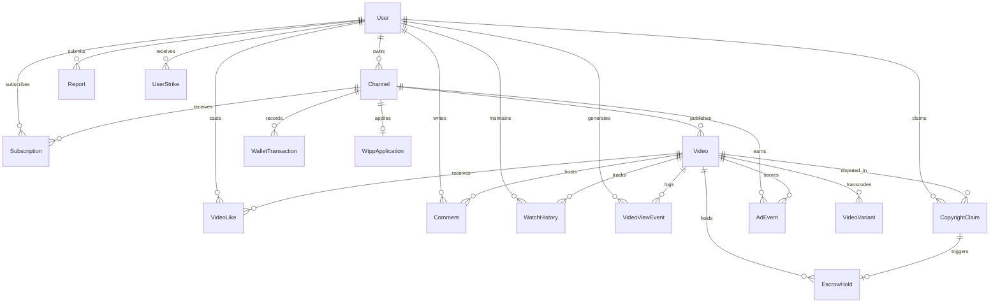

# WATCHTUBE — PROJECT TECHNICAL AUDIT, BASELINE & PROGRESS TRACKING

---

## Phase 1A — Infrastructure, Media, Database, Ads & Payment Reliability — November 22, 2026

- **Repository state:** Branch `main`, HEAD `1857d1a`; workspace `D:\watchtube\watchtube`.
- **Change Preservation:** All 97 pre-existing modified files and all untracked files/directories preserved without destructive Git commands (`git reset`, `git clean`, destructive checkout). Zero commits or pushes performed.
- **R2 Storage Configuration & Diagnostics (Workstream A):**
  - Repaired `apps/api/scripts/storage-check.cjs` with explicit `ts-node` tsconfig registration: executes with exit code 0 and reports `{"status":"configured","missing":[]}`.
  - Repaired `apps/worker/scripts/storage-check.cjs`: executes with exit code 0 and reports `{"status":"unconfigured","missing":["CLOUDFLARE_ACCOUNT_ID","R2_ACCESS_KEY_ID","R2_SECRET_ACCESS_KEY"]}`.
  - Added unit test in `apps/api/tests/storage-readiness.test.ts` validating configured status without exposing secret values (6/6 passing).
  - Existing local R2 credentials retained unchanged per owner decision; rotation was not performed and is not assumed.
- **FFmpeg / Media Processing Readiness (Workstream B):**
  - Updated `apps/worker/src/services/transcode.service.ts` to support configurable executable path overrides via `FFMPEG_PATH` and `FFPROBE_PATH`, auto-configuring `fluent-ffmpeg` and verifying binary existence.
  - Repaired `apps/worker/scripts/media-check.cjs`: executes cleanly with exit code 0 and reports `{"ffmpeg":false,"ffprobe":false}`.
  - Added test in `apps/worker/tests/worker.reliability.test.ts` for custom tool paths (suite increased from 16 to 17/17 passing).
- **Database Migrations & Schema Parity (Workstream C):**
  - Reconciled `packages/database/prisma/schema.prisma` with migration 3 additions: `AdEventType` (8 new lifecycle enum values), `AdEvent` telemetry columns (`sessionId`, `placement`, `adId`, `errorCode`, `playbackTimeSeconds`, and indexes), and `AdProviderConfig` fields (`providerType`, `supportedPlacements`).
  - Regenerated Prisma Client v5.22.0 (`pnpm --filter @watchtube/database db:generate`) and built `@watchtube/database`.
  - Applied all 3 pending migrations to the local PostgreSQL database (`127.0.0.1:5432/watchtube`) using `node packages/database/scripts/prisma-local.cjs migrate deploy`:
    1. `20261120170000_shorts_monetization_rate`
    2. `20261121190000_company_administration`
    3. `20261121220000_advertising_lifecycle_telemetry`
  - Verified `node packages/database/scripts/prisma-local.cjs migrate status`: `7 migrations found in prisma/migrations`, `Database schema is up to date!` (exit code 0).
- **Distributed Advertising Telemetry Replay Defense (Workstream D):**
  - Implemented `IRedisClientLike` and `RedisAdTelemetryNonceStore` with an atomic Redis Lua script enforcing duplicate impression detection, lifecycle conflict protection (`AD_COMPLETED` vs `AD_SKIPPED`), and session TTL expiration.
  - Updated `apps/api/src/routes/monetization.route.ts` to `await nonceStore.consumeEvent(...)` and exported configurable `createMonetizationRouter`.
  - Added 4 unit/concurrency tests in `apps/api/tests/advertising-engine.test.ts` covering atomic replay rejection, lifecycle state conflicts, multi-instance concurrency, and session expiration.
- **Mobile Money Payment & Payout Foundations (Workstream E):**
  - Implemented provider-independent payment architecture in `apps/api/src/services/payments/`:
    - `types.ts`: `IMobileMoneyProvider`, `PaymentInitiationRequest`, `PayoutInitiationRequest`, `WebhookEvent`, `PaymentProviderError`.
    - `msisdn.ts`: Rwandan phone number validation, carrier normalization (MTN 078/079, Airtel 072/073), masking, and SHA-256 hashing.
    - `mtnMoMoAdapter.ts`: Typed MTN Mobile Money collections and disbursements adapter with HMAC-SHA256 signature verification and payload parsing.
    - `airtelMoneyAdapter.ts`: Typed Airtel Money collections and disbursements adapter with OAuth2 contract and HMAC signature verification.
    - `paymentService.ts`: Central provider dispatcher, double-entry ledger invariant guardian, duplicate webhook deduplication, and compensating `ADJUSTMENT` transactions on provider dispatch rejection.
  - Wired `/api/v1/wallet/request-payout` and `/api/v1/wallet/webhooks/:provider` in `apps/api/src/routes/wallet.route.ts`. Preserves existing 501 contract when unconfigured.
  - Authored comprehensive test suite `apps/api/tests/mobile-money-payments.test.ts` (8 new tests, 199/199 passing in API suite).
- **Monorepo Test & Build Verification (Workstreams F & G):**
  - Total tests passing across all packages: 284/284 passed (Database: 6/6, API: 199/199, Worker: 17/17, Web: 35/35, Mobile: 9/9, Backup: 18/18). Zero test failures.
  - All 5 packages built cleanly with exit code 0 (`@watchtube/database`, `@watchtube/types`, `@watchtube/api`, `@watchtube/worker`, `@watchtube/web`).

---

## Phase 0 — Unified Repository Baseline & Master Document Consolidation — November 22, 2026

- **Repository state:** Branch `main`, HEAD `1857d1aeaa87e434d67a4c41a0c117acf91c41e5`; workspace `D:\watchtube\watchtube`.
- **Change Preservation:** All 97 pre-existing modified files and all untracked files/directories preserved without destructive Git commands (`git reset`, `git clean`, checkout). No commits or pushes made.
- **Build Verification Across Monorepo:**
  - `@watchtube/database`: Built cleanly (`tsc`).
  - `@watchtube/types`: Built cleanly (`tsc`).
  - `@watchtube/api`: Built cleanly (`tsc`) with exit code 0. Pre-existing CEO dashboard typing errors are confirmed resolved.
  - `@watchtube/worker`: Built cleanly (`tsc`).
  - `@watchtube/web`: Built cleanly (`tsc -b && vite build`) producing `dist/index.html` and assets bundle (1,231 kB index chunk noted for future code-splitting).
- **Test Verification (270/270 tests passing, 0 failures):**
  - Database Guard Suite: `pnpm --filter @watchtube/database test` — 6/6 passed (1,481ms).
  - API Suite: `pnpm --filter @watchtube/api test` — 186/186 passed across 5 test suites (32,804ms), including all 24 dedicated advertising engine and ad delivery tests, company administration tests, WTPP AES-GCM encryption tests, feed discovery tests, and upload tests.
  - Web Suite: `pnpm --filter @watchtube/web test` — 35/35 passed (47,893ms), including all admin portal, auth session, discovery pages, vite proxy, and upload workflow tests.
  - Worker Suite: `pnpm --filter @watchtube/worker test` — 16/16 passed (48,239ms), covering Shorts aspect/duration validation, quality labels, bounded retries, and storage key safety.
  - Mobile Suite: `pnpm --filter @watchtube/mobile test` — 9/9 passed (3,647ms), covering API feed parsing, cursor comment pagination, and session state revalidation.
  - Backup System Synthetic Suite: `node --test tools/backup-system/tests/core.test.mjs tools/backup-system/tests/postgres.test.mjs tools/backup-system/tests/queue-recovery.test.mjs tools/backup-system/tests/storage.test.mjs` — 18/18 passed (1,470ms).
- **Security & Storage Diagnostics:**
  - `apps/worker/scripts/storage-check.cjs`: Reports `{"missing":["CLOUDFLARE_ACCOUNT_ID","R2_ACCESS_KEY_ID","R2_SECRET_ACCESS_KEY"]}`.
  - `apps/worker/scripts/media-check.cjs`: Reports `{"ffmpeg":false,"ffprobe":false}`.
  - Cloudflare R2 credential exposure audit: Live keys previously placed into `apps/api/.env.example` in working copy must be treated as compromised. Rotation status is unverified and blocked pending authorized owner confirmation.
  - Advertising Telemetry Replay Defense: The existing `InMemoryAdTelemetryNonceStore` is verified locally for single-instance operation, but does not provide multi-instance replay defense across horizontally scaled APIs. Distributed atomic store (Redis SETNX or DB constraint) required before financial attribution.
- **Database Migrations Baseline:**
  - 7 migration directories in `packages/database/prisma/migrations/`:
    - `20261109070000_baseline_legacy_user`
    - `20261109082031_init_preserve_legacy_user`
    - `20261119140000_creator_upload_workflow`
    - `20261120160500_add_shorts_support`
    - `20261120170000_shorts_monetization_rate` (Unapplied locally)
    - `20261121190000_company_administration` (Unapplied locally)
    - `20261121220000_advertising_lifecycle_telemetry` (Unapplied locally)
  - No database migration or write was executed during Phase 0 baseline verification.
- **Documentation Consolidation:**
  - Authored `WATCHTUBE_UNIFIED_MASTER_VERIFICATION_PLAN.md` covering all 11 workstreams (A to K), 11 execution phases (Phase 0 to 10), and strict verification standards.
  - Reconciled `WATCHTUBE_MASTER_COMPLETION_CHECKLIST.md` with 6 standardized statuses (`NOT_STARTED`, `IN_PROGRESS`, `IMPLEMENTED_UNVERIFIED`, `VERIFICATION_FAILED`, `BLOCKED`, `COMPLETE_VERIFIED`).
  - Reconciled `WATCHTUBE_MASTER_ROADMAP.md` with unified phases, feature matrix, and resolved build status.

---

## Company Administration, SUPER_ADMIN Control & Admin Portal Implementation — November 21, 2026

- **Repository state:** `main`, HEAD `1857d1a`; all existing user work preserved; no destructive Git operations (`git reset --hard`, `git clean`); no commit or push.
- **Architectural & Organizational Structure:**
  - Implemented the full organizational hierarchy: `SUPER_ADMIN` (Founder, CEO & Owner), three designated `ADMIN` positions (`ADMIN 1`, `ADMIN 2`, `ADMIN 3` for trusted partners), ordinary `USER` (creator is also viewer), and architectural hooks for future `MODERATOR`.
  - Strictly protected the `SUPER_ADMIN` owner account against lockout, demotion, replacement, or deletion by any other account. Owner-only permissions reject non-owners on the backend even if wildcard permissions exist.
  - Three designated ADMIN positions are managed in the `AdminPosition` model (1, 2, 3) with vacant/occupied/suspended status, defined responsibility assignments, base creator-support permissions, and configurable privileges.
- **Database Schema & Migrations:**
  - Updated `packages/database/prisma/schema.prisma` with `Role` (`SUPER_ADMIN`, `ADMIN`, `USER`), `AdminPosition`, `AdminInvitation`, `SupportCase`, `SupportCaseNote`, `SupportCaseActivity`, `ApprovalRequest`, and `AdminAuditLog`.
  - Created idempotent migration SQL `packages/database/prisma/migrations/20261121190000_company_administration/migration.sql`.
  - Generated Prisma client and built `@watchtube/database`. All 6 database guard tests pass.
- **Backend Services & Security:**
  - `permissions.ts`: `BASE_ADMIN_PERMISSIONS`, `CONFIGURABLE_ADMIN_PERMISSIONS`, `OWNER_ONLY_PERMISSIONS`, and `hasPermission` validator enforcing account standing, position status, and owner-only boundaries.
  - `audit.service.ts`: `recordAuditEvent` with automated credential/token/PII redaction, and `listAuditLogs` supporting company scope for CEO and operational scope for Admins.
  - `adminManagement.service.ts`: Secure single-use invitation generation (SHA-256 hashed token, 72h expiry), revocation, resend, acceptance, position suspension/restore/revocation, and permission assignment.
  - `supportCase.service.ts`: Support case reference generation (`WT-CASE-YYYYMMDD-XXXX`), case assignment, status lifecycle, escalation, confidential internal notes, and activity timeline.
  - `approvalRequest.service.ts`: Administrative approval request lifecycle for CEO decision and rationale recording.
  - `ceoDashboard.service.ts`: CEO overview, admin oversight, platform health, company financial intelligence, and creator-scoped financial summary.
- **REST Endpoints & Routing:**
  - Mounted routers in `admin.route.ts` and `index.ts`: `/api/v1/admin/management/*`, `/api/v1/admin/invitations/*` (public verify & accept), `/api/v1/admin/cases/*`, `/api/v1/admin/approvals/*`, `/api/v1/admin/ceo/*`, `/api/v1/admin/creator-support/channels/:channelId/financial-summary`, and `/api/v1/admin/audit-logs`.
  - Updated `/api/v1/auth/me` to project `positionNumber`, `assignment`, and `permissions` for authenticated admins.
  - All 151 API unit and integration tests pass cleanly (`pnpm --filter @watchtube/api test`).
- **Shared Admin Portal Frontend:**
  - `AdminDashboard.tsx`: Shared Admin Portal integrating `CEO_OVERVIEW` (SUPER_ADMIN only), `POSITIONS` (SUPER_ADMIN only), `CASES` (all admins), `APPROVALS` (all admins), `CREATOR_FINANCE` (creator-scoped financial support lookup), `REPORTS`, `WTPP`, `COPYRIGHT`, and `AUDIT_LOGS`.
  - `CeoCompanyDashboard.tsx`: CEO executive dashboard displaying platform overview, company financial intelligence, and infrastructure health.
  - `AdminPositionsManager.tsx`: Partner invitation workflow, position occupancy, suspension/restoration, position revocation, and granular permission editing.
  - `SupportCaseManager.tsx`: Creator issue queue, filters, case creation, assignment to partners, confidential internal staff notes, status transitions, escalation, and activity audit timeline.
  - `ApprovalRequestsManager.tsx`: Escalation of sensitive actions to CEO with approval/rejection decision workflows and notes.
  - `CreatorFinancialLookup.tsx`: Creator-specific financial support tool preserving company financial confidentiality.
  - `AuditLogsViewer.tsx`: Searchable administrative audit trail with metadata inspector.
  - `AcceptInvitationPage.tsx`: Secure public single-use invitation acceptance and individual credential creation.
  - `Sidebar.tsx`: Updated to render "Admin Portal" navigation item for `ADMIN` and `SUPER_ADMIN` users.
  - Web application builds cleanly (`pnpm --filter @watchtube/web build`) and passes all 35 web tests (`pnpm --filter @watchtube/web test`).
- **Monorepo Test Verification:**
  - Total test pass count across all packages: 208/208 tests (Database: 6/6, API: 151/151, Worker: 16/16, Web: 35/35). Zero test failures.

---

## Stabilization Verification — November 18, 2026

- **Repository state:** `main`, HEAD `3cbfd9c708826915a2c6d440f52f9898f880ec69`; no staged changes; no commit or push performed during stabilization.
- **Environment isolation:** API and web development launchers now set loopback-only mode. The API rejects external PostgreSQL/Redis hosts in local-only mode; the web wrapper forces local-only Vite configuration and ignores external proxy env candidates.
- **Smoke test evidence:** The API listened on loopback port `43117` with dummy PostgreSQL/Redis endpoints at `127.0.0.1:1`. Vite listened on loopback port `5174`. `/health` returned `200`; `/api/v1/auth/me` returned `401`; `/api/v1/videos` and `/api/v1/feed/search?q=hy` reached the API and returned honest `500` responses because the dummy database was unreachable. No `ECONNREFUSED` or external-service connection occurred. API and Vite were stopped after the smoke test; common smoke/API ports were not left listening.
- **Security verification:** Read-only security review found no additional vulnerabilities in the reviewed remediation. Authentication revalidates current database role/status and rejects restricted/suspended/deleted users. Public video/comment/reply queries require accessible video visibility. Unverified ad events are disabled and return `501`.
- **Viewer/Studio:** Actual Viewer state reset/comment loading, Channel report/subscription state, Upload retry/status, and Studio analytics/payout/report components remain present and are covered by available source/test checks.
- **Backup prototype:** Synthetic tests pass for encryption round trips, wrong-key/ciphertext rejection, size limits, interruption cleanup, key/marker create-only behavior, and restore verification. No real PostgreSQL/R2 backup or restore was attempted.
- **Database:** Remains read-only/offline for this task. The prior P2021/missing-table and unresolved Neon branch findings remain unresolved. No migration, db push, table change, record change, restore, or external database connection was attempted.
- **Test status:** API tests `55/55`; API build passed; web tests `13/13`; web build passed with a large-chunk warning; web lint passed with 6 warnings and 0 errors; backup tests `18/18`; offline Prisma validation passed.
- **Current instability:** Database-backed routes cannot be proven against a real local database until the missing schema/migrations and Neon branch identity are resolved. Production readiness remains blocked.

---

**Audit Date:** November 4, 2026  
**Last Updated:** November 9, 2026 (Task 2B.1: Disposable Baseline Simulation Verified; Production Still Blocked)
**Auditor / Engineer:** Senior Software Architect & Full-Stack Engineer  
**Repository Branch:** `main` (commit `12713d8`)  
**Repository Remote:** `https://github.com/0789667675/watchtube.git`  
**Reference Specification:** *WatchTube Master Technical Specification & Architecture Blueprint v2.0*  

---

## 1. Project Identity and Purpose

**WatchTube** is a high-performance video-sharing, creator discovery, and monetization platform tailored for the East African market (primary launch: Rwanda) and architected for rapid continental expansion. The platform is engineered mobile-first to deliver ultra-smooth streaming over cellular data connections (3G/4G) with low data consumption, local creator payouts via MTN Mobile Money and Airtel Money, transparent revenue sharing (WTPP), and dual high-contrast themes (Obsidian Dark & Porcelain Light).

---

## 2. Actual Repository Root and Structure

### 2.1 File System Discovery
- **Workspace Directory:** `D:\watchtube`
- **Actual Git Monorepo Root:** `D:\watchtube\watchtube`
- *Note:* The workspace has a nested structure where `D:\watchtube` contains a top-level `node_modules` and the inner `watchtube` directory containing the active `.git` repository, application packages, and configuration files.

### 2.2 Actual Directory Tree (Excluding `node_modules`, `.git`, `.next`, `dist`, `build`)

```
D:\watchtube\watchtube\
├── .env.example                           # Root monorepo master environment template (Task 1)
├── WATCHTUBE_PROGRESS.md                  # Root audit & progress documentation
├── WATCHTUBE_TASK_LOG.md                  # Task execution & continuity log (Task 1)
├── AGENTS.md                              # Coding standards & Cloudflare R2 guidelines
├── package.json                           # Turborepo root package definition
├── pnpm-lock.yaml                         # Monorepo lockfile
├── pnpm-workspace.yaml                    # Defines apps/* and packages/*
├── README.md
├── turbo.json                             # Build pipeline tasks (build, lint, test, dev)
├── patch_layout.js                        # Historical patching script
├── patch_monetization.js                  # Historical patching script
├── patch_monetization_fix.js              # Historical patching script
├── patch_telemetry.js                     # Historical patching script
├── patch_telemetry_fix.js                 # Historical patching script
├── patch_video_player.js                  # Historical patching script
├── patch_watch_page.js                    # Historical patching script
├── apps/
│   ├── api/                               # Express.js REST API
│   │   ├── .env.example                   # API environment configuration template (Task 1)
│   │   ├── package.json
│   │   ├── tsconfig.json
│   │   └── src/
│   │       ├── index.ts                   # Entrypoint & video upload/verify routes
│   │       ├── middleware/
│   │       │   ├── admin.ts               # Admin / Moderator RBAC gate
│   │       │   └── auth.ts                # JWT authentication middleware
│   │       ├── routes/
│   │       │   ├── admin.route.ts         # Reports, WTPP review, claims, escrow, ads
│   │       │   ├── analytics.route.ts     # Telemetry heartbeat, raw/valid views, history
│   │       │   ├── auth.route.ts          # Register, login, logout, /me
│   │       │   ├── channel.route.ts       # Channel creation & handle retrieval
│   │       │   ├── feed.route.ts          # Search & Trending feed
│   │       │   ├── interaction.route.ts   # Likes, cursor-paginated comments, subs
│   │       │   ├── monetization.route.ts  # Ad events, VAST config, 50/50 reconcile
│   │       │   ├── studio.route.ts        # Creator analytics & performance
│   │       │   ├── trust.route.ts         # Reports, copyright claims, WTPP apply/status
│   │       │   └── wallet.route.ts        # Ledger, balance, MoMo/Airtel payout requests
│   │       └── services/
│   │           └── storage.service.ts     # Cloudflare R2 presigned PUTs & HeadObject
│   ├── web/                               # Vite + React 19 Client SPA
│   │   ├── package.json
│   │   ├── vite.config.ts
│   │   ├── tailwind.config.ts             # Obsidian Dark / Porcelain Light / Emerald / Amber
│   │   ├── postcss.config.js
│   │   ├── index.html
│   │   ├── .oxlintrc.json
│   │   ├── tsconfig.json
│   │   ├── tsconfig.app.json
│   │   ├── tsconfig.node.json
│   │   ├── public/
│   │   │   ├── favicon.svg
│   │   │   └── icons.svg
│   │   └── src/
│   │       ├── main.tsx
│   │       ├── App.tsx                    # React Router v7 routes
│   │       ├── App.css
│   │       ├── index.css
│   │       ├── components/
│   │       │   ├── brand/
│   │       │   │   └── ApertureLogo.tsx   # 8-bladed camera aperture shutter emblem
│   │       │   ├── layout/
│   │       │   │   ├── BottomNav.tsx      # Mobile bottom tab navigation (<md)
│   │       │   │   ├── Header.tsx         # Top search, auth, and studio navigation
│   │       │   │   └── Layout.tsx         # Root responsive layout
│   │       │   ├── modals/
│   │       │   │   └── ReportModal.tsx    # User report modal dialog
│   │       │   ├── player/
│   │       │   │   └── VideoPlayer.tsx    # HLS.js player, emerald scrub, data saver, ads
│   │       │   ├── studio/
│   │       │   │   ├── ChannelOnboardingModal.tsx # Channel creation modal
│   │       │   │   └── UploadModal.tsx    # Drag-and-drop video upload sheet
│   │       │   └── video/
│   │       │       └── VideoCard.tsx      # Video card with 16:9 aspect ratio
│   │       └── pages/
│   │           ├── HomePage.tsx           # Category pills & responsive video feed
│   │           ├── WatchPage.tsx          # Video watch view, comments, and up-next
│   │           ├── SearchPage.tsx         # Paginated public video and creator search
│   │           ├── SubscriptionsPage.tsx  # Subscribed channels feed
│   │           ├── TrendingPage.tsx       # Engagement-ranked public video feed
│   │           ├── auth/
│   │           │   ├── LoginPage.tsx      # User login form
│   │           │   └── RegisterPage.tsx   # User registration form
│   │           ├── studio/
│   │           │   ├── StudioLayout.tsx   # Creator studio navigation shell
│   │           │   ├── DashboardPage.tsx  # KPI summary, performance, MoMo payout
│   │           │   ├── ContentPage.tsx    # Video asset management list
│   │           │   └── MonetizationPage.tsx # WTPP eligibility tracker & application
│   │           └── admin/
│   │               ├── AdminDashboard.tsx # Moderation queue, WTPP review, disputes
│   │               └── RevenuePage.tsx    # 50/50 reconciliation & escrow releases
│   └── worker/                            # BullMQ + FFmpeg Media Worker
│       ├── .env.example                   # Worker environment configuration template (Task 1)
│       ├── package.json
│       ├── tsconfig.json
│       └── src/
│           ├── worker.ts                  # BullMQ worker (Windows temp path + job isolation) (Task 1)
│           └── services/
│               ├── storage.service.ts     # R2 download & public asset upload
│               └── transcode.service.ts   # fluent-ffmpeg HLS + EBU R128 loudnorm
└── packages/
    ├── config/                            # Shared ESLint, Prettier, tsconfig bases
    ├── database/                          # Prisma schema & database client
    │   ├── .env.example                   # Database environment configuration template (Task 1)
    │   ├── package.json
    │   ├── tsconfig.json
    │   ├── prisma/
      │   │   └── schema.prisma              # 18 PostgreSQL models & 15 enums
    │   └── src/
    │       └── index.ts                   # Global singleton Prisma client instance
    └── types/                             # Shared TypeScript interfaces & DTOs
        ├── package.json
        ├── tsconfig.json
        └── index.ts                       # 4-line stub interface
```

---

## 3. Current Branch and Git Status

- **Current Branch:** `main` (tracked to `origin/main`)
- **Working Tree State:** Modified with preserved local improvements and Task 1 deliverables.
- **Tracked Modifications:**
  - `packages/database/package.json` (preserved: updated `@types/node` dependency)
  - `packages/database/src/index.ts` (preserved: safe `globalThis` PrismaClient initialization)
  - `pnpm-lock.yaml` (preserved: updated lockfile)
  - `apps/worker/src/worker.ts` (Task 1: Windows-compatible temp directory & job isolation)
- **New Untracked Files:**
  - `.env.example` (Root monorepo master template)
  - `apps/api/.env.example` (API configuration template)
  - `apps/worker/.env.example` (Worker configuration template)
  - `packages/database/.env.example` (Database configuration template)
  - `WATCHTUBE_PROGRESS.md` (Audit & progress documentation)
  - `WATCHTUBE_TASK_LOG.md` (Task log)
- **Untracked Historical Scripts:** All 7 root patch scripts (`patch_*.js`) preserved.

---

## 4. Actual Technology Stack

| Layer | Component | Declared / Installed | Status in Codebase | Verified Working? |
|---|---|---|---|---|
| **Runtime & Tooling** | Node.js | v26.4.0 (System) | Runtime engine | Yes |
| | pnpm | v12.16.1 (System, root specifier `pnpm@10.30.3`) | Package manager | Yes |
| | Turborepo | v2.11.10 | Monorepo orchestrator | Yes (5 tasks pass) |
| | TypeScript | `^5.0.0` / `^5.6.0` / `~7.0.2` | Configured across all packages | Yes |
| **Web Frontend** | Vite | v8.3.5 | Bundler & dev server | Yes |
| | React | v19.3.1 | Core UI library | Yes |
| | React Router DOM | v7.18.5 | Client routing SPA | Yes |
| | TanStack Query | v5.0.0 | Server-state management | Configured |
| | Tailwind CSS | v3.4.0 | Utility CSS styling | Yes |
| | Lucide React | v1.65.0 | Vector iconography | Yes |
| | HLS.js | v1.7.4 | HLS adaptive streaming client | Yes |
| | React Hook Form & Resolvers | v7.91.0 / v6.0.2 | Form state management | Yes |
| | Oxlint | v1.89.0 | Static linter | Yes (0 errors, 8 warnings) |
| **Backend API** | Express | v4.18.0 | REST HTTP API framework | Yes (Compiles cleanly) |
| | Helmet | v7.0.0 | Security header middleware | Configured |
| | Cookie-Parser | v1.4.7 | Cookie parsing middleware | Configured |
| | JWT (`jsonwebtoken`) | v9.0.3 | Token generation & validation | Configured |
| | bcryptjs | v3.0.3 | Password hashing | Configured (Replaces Argon2id) |
| | Zod | v3.0.0 | Schema validation contracts | Configured & used |
| | BullMQ | v4.0.0 | Redis-backed job queues | Configured |
| | ioredis | v5.0.0 | Redis client connection | Configured |
| | AWS SDK S3 & Pre-signer | v3.0.0 | Cloudflare R2 / S3 storage | Configured |
| **Worker / Media** | fluent-ffmpeg | v2.1.3 | FFmpeg orchestration | Configured (Binary missing) |
| | BullMQ | v4.0.0 | Queue worker consumer | Configured |
| | OS Temp Scratch | Native `os.tmpdir()` | Cross-platform temporary processing | **Verified Working (Task 1)** |
| **Database** | Prisma ORM | v5.22.0 | PostgreSQL schema & client | Configured & compiled |
| | PostgreSQL | 18.6 (live configured database) | Database provider | Reachable; migration deployment blocked by Prisma P3005 |
| **Mobile Apps** | React Native / Expo | Blueprint: Expo SDK 52 | Mobile clients | **Not Found (0%)** |
| **Design System** | `@watchtube/ui` | Blueprint: Shared UI pkg | Design system | **Not Found (0%)** |

---

## 5. Database Architecture

The schema is defined in `packages/database/prisma/schema.prisma` targeting PostgreSQL. It comprises **18 models** and **15 enums/types**:

### Relational Entity Graph



---

## 6. Audit of the 30 Subsystems

| # | Subsystem | Code Location | Status | Evidence & Observations |
|---|---|---|---|---|
| 1 | Monorepo & Foundation | Root, `turbo.json`, `pnpm-workspace.yaml` | **IMPLEMENTED & VERIFIED** | Turborepo passes `pnpm build` across 5 packages in 24.31s. |
| 2 | Registration & Auth | `apps/api/src/routes/auth.route.ts` | **IMPLEMENTED BUT NOT VERIFIED** | Register, Login, Logout, /me routes with JWT cookie & bcryptjs. Requires live DB to run. |
| 3 | Sessions & RBAC | `apps/api/src/middleware/auth.ts`, `admin.ts` | **PARTIALLY IMPLEMENTED** | Role checks implemented. Missing Redis-backed session revocation and refresh token rotation. |
| 4 | Profiles & Channels | `apps/api/src/routes/channel.route.ts` | **PARTIALLY IMPLEMENTED** | Channel creation and handle search exist. Channel page customization, avatar/banner uploads missing. |
| 5 | Video Upload & Ingestion | `apps/api/src/index.ts`, `UploadModal.tsx` | **PARTIALLY IMPLEMENTED** | Pre-signed upload intent & S3 verification exist on API. Frontend modal currently runs a local timer simulation. |
| 6 | Video Storage (Cloudflare R2) | `apps/api/src/services/storage.service.ts` | **BLOCKED BY MISSING CONFIG** | S3Client configured with R2 endpoints. Environment templates documented in Task 1. |
| 7 | FFmpeg Processing | `apps/worker/src/worker.ts`, `transcode.service.ts` | **PARTIALLY IMPLEMENTED** | Worker updated with Windows temp path & job isolation (Task 1). FFmpeg binaries missing from PATH. |
| 8 | HLS Adaptive Streaming | `apps/worker/src/worker.ts` | **PARTIALLY IMPLEMENTED** | Generates 360p, 720p, 1080p ABR renditions and master playlist. Missing 144p, 240p, 480p from blueprint. |
| 9 | Video Playback | `apps/web/src/components/player/VideoPlayer.tsx` | **IMPLEMENTED & VERIFIED** | HLS.js custom chrome, Virunga emerald scrubber, Data-Saver button, level selector, builds with 0 errors. |
| 10 | Home Discovery Feed | `apps/web/src/pages/HomePage.tsx`, API `/videos` | **PARTIALLY IMPLEMENTED** | API `/api/v1/videos` supports pagination. Frontend currently renders hardcoded `MOCK_VIDEOS`. |
| 11 | Search & Categories | `apps/api/src/routes/feed.route.ts`, `apps/web/src/pages/SearchPage.tsx` | **IMPLEMENTED; DATABASE RESULTS UNVERIFIED** | Search returns separately paginated public video and channel/creator results, validates query/page size, and has loading/error/retry/empty states. No full-text index or live database search test. |
| 12 | Likes & Comments | `apps/api/src/routes/interaction.route.ts` | **PARTIALLY IMPLEMENTED** | Cursor-paginated comments, threaded replies, and likes API complete. Frontend UI is currently mock/local state. |
| 13 | Subscriptions & History | `apps/api/src/routes/interaction.route.ts` | **PARTIALLY IMPLEMENTED** | Transactional subscribe/unsubscribe and subscription feed complete in API. Frontend not yet wired. |
| 14 | Creator Studio | `apps/web/src/pages/studio/*` | **PARTIALLY IMPLEMENTED** | Studio Layout, Dashboard, Content, and Monetization pages implemented in `apps/web` (not standalone app). |
| 15 | Creator Analytics | `apps/api/src/routes/studio.route.ts` | **PARTIALLY IMPLEMENTED** | Calculates total views, total watch hours from valid views, and subscriber count. 28-day retention curves missing. |
| 16 | Raw vs Valid View Tracking | `apps/api/src/routes/analytics.route.ts` | **IMPLEMENTED BUT NOT VERIFIED** | Validates >=15s or 50% watch time, enforces 30-min session/user deduplication before incrementing views. |
| 17 | Anti-Fraud Mechanisms | `apps/api/src/routes/analytics.route.ts` | **PARTIALLY IMPLEMENTED** | View de-duplication window and IP hash logging present. Device fingerprinting and replay defense missing. |
| 18 | Trust, Moderation, Reports | `apps/api/src/routes/trust.route.ts`, `admin.route.ts` | **IMPLEMENTED BUT NOT VERIFIED** | User reporting, copyright claims, admin dispute review, 90-day strikes, and escrow holds fully coded. |
| 19 | WTPP Creator Onboarding | `apps/api/src/routes/trust.route.ts`, `admin.route.ts` | **IMPLEMENTED BUT NOT VERIFIED** | Exact blueprint rules: 1,000 subscribers, 4,000 watch hours, 0 strikes. Admin approval toggles monetization. |
| 20 | Ads & Monetization Sandbox | `apps/api/src/services/advertising/*`, `apps/api/src/routes/monetization.route.ts`, `admin.route.ts` | **API INTEGRATED & VERIFIED** | Real Ad Decision API (`POST /decision`) with content/WTPP/strike eligibility checks & fail-open guarantees; secure Ad Telemetry Ingestion (`POST /ad-event`) with HMAC-SHA256 tokens, atomic replay/nonce prevention, and zero-client-revenue enforcement; RBAC-protected provider management (`/admin/monetization/providers`) with audit logging; unapplied safe migration prepared (`20261121220000_advertising_lifecycle_telemetry`). 24 dedicated advertising tests passing (252 monorepo total). |
| 21 | Creator Wallet & Ledger | `apps/api/src/routes/wallet.route.ts` | **PARTIALLY IMPLEMENTED** | Single-table transaction ledger with balance tracking and BigInt precision. Enterprise multi-account double-entry pending. |
| 22 | MTN Mobile Money | `apps/api/src/routes/wallet.route.ts` | **PARTIALLY IMPLEMENTED** | Enum and request parameter accepted in payout route. Actual MTN MoMo API client integration not written. |
| 23 | Airtel Money | `apps/api/src/routes/wallet.route.ts` | **PARTIALLY IMPLEMENTED** | Enum and request parameter accepted in payout route. Actual Airtel Money API client integration not written. |
| 24 | Creator Payouts | `apps/api/src/routes/wallet.route.ts`, `DashboardPage.tsx` | **PARTIALLY IMPLEMENTED** | Payout request creates PENDING transaction and debits balance. 25,000 RWF minimum threshold check missing. |
| 25 | Viewer Mobile App | Blueprint `apps/mobile` | **NOT IMPLEMENTED** | Not found in repository. |
| 26 | Creator Studio Mobile App | Blueprint `apps/studio-mobile` | **NOT IMPLEMENTED** | Not found in repository. |
| 27 | Internationalization (Kinyarwanda) | Blueprint i18n core | **NOT IMPLEMENTED** | No i18n framework configured in `apps/web`. |
| 28 | Responsive Interfaces | `BottomNav.tsx`, `Layout.tsx`, `WatchPage.tsx` | **IMPLEMENTED & VERIFIED** | Breakpoints configured, mobile bottom nav bar, edge-to-edge player on small screens, desktop cinema mode. |
| 29 | Security & Performance | Express middleware, Prisma singleton | **PARTIALLY IMPLEMENTED** | Helmet, Zod validation, and bcryptjs in place. Rate-limiting, CORS origin locking, and Redis caching missing. |
| 30 | Production Deployment | Docker, PgBouncer, Nginx, Cloudflare | **NOT IMPLEMENTED** | Docker files not found. Docker CLI is not installed on host machine. |

---

## 7. Verification Results & Command Executions

1. **`pnpm --filter @watchtube/worker build` (Post-Task 1)**
   - Command: `tsc` in `apps/worker`
   - Result: Exit code `0` (Success).
2. **`pnpm build` (Root Turborepo Build Post-Task 1)**
   - Command: `turbo run build`
   - Result: Exit code `0` (5 successful tasks: `@watchtube/types`, `@watchtube/database`, `@watchtube/web`, `@watchtube/worker`, `@watchtube/api` in 24.31s).
3. **Windows Node.js Path Resolution Verification**
   - Command: Verified `os.tmpdir()` and `path.join(base, 'video-uuid_job-1')`.
   - Result: Resolves to valid Windows absolute path under `%LOCALAPPDATA%\Temp\watchtube`.
4. **Environment Template Leak Verification**
   - Verified `.env.example` templates across root, `apps/api`, `apps/worker`, and `packages/database`.
   - Result: Zero real secrets or production credentials present. Placeholders only.

---

## 8. Current Blockers and Technical Risks

1. **Local Services & Infrastructure (last checked November 9, 2026):**
   - PostgreSQL 18.6 is reachable through the existing configuration. The live database still contains only the empty legacy `User` table and has no `_prisma_migrations` history. `prisma migrate deploy` stopped with P3005 because the schema is non-empty; no migration DDL was applied. See Task 2B below.
   - Redis connectivity was not checked as part of Task 2A.
   - Docker was reported as unavailable during Task 1; not rechecked in Task 2A.
2. **Missing Media Processing Binaries:**
   - FFmpeg and ffprobe are not installed in the Windows system PATH, preventing transcode execution in `apps/worker`.
3. **Zero Automated Tests:**
   - There are zero unit, integration, or end-to-end tests across all packages.

---

## 9. Recommended Implementation Sequence

1. **Phase 1: Environment & Infrastructure Baseline (In Progress - Tasks 1, 1B & 1C Complete)**
   - [x] Task 1: Document and author `.env.example` configurations for `apps/api`, `apps/worker`, and `packages/database`.
   - [x] Task 1B: Worker temporary directory hardening (UUID validation, `fs.mkdtemp` isolation, path containment, cleanup preservation) and centralized JWT production security (`apps/api/src/config/jwt.ts`).
   - [x] Task 1C: Strengthened JWT secret validation to 32 characters in production; protected public media URL generation against missing domains.
   - [x] Configure gitignored local `.env` files with external database, Redis, and Cloudflare R2 credentials.
   - [x] Confirm PostgreSQL connectivity and inspect the live schema (Task 2A).
   - [ ] Establish migration history; Task 2B is blocked at Prisma P3005 and requires a separately reviewed baseline approach. No seed data was created.
2. **Phase 2: Platform Testing Infrastructure**
   - Establish unit and integration testing framework (`vitest` / `supertest`) across `apps/api` and `apps/web`.
   - Write automated tests for auth, channel creation, and view telemetry de-duplication.
3. **Phase 3: Frontend-to-Backend API Integration**
   - Replace mock data in `HomePage.tsx`, `WatchPage.tsx`, and `SearchPage.tsx` with TanStack Query hooks consuming `/api/v1/*`.
   - Connect `UploadModal.tsx` to `/api/v1/videos/upload-intent` and `/verify-upload`.
4. **Phase 4: Media Processing Worker Hardening**
   - Add missing low-bandwidth renditions (144p, 240p, 480p) to transcode ladder.
5. **Phase 5: Financial & Payment Engine Hardening**
   - Enforce 25,000 RWF minimum withdrawal threshold in `wallet.route.ts`.
   - Implement MTN Rwanda MoMo Disbursement API integration and webhook verification.
6. **Phase 6: Native Mobile Applications & Localization**
   - Scaffold Expo SDK 52 apps sharing types and design tokens.
   - Introduce Kinyarwanda language support via `react-i18next`.

---

## 10. Exact Next Task to Implement

**Task 2B status:** Owner-authorized migration attempt stopped at Prisma P3005 before DDL. The migration SQL is prepared, but the live database is unchanged and migration history is not established. Any future baseline/resolve procedure requires review and approval; do not retry deployment or alter the database under this task.

- **Historical gate:** Task 2A was read-only; owner approval for Task 2B was recorded before its migration attempt.

---

## TASK 2A: Read-only Database Connectivity & Existing Schema Inspection

**Date:** November 9, 2026  
**Status:** COMPLETED — READ-ONLY; OWNER APPROVAL RECORDED BEFORE TASK 2B

### Scope and preservation
- Inspected the Prisma schema, migration inventory, current environment-file locations, and PostgreSQL metadata.
- No database writes, migrations, seeds, `db push`, resets, or schema modifications were run.
- Existing `.env` files were not edited and no credential values were printed.
- Pre-existing modified and untracked files, including all historical `patch_*.js` scripts, were preserved. `git status --short` after the checks matched the pre-check status.

### Prisma schema inventory
- **18 models:** `User`, `Channel`, `Video`, `VideoVariant`, `WalletTransaction`, `VideoLike`, `Subscription`, `Comment`, `WatchHistory`, `VideoViewEvent`, `Report`, `CopyrightClaim`, `UserStrike`, `WtppApplication`, `AdEvent`, `RevenueReconciliation`, `EscrowHold`, `AdProviderConfig`.
- **15 enums:**
   - `Role`: `VIEWER`, `CREATOR`, `MODERATOR`, `ADMIN`.
   - `UserStatus`: `GOOD_STANDING`, `WARNING`, `RESTRICTED`, `SUSPENDED`.
   - `VideoStatus`: `DRAFT`, `UPLOADING`, `PROCESSING`, `READY`, `REJECTED`.
   - `Visibility`: `PUBLIC`, `UNLISTED`, `PRIVATE`.
   - `TransactionType`: `HOLD`, `REVENUE_CREDIT`, `PAYOUT`, `ADJUSTMENT`.
   - `WalletStatus`: `PENDING`, `AVAILABLE`, `PAID`, `FAILED`.
   - `ReportReason`: `SPAM`, `HARASSMENT`, `COPYRIGHT`, `HATE_SPEECH`, `MISLEADING`, `OTHER`.
   - `ReportTargetType`: `VIDEO`, `COMMENT`, `CHANNEL`.
   - `ReportStatus`: `OPEN`, `UNDER_REVIEW`, `ACTION_TAKEN`, `DISMISSED`.
   - `CopyrightClaimStatus`: `OPEN`, `UNDER_REVIEW`, `APPROVED_TAKEDOWN`, `REJECTED`, `DISPUTED`.
   - `StrikeType`: `WARNING`, `VIDEO_REMOVAL`, `MONETIZATION_HOLD`, `SUSPENSION`.
   - `WtppApplicationStatus`: `NOT_APPLIED`, `PENDING`, `APPROVED`, `REJECTED`.
   - `AdEventType`: `AD_REQUEST`, `AD_SERVED`, `AD_VIEWABLE`, `AD_CLICK`.
   - `ReconStatus`: `ESTIMATED`, `REPORTED`, `FINALIZED`, `DISTRIBUTED`.
   - `EscrowStatus`: `HELD`, `RELEASED_TO_CREATOR`, `TRANSFERRED_TO_CLAIMANT`, `REFUNDED`.
- **Scalar fields by model** (relation fields are listed separately below):
   - `User`: `id`, `email`, `passwordHash`, `role`, `status`, `createdAt`, `updatedAt`.
   - `Channel`: `id`, `userId`, `handle`, `name`, `description`, `avatarUrl`, `bannerUrl`, `subscriberCount`, `isVerified`, `createdAt`, `isMonetized`.
   - `Video`: `id`, `channelId`, `title`, `description`, `rawStorageKey`, `status`, `visibility`, `duration`, `viewsCount`, `thumbnailUrl`, `lowBandwidthReady`, `createdAt`, `publishedAt`.
   - `VideoVariant`: `id`, `videoId`, `resolution`, `bitrate`, `playlistUrl`.
   - `WalletTransaction`: `id`, `channelId`, `transactionType`, `amountCents`, `balanceAfterCents`, `referenceId`, `createdAt`, `status`.
   - `VideoLike`: `id`, `userId`, `videoId`, `isDislike`, `createdAt`.
   - `Subscription`: `id`, `subscriberId`, `channelId`, `createdAt`.
   - `Comment`: `id`, `videoId`, `userId`, `parentId`, `content`, `likesCount`, `isPinned`, `createdAt`, `updatedAt`.
   - `WatchHistory`: `id`, `userId`, `videoId`, `lastPositionSeconds`, `completed`, `updatedAt`.
   - `VideoViewEvent`: `id`, `videoId`, `userId`, `sessionId`, `watchDurationSeconds`, `isValidView`, `ipHash`, `createdAt`.
   - `Report`: `id`, `reporterId`, `targetType`, `targetId`, `reason`, `details`, `status`, `createdAt`, `resolvedAt`.
   - `CopyrightClaim`: `id`, `claimantId`, `videoId`, `description`, `proofUrl`, `status`, `createdAt`, `resolvedAt`.
   - `UserStrike`: `id`, `userId`, `reason`, `strikeType`, `expiresAt`, `createdAt`.
   - `WtppApplication`: `id`, `channelId`, `status`, `channelWatchHours`, `subscriberCount`, `taxId`, `nationalIdOrPassport`, `reviewerNotes`, `submittedAt`, `reviewedAt`.
   - `AdEvent`: `id`, `videoId`, `channelId`, `eventType`, `provider`, `grossRevenueCents`, `ipHash`, `createdAt`.
   - `RevenueReconciliation`: `id`, `monthYear`, `grossProviderRevenueCents`, `platformShareCents`, `creatorPoolCents`, `status`, `finalizedAt`, `createdAt`.
   - `EscrowHold`: `id`, `videoId`, `claimId`, `heldAmountCents`, `status`, `createdAt`, `resolvedAt`.
   - `AdProviderConfig`: `id`, `name`, `vastTagUrl`, `priority`, `isEnabled`, `format`, `createdAt`, `updatedAt`.
- **Relations / foreign-key mappings:** `Channel.userId -> User.id`; `Video.channelId -> Channel.id`; `VideoVariant.videoId -> Video.id`; `WalletTransaction.channelId -> Channel.id`; `VideoLike.userId -> User.id` and `videoId -> Video.id`; `Subscription.subscriberId -> User.id` and `channelId -> Channel.id`; `Comment.videoId -> Video.id`, `userId -> User.id`, and nullable `parentId -> Comment.id` (self-relation); `WatchHistory.userId -> User.id` and `videoId -> Video.id`; `VideoViewEvent.videoId -> Video.id` and nullable `userId -> User.id`; nullable `Report.reporterId -> User.id`; `CopyrightClaim.claimantId -> User.id` and `videoId -> Video.id`; `UserStrike.userId -> User.id`; unique `WtppApplication.channelId -> Channel.id` (one-to-one); `AdEvent.videoId -> Video.id` and `channelId -> Channel.id`; `EscrowHold.videoId -> Video.id` and unique `claimId -> CopyrightClaim.id` (one-to-one). `RevenueReconciliation` and `AdProviderConfig` have no model relations. The inverse collection and optional relation fields are declared on the related models.
- **Primary keys:** Every model declares `id String @id @default(uuid()) @db.Uuid`.
- **Unique constraints:** `User.email`; `Channel.handle`; `WalletTransaction.referenceId`; `AdProviderConfig.name`; `WtppApplication.channelId`; `EscrowHold.claimId`; composite `(VideoLike.userId, VideoLike.videoId)`, `(Subscription.subscriberId, Subscription.channelId)`, and `(WatchHistory.userId, WatchHistory.videoId)`.
- **Foreign keys:** Relation fields declare references for all listed model relations, including the self-reference on `Comment.parentId`. Required versus optional relations follow the corresponding nullable FK fields in the schema.
- No explicit `@@index` or `@index` declarations are present. Unique constraints and primary keys imply their corresponding unique indexes in PostgreSQL. No explicit check constraints are declared in the Prisma schema.

### Migrations and live database
- No migration files or `packages/database/prisma/migrations` directory exist in the repository. The live database also has no `_prisma_migrations` table, so there is no recorded Prisma migration history to inspect.
- Existing configuration reaches PostgreSQL **18.6**. Read-only catalog checks found one public base table, `User`, and it is empty.
- The live `User` table has columns `email` (text, not null), `createdAt` and `updatedAt` (timestamp without time zone, not null), `id` (text, not null), and `name` (nullable text). Its constraints are a primary key on `id` and not-null checks; its indexes are the unique primary-key index on `id` and unique index on `email`.
- **Schema drift:** This live table is not the current Prisma `User` model, which declares UUID `id`, `passwordHash`, `role`, `status`, and no `name` field. No other tables from the current schema exist in the inspected `public` schema. The table contains no rows; this report did not attempt to reconcile it.

### Environment resolution and Prisma checks
- Existing `.env` files are present at repository root and `packages/database`; no `packages/database/prisma/.env` exists. Both files define `DATABASE_URL`, and their parsed targets match when comparing scheme, host, port, database path, and query while excluding credentials.
- Prisma `validate` from the database package loaded its local `.env`, loaded `packages/database/prisma/schema.prisma`, and succeeded. A root-working-directory validation using the package Prisma launcher also succeeded without a duplicate-env conflict message. The package and root invocations therefore both validate; callers should keep the working directory in mind because dotenv selection is location-dependent.
- `prisma generate` succeeded with Prisma Client 5.22.0 at the generator's default `node_modules` location. No authored source path or schema output path was targeted.
- Validation and generation exit codes: `0` and `0`, respectively. The database inspection used `SET TRANSACTION READ ONLY` and SELECTs only.

### Task gate
Task 2A was completed read-only and reviewed/approved before Task 2B. The Task 2B outcome is recorded below.

---

## TASK 2B: Safe Database Initialization & Migration Baseline

**Date:** November 9, 2026  
**Status:** BLOCKED — `prisma migrate deploy` stopped with P3005; no schema migration applied

### Pre-migration findings
- The configured target was confirmed by matching root/package environment targets without exposing credentials and by matching the connected database path internally. Server: PostgreSQL 18.6. Prisma CLI/client: 5.22.0.
- The only non-system schema is `public`; the only extension is `plpgsql` 1.0. Before deployment, the only base table was `public."User"` (zero rows). Its five columns were `email` text NOT NULL; `createdAt` timestamp without time zone NOT NULL DEFAULT `CURRENT_TIMESTAMP`; `updatedAt` timestamp without time zone NOT NULL; `id` text NOT NULL; and nullable `name` text. It had primary key `User_pkey`, unique index `User_email_key`, and four not-null constraints. No foreign keys, dependent views/materialized views, noninternal triggers, or migration-related objects were found.
- PostgreSQL client utilities are version **18.4**. A custom-format backup was created outside the repository at `C:\Users\sam\AppData\Local\WatchTubeBackups\watchtube_task2b_20261109_081805.dump`. `pg_dump` exited `0`; `pg_restore --list` exited `0`, reported 9 TOC entries, and contained the `public` schema, `User` table, and `User` table-data entry. Size: 3,481 bytes. SHA-256: `BBA3AFD7FCF5F93EE1D218AA36D23B33D832A2B90153A21FC7BF1C9D4A573BB3`. The archive was not test-restored.

### Migration design and files
- Prisma 5.22.0 generated the initial SQL from the current schema. The reviewed SQL creates 18 tables, 15 enum types, 9 unique indexes, and 24 foreign keys; it contains no `DROP` or `TRUNCATE` statements.
- Migration directory: `packages/database/prisma/migrations/20261109082031_init_preserve_legacy_user/`.
- Files created: `migration.sql` and `packages/database/prisma/migrations/migration_lock.toml` (`provider = "postgresql"`). The migration renames the legacy table to `User_legacy_20261109`, renames its primary-key constraint/index and unique email index to avoid name collisions, then creates the Prisma schema in an explicit transaction. This was reviewed against the live catalog; no dependencies were found.

### Apply and post-failure state
- Prisma schema validation passed (exit `0`) before deployment. `prisma migrate deploy` stopped with **P3005** because the target schema is non-empty. Prisma did not apply the migration.
- Per the failure rule, no baseline/resolve operation, retry, reset, `db push`, seed, manual DDL, or other repair was attempted.
- Post-failure read-only verification found the same sole `public."User"` table, the same five columns/defaults, same two indexes, and zero rows. No `User_legacy_20261109` or `_prisma_migrations` table exists. Database state is unchanged.
- Migration status, post-apply Prisma Client generation, database package build/tests, and schema-parity checks were not run because migration application failed. No full schema parity or migration success is claimed.
- No `.env`, application, worker, frontend, package source, or lock files were modified. `WATCHTUBE_ARCHITECTURE.md` is absent, so it was not edited. Parent workspace report mirrors were also updated.

### Current gate
**Database and migrations are not complete.** The next action is blocked pending a separately reviewed existing-database baseline approach; do not retry deployment or use `migrate resolve` without explicit review/approval.

---

## TASK 2B.1: Backup Restore Verification & Migration Baseline Investigation

**Date:** November 9, 2026  
**Status:** INVESTIGATION COMPLETE; PRODUCTION UNCHANGED; BASELINE APPROACH VERIFIED ON DISPOSABLE COPY

### Backup restore
- The existing backup `C:\Users\sam\AppData\Local\WatchTubeBackups\watchtube_task2b_20261109_081805.dump` exists and SHA-256 matches `BBA3AFD7FCF5F93EE1D218AA36D23B33D832A2B90153A21FC7BF1C9D4A573BB3`.
- PostgreSQL 18.4 `pg_restore --list` succeeded with 9 TOC entries, including the public schema, legacy `User` table, and its table-data section.
- A new PostgreSQL 18.4 cluster was initialized under `C:\Users\sam\AppData\Local\Temp\watchtube_task2b1_pg_5fdee570a4854203a1dd3d8843f7c6b5`, bound only to loopback at port 49165. The backup restored into a newly created disposable database using `pg_restore --single-transaction`; exit code `0`.
- Restored `User` matched the production snapshot: five columns and defaults, primary key, four not-null constraints, unique email index, and zero rows. The disposable server is stopped; its data directory was retained outside the repository.

### Prisma 5.22 baseline semantics and simulation
- The observed P3005 means Prisma Migrate found a non-empty schema without migration history and refused to assume the existing objects match the migration set. The production attempt applied no DDL.
- Installed `prisma migrate resolve --help` describes baselining an existing database; `--applied <migration>` records the named migration as applied. The disposable simulation confirmed it creates a successful history row with zero applied SQL steps and does not execute the baseline SQL.
- A baseline SQL artifact was derived from `pg_dump --schema-only` of the restored database. The psql-only `\restrict`/`\unrestrict` wrapper directives were omitted from the temporary Prisma migration; the actual legacy table, constraint, and index definitions came from the restored catalog.
- In a temporary Prisma project outside Git, the restored database accepted `migrate resolve --applied 20261109070000_baseline_legacy_user`; status then showed the later `20261109082031_init_preserve_legacy_user` as pending. `migrate deploy` applied that later migration successfully. Final `migrate status` reported up to date; `prisma validate` passed.
- Disposable catalog verification: 18/18 expected model tables, 15 enum types (62 labels), 24 foreign keys, and all expected keys/indexes. Both migration history rows are finished, not rolled back; the baseline has 0 SQL steps and the schema migration has 1. All 18 model tables and the archived table are empty. The archive retains its original five columns/default, PK and not-null constraints, and both unique indexes.
- Prisma's read-only schema diff from the disposable database to the current Prisma schema emitted only `DROP TABLE "User_legacy_20261109";`, the expected difference for an intentionally preserved out-of-schema archive. This SQL was inspected and not executed. No other schema drift was reported.

### Recommendation and production gate
- Evidence supports a two-stage strategy: add an earlier baseline migration that accurately represents the existing legacy database, mark only that baseline as applied on the existing database, then deploy the existing later schema-creation migration. The existing migration's archive rename and current schema creation succeeded in the disposable simulation.
- **Recommendation only; not run in production:** a follow-up must review the baseline SQL and backup, then explicitly authorize the production `migrate resolve --applied <baseline>` step followed by `migrate deploy`, with pre/post catalog checks. Never mark the current schema-creation migration as applied on the legacy database.
- Final production read-only check still found only the original `User` table (5 columns, 2 indexes, 0 rows); no archive or `_prisma_migrations` table. No production modification, credential exposure, `.env` edit, source edit, or new repository migration file occurred in Task 2B.1.
- Database and migrations remain **incomplete** until the separately authorized production baseline and migration are applied and verified. `WATCHTUBE_ARCHITECTURE.md` is absent.

---

## TASK 2B.2: Finalize Legacy Baseline Migration Artifact

**Date:** November 10, 2026  
**Status:** BLOCKED — stopped before either migration path because restored backup row count conflicts with Task 2B.1 evidence

### Evidence and stop condition
- Inspected the current Prisma schema, the complete migration inventory, both Task 2B/2B.1 histories, and the saved Task 2B.1 baseline/diff evidence. The migration history already present consists of `20261109082031_init_preserve_legacy_user`; it was not edited.
- Rechecked `C:\Users\sam\AppData\Local\WatchTubeBackups\watchtube_task2b_20261109_081805.dump`: 3,481 bytes and SHA-256 `BBA3AFD7FCF5F93EE1D218AA36D23B33D832A2B90153A21FC7BF1C9D4A573BB3`, matching the previously recorded hash. Its schema-only evidence contains only `public."User"` with five columns, its primary key, and the unique email index.
- Restored that backup into a new loopback-only PostgreSQL 18.4 disposable cluster at `127.0.0.1:49168`, database `watchtube_legacy_path_a`. The first transactional restore stopped on an absent ACL role; the failed transaction left zero public tables. Retrying with `pg_restore --single-transaction --no-owner --no-acl` succeeded.
- Actual restored catalog: `email text NOT NULL`; `createdAt timestamp(3) without time zone NOT NULL DEFAULT CURRENT_TIMESTAMP`; `updatedAt timestamp(3) without time zone NOT NULL`; `id text NOT NULL`; nullable `name text`; primary key on `id`; unique btree index on `email`. **The restored table has 1 row**, contradicting Task 2B and 2B.1's recorded 0 rows. No row contents were read or exposed.
- Stopped immediately before `migrate resolve`, `migrate deploy`, Path A, or Path B. A read-only check confirmed only the restored `User` table exists, with no archive and no `_prisma_migrations`. The temporary PostgreSQL cluster is stopped and its data directory retained at `C:\Users\sam\AppData\Local\Temp\watchtube_task2b2_pg_20261110_0757`.
- `prisma validate --schema prisma/schema.prisma` passed with `DATABASE_URL` explicitly pointed at the disposable loopback database. Migration status, migration replay, and schema diff were not run for either path because the evidence mismatch triggers the required stop. Production was not contacted or modified.

### Baseline artifact
- Added `packages/database/prisma/migrations/20261109070000_baseline_legacy_user/migration.sql`, ordered before the existing schema-creation migration. It contains only the verified legacy table, primary key, and unique email index; it does not create current application tables or insert data.
- This is the exact legacy schema DDL, not the table's row data. `migrate resolve --applied 20261109070000_baseline_legacy_user` records the baseline without executing its SQL; on a fresh database `migrate deploy` would execute the baseline and then the existing schema-creation migration.
- Production readiness is **not established** until the zero-versus-one-row discrepancy is reconciled and both disposable paths pass independently. Database and migrations remain unchecked/incomplete.

### Conditional production command order (NOT RUN; do not execute until the blocker is resolved and production is separately authorized)
From PowerShell, with `$env:DATABASE_URL` securely set to the intended production target (do not echo it; no `.env` file is changed). Run each line separately and stop on any nonzero exit or unexpected output:

```powershell
Set-Location 'D:\watchtube\watchtube\packages\database'
pnpm exec prisma validate --schema prisma/schema.prisma
& 'C:\Program Files\PostgreSQL\18\bin\psql.exe' -X -v ON_ERROR_STOP=1 -d "$env:DATABASE_URL" -c 'SELECT current_database(), current_schema(); SELECT count(*) AS legacy_user_rows FROM public."User"; SELECT column_name, data_type, datetime_precision, is_nullable, column_default FROM information_schema.columns WHERE table_schema=''public'' AND table_name=''User'' ORDER BY ordinal_position; SELECT indexname, indexdef FROM pg_indexes WHERE schemaname=''public'' AND tablename=''User'' ORDER BY indexname; SELECT to_regclass(''public._prisma_migrations'') IS NULL AS no_migration_history;'
pnpm exec prisma migrate resolve --applied 20261109070000_baseline_legacy_user --schema prisma/schema.prisma
& 'C:\Program Files\PostgreSQL\18\bin\psql.exe' -X -v ON_ERROR_STOP=1 -d "$env:DATABASE_URL" -c 'SELECT migration_name, applied_steps_count, finished_at IS NOT NULL AS finished FROM public."_prisma_migrations" ORDER BY started_at; SELECT count(*) AS legacy_user_rows FROM public."User"; SELECT column_name, data_type, datetime_precision, is_nullable, column_default FROM information_schema.columns WHERE table_schema=''public'' AND table_name=''User'' ORDER BY ordinal_position; SELECT indexname, indexdef FROM pg_indexes WHERE schemaname=''public'' AND tablename=''User'' ORDER BY indexname;'
pnpm exec prisma migrate status --schema prisma/schema.prisma
pnpm exec prisma migrate deploy --schema prisma/schema.prisma
pnpm exec prisma migrate status --schema prisma/schema.prisma
& 'C:\Program Files\PostgreSQL\18\bin\psql.exe' -X -v ON_ERROR_STOP=1 -d "$env:DATABASE_URL" -c 'SELECT migration_name, applied_steps_count, finished_at IS NOT NULL AS finished FROM public."_prisma_migrations" ORDER BY started_at; SELECT count(*) AS archived_user_rows FROM public."User_legacy_20261109"; SELECT count(*) AS current_model_tables FROM pg_tables WHERE schemaname=''public'' AND tablename NOT IN (''_prisma_migrations'', ''User_legacy_20261109''); SELECT column_name, data_type, datetime_precision, is_nullable, column_default FROM information_schema.columns WHERE table_schema=''public'' AND table_name=''User_legacy_20261109'' ORDER BY ordinal_position; SELECT indexname, indexdef FROM pg_indexes WHERE schemaname=''public'' AND tablename=''User_legacy_20261109'' ORDER BY indexname;'
pnpm exec prisma validate --schema prisma/schema.prisma
pnpm exec prisma migrate diff --from-url "$env:DATABASE_URL" --to-schema-datamodel prisma/schema.prisma --script
```

- The first `validate` is static. The first `psql` is read-only preflight; verify the target identity and exact legacy schema, and record its row count. `migrate resolve` records **only** `20261109070000_baseline_legacy_user` as applied (zero SQL steps); it does not execute its DDL. The next read-only query and `migrate status` must show that baseline finished and `20261109082031_init_preserve_legacy_user` still pending, with the original table unchanged. Only `migrate deploy` executes the existing `20261109082031_init_preserve_legacy_user`, which archives `User` and creates the current Prisma schema.
- Final read-only checks must show both migrations finished, 18 current model tables, and `User_legacy_20261109` retaining the preflight row count, columns, PK, and indexes. The expected Prisma schema diff is only the intentionally out-of-model archive table; no diff SQL is to be executed.
- If any command fails, target identity is unexpected, migration status differs, or row/schema checks do not match, stop immediately. Do not rerun, reset, drop, truncate, use `db push`, mark the schema-creation migration applied, roll back/repair migration history, or attempt destructive repair. Preserve output and use read-only inspection only.

---

## 11. Repository Evidence Completion Map — November 18, 2026

This section is an additive, factual assessment; it supersedes only the status conclusions listed below when they conflict with newer repository evidence. It does not claim live database, external service, browser, or production readiness.

| Category | Status | Concise evidence |
|---|---|---|
| Foundation | **Partial** | pnpm/Turborepo and shared Prisma/TypeScript packages exist (`package.json`, `turbo.json`, `pnpm-workspace.yaml`, `packages/*`). Database migration baseline remains blocked by a zero-versus-one-row discrepancy. `pnpm build` was not green on November 18: database/types packages passed, but web build failed on `ReportModal.tsx(18,10)` unused `error`. |
| Auth | **Partial** | Registration, login, logout, `/me`, JWT cookies, bcrypt, role and account-state middleware exist (`apps/api/src/routes/auth.route.ts`, `apps/api/src/middleware/auth.ts`). Auth middleware tests pass (4 tests). No live end-to-end auth/database verification or refresh-token/session-revocation implementation is established. |
| Viewer | **Partial** | Home, watch, channel, trending, subscription, comments, and responsive layout routes/pages are present and wired (`apps/web/src/App.tsx`, `apps/web/src/pages/*`). Trending ranks eligible public videos from valid view events, positive likes, and comments recorded in the preceding seven days, with deterministic tie-breaking and pagination. Mocked API tests and the web build pass; live database results and browser/E2E remain unverified. |
| Search | **Partial** | `/api/v1/feed/search` validates bounded queries/pages, separately paginates public videos and channel/creator results, excludes blocked/non-ready/private videos and restricted/suspended channel owners, and selects only public response fields. Mocked API tests and the web build pass. No full-text index or live database/browser search verification. |
| Ingestion | **Partial** | Pre-signed upload intent, owner-scoped URL renewal, verification, upload-status routes, and the web upload workflow are implemented (`apps/api/src/routes/video-upload.route.ts`, `apps/web/src/components/studio/UploadModal.tsx`). API/video and channel-image tests pass. Actual storage credentials and a live object-store round trip are not verified. |
| Processing | **Partial** | BullMQ worker and FFmpeg HLS, thumbnail, poster, metadata, and 360p/720p/1080p rendition code exists (`apps/worker/src/worker.ts`, `apps/worker/src/services/transcode.service.ts`). Builds and unit-level tests do not prove processing: FFmpeg/ffprobe availability and live storage/database processing remain unverified. |
| Studio | **Partial** | Studio routes/pages, content management, monetization, comments, settings, channel updates, analytics, and real upload workflows exist (`apps/web/src/pages/studio/*`, `apps/api/src/routes/studio.route.ts`). Channel and upload API suites pass, but no live database/browser studio workflow and no complete web build are verified. |
| Community | **Partial** | Like, subscription, comment, reply, cursor pagination, reports, and copyright claim routes exist (`apps/api/src/routes/interaction.route.ts`, `apps/api/src/routes/trust.route.ts`). Route-level tests cover comments/channel/public access; a live database/community end-to-end flow is not verified. |
| Monetization | **Partial** | Wallet/ledger, payout request, WTPP status/application, ad event/config/reconcile, and provider admin routes exist (`apps/api/src/routes/wallet.route.ts`, `apps/api/src/routes/monetization.route.ts`, `apps/api/src/routes/trust.route.ts`). Monetization tests pass and real MTN/Airtel API clients, withdrawal threshold enforcement, and live settlement are not evidenced. |
| Admin | **Partial** | Admin RBAC plus report, WTPP, copyright, escrow, and ad-provider routes/pages exist (`apps/api/src/middleware/admin.ts`, `apps/api/src/routes/admin.route.ts`, `apps/web/src/pages/admin/*`). No admin workflow test suite or live database/browser verification demonstrates operational completion. |
| Mobile | **Not implemented** | No `apps/mobile` or `apps/studio-mobile` directory exists in the repository. |
| Security | **Partial** | Helmet, Zod, bcrypt, JWT claim revalidation, role/account-state checks, allowlist CORS, public-media filtering, endpoint safety, and upload ownership/ticket validation exist. 53 API tests pass, including CORS and service-endpoint safety. Rate limiting, CSRF strategy, refresh-token/session revocation, and production CORS/session deployment are not fully evidenced. |
| Testing | **Partial** | Current API tests pass 96/96 and web tests pass 19/19; API and web builds pass. Web lint exits 0 with 7 React/compiler warnings in unrelated files, and Vite reports a large-chunk advisory. API discovery tests use mocked repositories and web discovery tests use SSR; no live database/browser suite is evidenced. |
| Deployment | **Not implemented** | No Dockerfile, Compose/Kubernetes/Helm, Nginx, CI workflow, or production IaC was found. Database migration remains blocked and external PostgreSQL/R2/Redis/FFmpeg services are not production-verified. |

### Verification commands run on November 18, 2026

```powershell
Set-Location 'D:\watchtube\watchtube'
pnpm build
# Failed: web build stopped by src/components/modals/ReportModal.tsx unused variable "error".

pnpm --filter @watchtube/api test
# Passed: 53/53 tests.

pnpm --filter @watchtube/web test
# Passed: 8/8 tests.

pnpm --filter @watchtube/web lint
# Exit 0; reported warnings, including unused catch variables and React set-state/effect warnings.

node --test tools\backup-system\tests\core.test.mjs tools\backup-system\tests\queue-recovery.test.mjs tools\backup-system\tests\storage.test.mjs tools\backup-system\tests\postgres.test.mjs
# Passed: 18/18 synthetic backup tests.
```

---

## 12. Immediate Local Development Repair — November 19, 2026

This checklist is based on the implementation, focused tests, loopback endpoint checks, and the approved fresh local database setup performed for the local development repair. It does not claim production readiness.

### 1. Foundation
- [x] Local API process starts on `127.0.0.1:3001` in local-only mode without PostgreSQL or Redis; `/health` remains live.
- [x] Vite local proxy uses the API port and ignores external proxy/API base URL overrides in local-only mode.
- [x] The local `watchtube` database was reached using an explicit loopback-only process URL; Prisma reports all three migrations applied and the schema up to date.
- [x] API readiness and Vite-proxied health return 200 with PostgreSQL and Redis connected; storage remains accurately reported as unconfigured.

### 2. Video Ingestion

- [x] Upload authorization, metadata validation/persistence, storage/queue-unavailable handling, owner checks, thumbnail validation, publication gating, and retry paths have focused mocked API tests.
- [~] Video selection, title, description, thumbnail preview/replacement, tags, category, language, audience, and visibility controls are connected to creator API routes.
- [~] Draft saving/editing, upload progress/cancellation, retry, processing states, private worker staging, and publication-time media promotion are implemented; real R2 access and FFmpeg processing remain unverified.
- [~] Creator copyright declaration is persisted with the declaring user and timestamp; admin claim review and blocking/takedown handling are implemented.
- [ ] R2 configuration for local API/worker runtimes, real raw/public bucket access, and end-to-end upload verification.
- [ ] Genuine automated copyright matching; no matching provider is integrated and no "passed" scan is claimed.

### 3. Trending and Search Discovery
- [x] Trending ranks only recorded valid views, positive likes, and comments from a rolling seven-day window (weights 1/3/4), then breaks ties by publication/creation time and ID. A parameterized SQL query filters eligible public videos, aggregates recent activity, and applies `LIMIT`/`OFFSET` with a lookahead row; activity counts are not exposed.
- [x] Trending and search restrict videos to `READY`/`PUBLISHED`, `PUBLIC`, non-blocked content from non-restricted/non-suspended channel owners. Search returns an explicit public video/channel field selection and does not search or expose private account email.
- [x] Search validates trimmed query length (1–100) and pagination, returns separately paginated video and channel/creator results, applies deterministic ID tie-breakers, and surfaces empty/error responses without success-shaped fallbacks.
- [x] API tests cover ranking weights/ties, the seven-day window, SQL eligibility filters and bounded pagination, search special characters and validation, deterministic pagination, empty results, and database failures; repositories are mocked, with no live database.
- [~] Trending/Search pages retain loading, empty, retry/error, and pagination UI. SSR tests cover loading, empty, error/retry, channel/video result types, and page-navigation affordances. Local browser checks verified the requested routes, empty search, and retryable API-unavailable states; no database-backed results or browser result-pagination interaction was available.
- [ ] Live database ranking/search results and database-backed end-to-end browser verification.
- [~] Trending output is bounded, but each request still aggregates recent activity for eligible videos. No migration or activity index was added; query plans and performance at production data volume remain unverified.
- [x] Subscriptions was not modified for this task.

#### Trending/Search verification — November 20, 2026
- `pnpm --filter @watchtube/api test`: passed, 106/106 tests. Feed API tests use injected repositories; no live database was queried.
- `pnpm --filter @watchtube/web test`: passed, 21/21 tests. Discovery state coverage uses Vite SSR; the run reported a non-fatal Vite WebSocket port-in-use warning.
- `pnpm --filter @watchtube/api build`: passed.
- `pnpm --filter @watchtube/web build`: passed; Vite reported a large-chunk (>500 kB) advisory.
- `pnpm --filter @watchtube/web lint`: passed with 7 React/compiler warnings in unrelated files and no errors.
- Local browser check: `/feed/trending` and `/search` loaded; Search showed its empty-query state, and both discovery pages showed API-unavailable errors. The Search retry issued a new request and remained in the error state as expected (502 because the local API was not running). No content results were fabricated or served.
- No migration, seed, production database write, infrastructure change, commit, or push was performed.

### 4. Viewer Experience
- [~] Home/videos and unauthenticated Subscriptions health were previously checked locally; no live viewer-feed result was queried during the Trending/Search repair.
- [~] Search and Trending API behavior is verified with mocked repositories; live public content/results are not verified.
- [x] The existing Subscriptions route/page and behavior were left unchanged in this task.

### 5. Creator Studio
- [x] Authentication and database-unavailable paths fail closed; unauthenticated `/auth/me` returns 401 and the Studio handles failed verification as unavailable rather than showing a dashboard.
- [~] The fresh local database is empty, so no eligible creator account exists; creator ownership and populated Studio workflows remain unverified.

### 6. Monetization
- [x] Existing tests verify no ad provider is fabricated and reconciliation remains unavailable without verified allocation data.
- [~] Live provider configuration, wallet accounting, and settlement remain unverified.

### 7. Mobile Apps
- [ ] Native mobile applications remain unimplemented.

### 8. Security & Production
- [x] API and worker local-only endpoint guards, missing-storage reporting, private raw/public media bucket defaults, and sanitized service errors have focused tests.
- [~] The local API still emits the existing development JWT fallback warning when `JWT_SECRET` is unset; production configuration and external services were not accessed.

### Local dependency readiness
- PostgreSQL 18 listens on port 5432. A read-only Prisma status check against `127.0.0.1:5432/watchtube` found all three migrations applied and the schema current. The root `.env` was not read or modified; no production database was contacted.
- Historical backup evidence still has a zero-versus-one-row discrepancy; it does not affect this empty fresh database, but must be reconciled before any backup restore.
- Memurai Developer 4.1.2 is running on `127.0.0.1:6379` and responds `PONG`. Its firewall-rule and PATH modifications were disabled during installation; the API reports Redis connected. Redis is required for upload processing and the worker, not basic feeds/auth/viewing.
- Before the November 19 R2 task, package-local launchers could report R2 as missing because the variables existed only in the root `.env`. After the root fallback fix, direct and proxied `/ready` report storage configured; R2 credentials, bucket permissions, and public-domain delivery remain unverified and no R2 service was contacted.
- The API needs raw-bucket object read/write/list and public-bucket write/list/delete access; the worker needs raw-bucket read/write only. No R2 service was contacted.
- The explicitly approved `20261119140000_creator_upload_workflow` migration is applied locally alongside `20261109070000_baseline_legacy_user` and `20261109082031_init_preserve_legacy_user`; Prisma reports the schema up to date.

---

## 13. R2 Storage and Video Upload Reliability — November 19, 2026

This section distinguishes configuration verification from live R2 operations. It does not claim bucket or credential access was verified through Cloudflare.

### 1. Foundation
- [x] API, worker, and production-style startup scripts load an existing package-local `.env` first and fall back to the monorepo root `.env` without overriding process environment values.
- [x] The original R2 readiness failure was caused by package-local launchers reading `apps/api/.env` or `apps/worker/.env` while R2 variables existed in the root `.env`.
- [x] Live direct and Vite-proxied `/ready` checks now report database connected, Redis connected, and storage configured. This verifies variable presence and local syntax/validation only.

### 2. Video Ingestion
- [x] R2 bucket defaults remain `watchtube-raw-uploads` and `watchtube-media-public`; neither bucket is created, renamed, or replaced.
- [x] Storage validation rejects placeholders, malformed account IDs, malformed bucket names, invalid public-media URLs, and missing credentials without exposing values.
- [x] Signed raw-video upload generation is covered by a 15-minute URL test that uses fake credentials and makes no R2 request.
- [x] Upload intent, URL renewal, metadata/size/content-type verification, queue timeout, owner checks, idempotent verification, retry, thumbnail confirmation, publication gating, and partial-publication cleanup have focused tests.
- [~] The worker downloads raw objects, transcodes locally, uploads private processing artifacts, preserves a creator-selected thumbnail, and transitions only a video still in `PROCESSING`; live R2/FFmpeg processing is not yet verified.
- [ ] Live existence and permissions for `watchtube-raw-uploads` and `watchtube-media-public`, signed-upload transfer, raw-object download, public-bucket publication, public URL delivery, and end-to-end upload/transcoding.

### 3. Viewer Experience
- [x] The upload modal reports progress, cancel, retry-upload, retry-processing, and truthful API/storage/queue failures. Upload progress and retry workflows pass focused web tests.
- [~] Live media playback and public-media delivery remain unverified because no R2 network operation or public object was created.

### 4. Creator Studio
- [x] Upload, thumbnail, owner, processing-retry, copyright, and publication routes remain authorization-gated and fail closed.
- [~] An actual creator account and live R2 round trip remain unverified.

### 5. Monetization
- [x] No storage change introduces fabricated revenue, ad providers, views, or activity.

### 6. Mobile Apps
- [ ] Native mobile applications remain unimplemented.

### 7. Security & Production
- [x] `.env` values are not copied or printed. Package-local configuration retains precedence over root fallback; shell/process environment variables retain precedence through Node env loading.
- [x] No migration or database write was performed for this task. No R2, production database, or external storage request was made.
- [ ] Live R2 credential authorization, bucket policy verification, public delivery authorization, and real production-style upload test remain blocked until explicitly authorized.

### Storage verification commands and results
- API tests: `85/85` passed, including storage validation and signed upload URL generation without R2 network access.
- Worker tests: `13/13` passed, including thumbnail preservation and terminal failure transitions.
- Web tests: `15/15` passed, including upload progress, cancellation/retry, and API availability behavior.
- API build: passed.
- Worker build: passed.
- Web build: passed with the existing large-bundle warning.
- Web lint: exit 0 with six React Compiler warnings.
- `git diff --check`: passed.
- Direct and proxied `/ready`: returned `ready`, database connected, Redis connected, storage configured.

### Remaining storage blockers
- No live R2 API request was made. This has not verified the R2 account credentials, bucket existence, bucket policies, object read/write/list/delete permissions, or public-media access.
- FFmpeg availability and a real raw-object download/transcode/publication round trip remain unverified.
- The existing end-to-end test must use an authorized local/verified R2 account and isolated object keys. It must not use production as a substitute for local readiness.
- The fresh local database was created and migrations applied only after explicit approval. No production database or R2 service was contacted.

---

## 14. Viewer Experience and Video Playback — November 19, 2026

This section records implementation and verification without claiming a live browser or live-media playback result.

### 1. Foundation
- [x] Existing HLS player, public watch routes, watch analytics, comments, subscriptions, search, trending, and channel pages were preserved and inspected.
- [x] API and web builds compile after viewer changes.

### 2. Video Ingestion
- [~] Published processed HLS media can be represented by `playlistUrl` variants, but live R2, FFmpeg, transcoding, and public object delivery remain unverified.

### 3. Viewer Experience
- [x] Public watch lookup remains limited to ready/published public or unlisted videos.
- [x] Discovery, search, trending, and related-home feeds use public-only video filters; private and unlisted records are excluded from discovery.
- [x] The player includes HLS/native-HLS support, buffering/error/retry states, seek, play/pause, mute, volume, fullscreen, low-bandwidth mode, resolution selection, keyboard seek/play/mute/fullscreen/volume controls, and playback-speed controls.
- [x] The watch page includes resume-position lookup, periodic signed-in telemetry, like/dislike controls, channel/subscription actions, comments, replies, share/copy-link, metadata, description, and related-video retry states.
- [x] Telemetry validates UUID, bounded session IDs, bounded positions/durations, and accepts watch activity only for public or unlisted ready/published videos.
- [x] Comments and likes reject private/non-ready videos and comments require a top-level parent belonging to the same video.
- [~] Frontend and API tests pass, but no real-browser or live-database playback session was available.
- [ ] Live HLS segment delivery, autoplay behavior, actual seek/volume/fullscreen interactions, and media resume in a browser.

### 4. Creator Studio
- [~] Existing Studio behavior remains intact; live creator, upload, processing, and publication flows remain unverified.

### 5. Monetization
- [x] Viewer changes add no ad or revenue events; view counting remains database-backed and deduplicated in the existing 30-minute valid-view window.

### 6. Mobile Apps
- [ ] Native mobile applications remain unimplemented.

### 7. Security & Production
- [x] Public watch/comments/replies/reactions/history routes fail closed for private or non-ready videos.
- [x] Recommendations continue to use public discovery queries; unlisted videos are direct-link/public-watch eligible but remain outside public feeds.
- [x] No fake views, watch history, comments, creators, or recommendations were introduced.
- [~] Live database privacy, playback, and browser responsiveness need end-to-end verification.

### Viewer verification commands and results
- API tests: `93/93` passed.
- Web tests: `18/18` passed.
- API build: passed.
- Web build: passed with the existing large-bundle warning.
- Web lint: exit 0 with existing React Compiler warnings, including the new WatchPage exhaustive-deps warning and existing player effect warning.
- `git diff --check`: run as final verification.
- Browser smoke: Home showed the genuine empty-state, Trending showed the genuine empty trending-state, Subscriptions showed the signed-out state, and Creator Studio showed the signed-in-required state.
- No browser-shared authenticated session or real published playable video was available.

### Remaining viewer blockers
- No browser was shared and no real playable local media URL was available.
- Live R2, FFmpeg, a real published video, genuine authenticated watch history, and browser/E2E playback remain blocked.
- No migration, database write, seed, R2 change, production request, commit, or push was performed for this viewer task.

---

## 15. Creator Studio, Monetization, and Administration Review

This follow-up preserves the existing upload, thumbnail, copyright declaration, processing, Trending/Search, and Subscriptions work. Verification below is mocked API/UI-contract testing plus local builds; it is not live-database, browser, advertising-provider, or payment-provider verification.

### Creator Studio
- [~] Studio analytics now select an owned channel, validate a date range of up to 366 days, and aggregate recorded valid views/watch duration plus recorded likes/comments by video. The API route is tested with a mocked repository; the Prisma aggregation has not been run against the database.
- [~] The responsive Studio dashboard now exposes channel/date filters, period totals and a per-video breakdown. Response-contract tests and the web build pass; no browser test or live analytics data was used.
- [~] Existing video editing/status management, channel settings/customization, creator comments management, upload access, and responsive Studio navigation remain present. Focused upload, channel, and comments API tests pass; no populated live creator workflow was run.
- [~] Monetization application selection now supports each owned channel. Channel ownership is checked by the route, but persistent multi-channel application behavior has only mocked API coverage.

### Monetization
- [~] Removed the hardcoded 1,000-subscriber/4,000-watch-hour/zero-strike application gate. Any authenticated creator channel may apply for manual review; the mocked route test covers a channel with zero subscribers and zero watch hours.
- [~] A rejected application can be resubmitted immediately, duplicate pending/approved submissions are rejected, and reapplication clears the latest review note/timestamp. These route behaviors pass mocked tests; no database-backed persistence test was run.
- [~] Admin WTPP review requires a reason for rejection, accepts only pending applications, and updates the channel monetization flag in the same Prisma transaction. Admin/moderator authorization and route behavior pass tests using a mocked repository; database transaction behavior remains unverified.
- [~] Ad events and revenue reconciliation remain unavailable without verified provider allocation. Creator/admin pages no longer invent gross revenue, earnings, 50/50 amounts, balances, or successful payouts; page rendering was not browser-tested.
- [~] New payout requests and escrow settlements are disabled rather than creating unverified financial ledger entries. Payout API behavior has an authenticated mocked test; escrow UI/API behavior was not exercised end-to-end.
- [ ] Provider fees, invalid-traffic deductions, calculation basis, payout minimum/schedule, and tax treatment still require documented policy decisions.
- [ ] No genuine ad event/allocation provider, creator earnings-by-video ledger, verified available/pending/paid balances, or Mobile Money payment integration is present.

### Administration and trust
- [~] WTPP administrator/moderator review now requires a rejection reason and only transitions pending records; copyright claims continue to store reviewer identity/time and block/take down approved videos. API route tests cover WTPP role and decision behavior, but copyright workflows were not newly tested against persistent data.
- [~] The existing report, copyright, and WTPP queues remain available behind ADMIN/MODERATOR API authorization. No production admin login or browser workflow was exercised.
- [ ] Generic report/channel/video action audit history, WTPP reviewer identity/history, and durable reapplication history are not supported by the current Prisma schema.
- [ ] A safe video restoration workflow is not implemented: prior visibility/status and moderation history are not persisted for restoration. Creator/channel moderation actions and reasoned audit records also remain incomplete.
- [~] Copyright escrow entries can still be viewed, but settlement is disabled until source allocations and an auditable resolution workflow exist.

### Verification and safety
- [x] API tests: 93/93 passed, including mocked WTPP application/review, admin-role checks, payout unavailability, and Studio analytics date/ownership validation.
- [x] Web tests: 18/18 passed, including Studio analytics/monetization response validation.
- [x] API TypeScript build and web TypeScript/production build passed. Web lint exited 0 with existing React Compiler warnings; no new Studio dashboard lint warning remains.
- [x] No production database/provider/storage operation, migration, `db push`, schema initialization, production write, commit, or push was performed for this follow-up. Existing worktree changes were preserved.
- [ ] Migration approval is needed before implementing durable admin action/review history and safe video restoration. No migration was created or applied.

### Remaining decisions and risks
- The documented 50/50 target is retained, but its calculation basis and all deductions/settlement/tax terms remain unresolved; therefore no financial amounts are calculated or displayed.
- Current `WtppApplication` has one unique row per channel and no reviewer ID/history model. Reapplication necessarily replaces the previous decision note/timestamp; the API currently exposes only the latest review information.
- Existing report decisions lack resolver identity/reason fields. Copyright claims have reviewer identity/time but no structured reviewer decision reason or restoration snapshot.
- Storage/R2, video processing, live Prisma query behavior, populated creator data, and end-to-end creator/admin browser workflows remain unverified.

---

## 16. Mobile Application Foundation and Viewer Readiness

This section supersedes earlier progress rows that described the viewer mobile app as unimplemented. It records local configuration, type/lint checks, and JavaScript bundling; it does not claim native build or device verification.

### Foundation and viewer flows
- [x] Added `apps/mobile` as an Expo SDK 58 / Expo Router app with WatchTube identity, Android and iOS identifiers, tablet support, default orientation, TypeScript, and package scripts.
- [x] Added an environment-driven `EXPO_PUBLIC_API_BASE_URL`; the client validates the configured HTTP(S) origin and does not fall back to localhost.
- [x] Reused existing API endpoints and shared viewer types for the public home feed, subscriptions, Trending, video/channel Search, video details, HLS playback, comments, reactions, and channel subscription actions.
- [x] Public feeds exclude unlisted/private videos; direct watch access uses the server's public/unlisted policy and does not expose private videos to non-owners.
- [x] Added loading, empty, offline, and API-error feedback, safe-area handling, keyboard avoidance, responsive video grids, and landscape fullscreen playback.
- [x] Mobile sign-in matches the existing login/session/logout response contracts, uses credentialed requests, verifies successful login with `/auth/me`, and stores no JWT/session secret in JavaScript. Transient session-check failures preserve a loaded session; expired/restricted sessions are cleared and surfaced appropriately.
- [x] The app rechecks `/auth/me` when returning from background; pure lifecycle tests cover foreground transitions without introducing JavaScript token storage.
- [~] The API issues an HTTP-only `token` cookie and the Axios client sets `withCredentials`; native cookie persistence across app restarts is not device-verified. The documented fallback is a native cookie-jar bridge before any API auth redesign.
- [x] No fake content, views, or engagement was added.
- [x] Video detail loads the authenticated viewer's reaction state and applies like/dislike responses; unauthenticated actions prompt sign-in and do not display a reaction state.
- [x] HLS playback errors expose an accessible retry that reloads the same source asynchronously; playback itself is not device-verified.
- [x] Fixed `GET /videos/:id/like-status` registration so it exists before any POST reaction and retains authentication/public-video checks.
- [x] Runtime response parsers now validate video detail/feed, trending/search pagination, comments, session, subscription, reaction, and auth-acknowledgement response shapes. Comment page merges suppress repeated cursor rows.
- [x] Status-specific error handling covers 401, 403, 404, 429, 5xx, network, and timeout failures. Android keyboard resizing is explicitly configured; orientation remains device-default with landscape fullscreen playback.
- [~] Search displays public channel/creator results and video detail displays channel identity/subscription controls, but there is no mobile channel-detail/navigation route. The existing channel-detail API response includes an unpaginated video list, so it was not wired into the mobile app.

### Local verification
- [x] `pnpm --filter @watchtube/mobile typecheck` passed.
- [x] `pnpm --filter @watchtube/mobile lint` passed.
- [x] `pnpm --filter @watchtube/mobile test` passed 9/9 contract, authentication-state, foreground lifecycle, reaction-state, pagination, and API-error tests.
- [x] `pnpm --filter @watchtube/mobile exec expo config --type public` passed; reports SDK 58, Android/iOS, tablet support, default orientation, and Android keyboard resize.
- [x] `pnpm --filter @watchtube/mobile exec expo install --check` reported dependencies up to date.
- [x] `pnpm --filter @watchtube/mobile exec expo export --platform android` bundled the Android JavaScript app successfully; this is not a native build.
- [x] `pnpm --filter @watchtube/api test` passed 98/98 tests, including the reaction-status route-registration regression.
- [x] `pnpm --filter @watchtube/api build` passed.
- [x] Validation was local and mocked; no production service, database write, migration, schema change, R2 operation, commit, or push was performed.

#### Native and device readiness audit — November 20, 2026
- [x] `pnpm --filter @watchtube/mobile typecheck`, `lint`, and `test` passed; mobile tests now pass 9/9, including app foreground-session revalidation.
- [x] `pnpm --filter @watchtube/mobile exec expo config --type public` resolved Expo SDK 58.0.0, Expo Router, the WatchTube scheme, Android/iOS identifiers, tablet support, default orientation, and Android keyboard resizing.
- [x] `pnpm --filter @watchtube/mobile exec expo install --check` reported dependencies up to date.
- [x] `pnpm --filter @watchtube/mobile exec expo export --platform android` exported the Android JavaScript bundle. `EXPO_PUBLIC_API_BASE_URL` was unset for this bundle check; this did not exercise API connectivity.
- [ ] Native prebuild/build was not run. No Android/iOS native folders existed; Android Java/Gradle/SDK/adb tooling is unavailable, and iOS builds require macOS/Xcode.
- [ ] No emulator or physical device was tested. Cookie persistence over cold restart, real HLS playback, background interruptions, phone/tablet responsive layouts, keyboard behavior, and fullscreen orientation remain unverified.
- [ ] There is no `eas.json` or EAS project ID. EAS build profiles/signing credentials, release icons/splash assets, store metadata/privacy disclosures, and signed store artifacts remain to be configured and verified.
- [~] Channel search results and video details show channel information, but the mobile app has no channel-detail route. The existing channel API returns an unpaginated video list, so no mobile route was added.
- [x] `git diff --check` passed; no API, database, shared-package, or security files were changed for this mobile audit.

### Platform readiness and remaining verification
- [~] Android JavaScript export is verified, but a native Android build was not run; Java, Gradle, adb, `ANDROID_HOME`, and `ANDROID_SDK_ROOT` are unavailable, and no generated `android/` project exists.
- [ ] No iOS native build was run; Xcode requires macOS and was unavailable.
- [ ] No emulator or real-device verification was performed. Native cookie persistence across cold restart, phone/tablet layouts, keyboard behavior, orientation/fullscreen transitions, background playback interruption, and real HLS playback remain unverified.
- [ ] Reproducible EAS builds are not configured: no `eas.json`, EAS project ID, or signing/build credentials are present. Configure these in the project owner’s EAS account before cloud builds; do not commit credentials.
- [ ] Store submission is not verified: app icon/adaptive icon and splash assets, store metadata/privacy disclosures, signed Android/iOS artifacts, and store review requirements remain to be supplied and checked.
- [ ] If cookie persistence fails on a supported device, first test a native cookie-jar bridge; if that is insufficient, design short-lived in-memory access plus a rotating refresh credential held in Keychain/Keystore before changing API auth.

---

## 17. Safe Local Database Readiness - November 20, 2026

This additive update records a fresh loopback-only inspection. Section 18 records later evidence that supersedes the connectivity, role, backup, and direct-Prisma status below.

### Checklist
- [x] Confirmed PostgreSQL 18.4 at loopback port 5432, database `watchtube`, schema `public`, and the expected local database owner. The root `.env` points to a non-loopback database named `neondb`; it was never used for a connection.
- [x] Read-only local counts found one current `User`, one `Channel`, zero archived legacy users, zero `Video` rows, and zero subscriptions, comments, likes, view events, and wallet transactions. No row contents were read.
- [x] Prisma reports all three ordered migrations finished and the database up to date; `prisma validate` passed and a read-only schema diff found no differences.
- [x] API `/health`, `/ready`, public feed, Trending, and Search returned HTTP 200. The later browser check in section 18 confirms current DB/Redis connectivity and that readiness is degraded only because storage configuration is incomplete.
- [x] Local Memurai on loopback returned `PONG` to a read-only ping. Vite on a temporary loopback port successfully proxied Trending to the API configured on port 3001.
- [x] Local API and worker development launchers load only package-local `.env` files and now require dedicated loopback runtime roles. Root `.env` remains unchanged.
- [x] Guarded database commands load package-local owner URLs and reject non-loopback targets. Direct raw Prisma commands fail closed because the schema requires separate `WATCHTUBE_*` variables; see section 18.
- [~] The worker intentionally exits before connecting to PostgreSQL or Redis because local R2 configuration is absent. No external storage credentials or requests were used.
- [~] Read-only `EXPLAIN` plans used the Video status/visibility/createdAt index for the public feed. Search and Trending plans included small-table scans/sorts; the local data volume is too small to infer production performance. Activity-table and substring-search indexes remain candidates for workload-based review.
- [x] A fresh loopback-only current-database backup restored into a disposable local database with matching row counts. The historical archive was not modified; its previously recorded discrepancy remains.
- [ ] Video ownership/persistence, subscription, comment, reaction, and wallet writes were not exercised; existing video/interaction data is absent and no write approval was given.
- [x] Dedicated non-superuser API and worker roles are configured locally. Neither can create databases or access Prisma migrations; worker privileges are column/table scoped. API DML grants are restricted to active application tables. See section 18 for verified permissions.

### Validation
- [x] `pnpm exec prisma migrate status --schema prisma/schema.prisma`: three migrations applied; up to date.
- [x] `pnpm exec prisma validate --schema prisma/schema.prisma`: passed.
- [x] `pnpm exec prisma migrate diff --from-url <explicit loopback URL> --to-schema-datamodel prisma/schema.prisma --exit-code`: no difference detected.
- [x] `pnpm --filter @watchtube/database test`: local URL guard tests passed 6/6. Loopback dry-check passed; remote and missing URL dry-checks failed closed without echoing URL values.
- [x] API tests: 113/113; API build passed.
- [x] Worker tests: 13/13; worker build passed.
- [x] Web tests: 22/22; Vite reported the existing WebSocket port 24678 was in use, but all tests passed.
- [x] No schema migration, seed, or production database connection/write occurred. The local role change followed backup/restore verification; no commit or push was made.

---

## 18. Local API Connectivity, Runtime Privileges, and WTPP PII Protection - November 20, 2026

The requested `sprint 2(3).txt` audit file was not present in the repository workspace. This update records direct local checks and supersedes earlier connectivity/security readiness statements. All database URLs were checked in memory and restricted to loopback; no credentials or row contents were printed.

### Connectivity and browser verification
- [x] Root cause of the reported API errors: neither Vite (`5173`) nor API (`3001`) was listening at initial reproduction. Vite's `/api` proxy targets the loopback API on `3001`; with the API stopped, the existing proxy regression returns `502` instead of fabricated content.
- [x] Started the local API and Vite services. Direct API `/health` and `/ready` returned `200` (`/ready` was `degraded`); direct and Vite-proxied Home feed, Trending, and Search requests returned `200`. Subscriptions and Studio session checks returned the expected unauthenticated `401`. The API log confirmed local PostgreSQL and Redis connections.
- [x] Browser-rendered `http://localhost:5173/`: “No videos yet”; `/feed/trending`: “Nothing trending yet”; `/search?q=a`: “No results found”; `/feed/subscriptions`: sign-in prompt after the expected unauthenticated `401`; `/studio`: sign-in prompt after the expected unauthenticated `401`.
- [x] No videos or public channels matched the tested Search query; no content or engagement was fabricated. The authenticated Subscriptions and Studio flows were not tested with a real account.
- [~] `/ready` is degraded because local R2/storage configuration is absent. Worker end-to-end media processing and storage-backed features remain unverified; no R2 request or configuration change was made.

### Local database access and Prisma guard
- [x] Confirmed PostgreSQL 18.4 at `127.0.0.1:5432`, database `watchtube`, schema `public`; all three Prisma migrations are applied. A fresh uniquely named backup was restored into a disposable local database and row counts matched. The pre-existing historical archive was not altered.
- [x] Created local non-superuser roles `watchtube_api` and `watchtube_worker` only after verifying the local target and backup. Both roles have no database-create, role-create, or replication privilege and no access to `_prisma_migrations`.
- [x] API role verification: active application-table DML only; no superuser, database-create, or migration-table access. This role has table-level CRUD needed by current API routes rather than column-level grants.
- [x] Worker role verification: no superuser/database-create privilege; can read required video data, update video processing status but not video title, and insert video variants. It cannot delete videos or access Prisma migration records.
- [x] API and worker local launchers now fail closed unless `WATCHTUBE_DATABASE_URL` names their dedicated runtime role. Owner URLs are stored only in ignored `packages/database/.env`; API/worker `.env` files contain runtime-role URLs only. Their Windows ACLs are restricted to the current user and SYSTEM. Root `.env` was not changed.
- [x] `pnpm --filter @watchtube/database db:status`: guarded owner workflow reports three migrations and schema up to date. Direct Prisma validation without guarded `WATCHTUBE_*` URLs failed closed on missing `WATCHTUBE_DIRECT_URL`; no connection URL was echoed.

### WTPP sensitive-field protection
- [x] WTPP tax and identity-document fields are AES-256-GCM encrypted before persistence with versioned, field-bound authenticated ciphertext. API response paths omit these values; invalid or missing encryption configuration fails closed.
- [x] `pnpm --filter @watchtube/api wtpp:pii:dry-run`: scanned `0`, encrypted `0`; the local database contains no legacy WTPP applications. No row was modified.
- [~] Production records/backups were not inspected or migrated. Before deployment, provision and protect `WTPP_PII_ENCRYPTION_KEY`, verify a production backup, and run the documented migration through an approved owner workflow. Historical plaintext backups require separate retention/key-management review.

### Validation
- [x] `pnpm --filter @watchtube/database test`: 6/6 passed; `pnpm --filter @watchtube/database db:status`: up to date; raw Prisma validation failed closed without guarded URLs.
- [x] `pnpm --filter @watchtube/database build` and `pnpm --filter @watchtube/database db:generate` passed. Client generation was retried after stopping the local API to release a Windows DLL lock.
- [x] `pnpm --filter @watchtube/api test`: 113/113 passed; `pnpm --filter @watchtube/api build`: passed.
- [x] `pnpm --filter @watchtube/worker test`: 13/13 passed; `pnpm --filter @watchtube/worker build`: passed.
- [x] `pnpm --filter @watchtube/web test`: 22/22 passed; `pnpm --filter @watchtube/web build`: passed. `pnpm --filter @watchtube/web lint` exited 0 with seven existing UI warnings; build emitted the existing >500 kB chunk warning. The test Vite server also reported existing WebSocket port `24678` in use.
- [x] `node --check` passed for API, worker, and WTPP migration entrypoints; `git diff --check` passed.
- [ ] Worker media processing, R2 integration, authenticated browser flows, production PII migration/key deployment, and production readiness remain unverified.
- [x] No production connection/write, schema migration, seed, R2 operation, commit, or push was performed.

---

## 19. Priority Video Upload and Shorts Implementation - November 20, 2026

### Root cause and storage status
- [x] Standard upload failure traced end-to-end to R2 configuration. The API and worker local environment files contain placeholder R2 account/credential values. The API exits no storage operation; upload authorization fails before a browser PUT with `503 Cloud storage is not configured or is temporarily unavailable.`
- [x] Both local buckets remain preserved: raw uploads use `watchtube-raw-uploads` and public media use `watchtube-media-public`. No replacement bucket was created and no existing object was changed.
- [~] No real standard or Short upload can succeed locally until valid R2 credentials and public media configuration are supplied. FFmpeg and FFprobe are not installed in the Windows environment, and Redis is available only as a TCP listener at local port 6379.
- [ ] Real browser upload, raw-object verification, FFmpeg worker processing, public-object publication, HLS playback, and authenticated end-to-end upload verification remain blocked.

### Standard upload implementation
- [x] Existing presigned upload, duplicate/refresh verification, thumbnail normalization, BullMQ queue submission, FFmpeg worker pipeline, publication gating, and private/public asset handling are preserved.
- [x] Standard feeds explicitly exclude Shorts, while published standard videos keep the existing public/unlisted/private and READY/PUBLISHED rules.
- [x] Standard publishing still requires a copyright declaration and READY_FOR_REVIEW status; processing failures cannot publish.

### Shorts implementation
- [x] Added the backward-compatible `Video.isShort` Boolean field and migration `20261120160500_add_shorts_support` with an indexed query for format/status/visibility/creation-time filtering.
- [x] Locally deployed the additive migration through the guarded owner workflow. Four migrations are applied; no production migration was run.
- [x] Added a dedicated `GET /api/v1/feed/shorts` feed that returns only public, published, non-blocked Shorts and supports bounded pagination.
- [x] Added Shorts choice and portrait upload guidance to Creator Studio.
- [x] Documented and implemented a 180-second Shorts duration limit and an approximately 9:16 portrait aspect tolerance of 10 percent.
- [x] Shorts upload authorization validates file size (1 GB maximum), duration, and dimensions; the worker additionally validates ffprobe duration, stream dimensions, and aspect ratio before portrait renditions.
- [x] Worker HLS portrait renditions are `360x640`, `540x960`, and `1080x1920`; standard renditions remain `640x360`, `1280x720`, and `1920x1080`.
- [x] The web app has a dedicated `/feed/shorts` page with loading, empty, error/retry, pagination, portrait cards, and normal watch-route playback.

### Test evidence
- [x] Database tests: 6/6; four local migrations are applied.
- [x] API tests: 118/118, including Shorts duration/aspect/size, standard upload, thumbnail, publishing, queue unavailable, storage unavailable, duplicate verification, and Shorts feed retrieval.
- [x] Worker tests: 14/14, including Shorts duration/aspect metadata and processing failure behavior.
- [x] Web tests: 25/25, including web Shorts upload validation and standard upload workflow.
- [x] API build, worker build, and web build passed.
- [x] Web lint passed with existing warnings only where lint was previously run.
- [x] `git diff --check` passed.

### Browser and native verification
- [x] Real local services: API reported PostgreSQL and Redis connected; Vite served `/feed/shorts`; the browser displayed the Shorts navigation and an honest “No Shorts yet” state.
- [ ] Creator Studio browser upload was not attempted as a real upload because no authenticated local account and R2 credentials were available. Existing unauthenticated Studio behavior showed the sign-in gate.
- [ ] Standard and Short raw upload, worker processing, public HLS publication, and playback remain unverified.
- [ ] Native/device verification remains out of scope for this run; no emulator or real device was used.

---

## 20. Video Upload Storage Configuration Diagnosis - November 20, 2026

### Exact root cause
- [x] The API local environment loader reads only `apps/api/.env`; it does not load the monorepo root `.env`.
- [x] `apps/api/.env` and `apps/worker/.env` contain placeholder/invalid R2 account and credential values.
- [x] Configuration-name audit found all four public upload prerequisites missing or invalid in package-local API/worker environments: `CLOUDFLARE_ACCOUNT_ID`, `R2_ACCESS_KEY_ID`, `R2_SECRET_ACCESS_KEY`, and `R2_PUBLIC_DOMAIN or R2_BUCKET_PUBLIC_URL`.
- [x] Root `.env` metadata is valid and configured for `watchtube-raw-uploads` and `watchtube-media-public`, but it was not used for local API startup and was not copied into package-local files.
- [x] Both package-local env files retain the existing bucket names through defaults/overrides, so no bucket replacement or creation is indicated.
- [x] The reported generic error originates in video upload intent authorization: `createUploadUrl` reaches typed storage validation before a presigned URL is returned. No browser PUT or R2 object write occurs.

### Smallest safe required change
- [ ] Supply valid R2 values in the ignored `apps/api/.env` and `apps/worker/.env` environments, or supply them through an approved secret injection mechanism.
- [ ] Keep `R2_BUCKET_RAW=watchtube-raw-uploads` and `R2_BUCKET_PUBLIC=watchtube-media-public`.
- [ ] Keep local-only development loopback database/Redis settings and do not use root `.env` as a fallback in local API launchers.
- [ ] Before real remote verification, approve R2 connectivity and configure/verify bucket credentials, permissions, and browser CORS for the existing buckets. No root values were copied and no remote request was made.

### Implementation improvements
- [x] API video upload storage failures now return safe structured codes for missing configuration, permission rejection, network failure, and temporary outages.
- [x] Web upload handling now distinguishes configuration, permission/CORS, network, throttling, and temporary storage failures instead of a generic upload message.
- [x] Existing presigned PUT workflow, server metadata verification, BullMQ duplicate job IDs, owner authorization, and publication status gates remain intact.
- [x] Standard upload, thumbnail, queue, Shorts, and storage-unavailable regressions were retained or expanded.

## 20. Product-Wide Roadmap and Shorts Monetization Rate - November 20, 2026

This entry records a repository-wide plan and a bounded Shorts-rate configuration task. The v2.1 blueprint and earlier progress sections contain historical snapshots; the master roadmap is the current evidence-based feature inventory. This checkout began with extensive modified and untracked files, which were preserved.

### Repository and evidence baseline
- [x] Confirmed repository root `D:\watchtube\watchtube`, branch `main`, HEAD `1857d1aeaa87e434d67a4c41a0c117acf91c41e5`. The worktree remains dirty; no cleanup, commit, or push was performed.
- [x] Read repository guidance, README, progress/task records, all eight pages of `WatchTube_Master_Technical_Blueprint_v2.1.pdf`, design references, and backup-system documentation.
- [x] Verified Subscriptions source routes/page and mocked tests. The browser-shared page showed only the expected signed-out state; no authenticated browser or live database subscription flow was tested. Subscriptions were not rebuilt.
- [x] Preserved the existing R2 bucket names `watchtube-raw-uploads` and `watchtube-media-public`. No cloud or object-store operation was made.
- [x] Created [WATCHTUBE_MASTER_ROADMAP.md](./WATCHTUBE_MASTER_ROADMAP.md) and [WATCHTUBE_MASTER_COMPLETION_CHECKLIST.md](./WATCHTUBE_MASTER_COMPLETION_CHECKLIST.md) with feature purpose, dependencies, status, gaps, acceptance gates, and prioritized phases.

### Shorts encoding and rate configuration
- [x] The Shorts worker has a separate portrait ladder: 360x640/800 kbps, 540x960/1,800 kbps, and 1080x1920/3,500 kbps, AAC audio, H.264, six-second HLS MPEG-TS segments. Corrected the 540x960 rung label from `720p` to `540p` and added a profile regression test.
- [~] These are source-level target bitrates (`-b:v`), not proven hard maxrate limits. FFmpeg/FFprobe are unavailable in the recorded environment; real encode and HLS playback remain unverified. Shorts still need a separate portrait-thumbnail/frame-selection workflow.
- [x] Added a database-backed Shorts rate setting design with a 3,000-basis-point (30.00%) migration seed; the API validates the 0.00-100.00% range and Prisma/migration DDL remain aligned.
- [x] Added an ADMIN-only read/update route, exact 0.00-100.00% validation, optimistic concurrency/row lock behavior, confirmation UI, and a per-change record of actor, timestamp, previous rate, and new rate. Moderators are not authorized to change it.
- [x] Added integer basis-point conversion and RWF calculation with round-half-away-from-zero; tests cover 1,000 RWF at 30%, 25%, and 50%.
- [~] Rate changes are not connected to earnings, Studio/admin financial reports, or payouts because verified revenue attribution and an earning ledger are absent. No view-only earnings are calculated. Per-earning historical rate snapshots remain a release dependency.
- [ ] The new migration `20261120170000_shorts_monetization_rate` has not been applied. No live database write or production migration was attempted. Prisma schema validation passed with explicit loopback-only process URLs; Prisma Client generation failed with `EPERM` while replacing the Windows query-engine DLL. A WatchTube runtime was active and no process was stopped; the exact lock owner was not identified.

### Validation in this task
- [x] Final workspace test run: API 124/124, web 25/25, worker 15/15, mobile 9/9, and database guards 6/6; 179 tests passed with no failures.
- [x] Final `pnpm --dir D:\watchtube\watchtube run build`: 5/5 build tasks passed. Mobile typecheck and lint passed; web lint exited 0 with seven existing React/compiler warnings. Web build reports the existing >500 kB chunk advisory.
- [x] Guarded Prisma schema validation passed; generated DDL was inspected for the new models. The unapplied migration contains only Prisma-representable table/index/FK definitions plus the default-row seed.
- [x] `git diff --check` passed after the final documentation and migration edits; final worktree status was inspected. The worktree remains dirty with extensive pre-existing and task-related changes; none were reverted.
- [ ] Database transaction/migration integration, live R2, FFmpeg processing, authenticated creator/admin browser workflows, native builds/devices, payment providers, and production readiness remain unverified.

### Safety and next priority
- [x] No production DB/R2/payment provider request, write, migration, seed, bucket/object change, secret display/copy, commit, or push was performed.
- [ ] Next highest-priority product task: implement and test the dedicated portrait Shorts thumbnail upload/frame-selection system. In parallel, resolve the safe local schema/client-generation gate without interrupting an active runtime. Keep revenue integration blocked until allocation and payout policies are verified.

### Validation
- [x] API storage path traced to the package-local launcher and typed R2 configuration validator.
- [x] Root/API/worker env comparison used variable names and validity only; no secret values were printed or copied.
- [x] API tests: 118/118 passed, including unavailable storage and structured video upload error handling.
- [x] Web tests: 25/25 passed, including configuration, permission/CORS, network, and temporary storage error presentation.
- [x] Worker tests: 14/14 passed; worker build passed.
- [x] Web lint exited 0 with existing warnings; web build passed with the existing large-chunk warning.
- [x] Database tests: 6/6; migration status reports four migrations applied.
- [x] API tests, worker tests, web tests, builds, lint, migration status, and `git diff --check` are locally applicable.
- [ ] R2 connectivity, signed PUT, object presence, worker processing, public object publication, and browser playback remain unverified and require explicit credential/configuration approval.
- [x] No remote R2 request/write, production database operation, migration, seed, commit, push, bucket/object delete, or destructive Git operation was performed.

---

## 21. Video Ingestion Diagnostic Scripts and Toolchain Readiness - November 20, 2026

### Safe diagnostics
- [x] Added `pnpm --filter @watchtube/api storage:check`, `pnpm --filter @watchtube/worker storage:check`, and `pnpm --filter @watchtube/worker media:check`.
- [x] API storage check reports only variable names: `CLOUDFLARE_ACCOUNT_ID`, `R2_ACCESS_KEY_ID`, `R2_SECRET_ACCESS_KEY`, and `R2_PUBLIC_DOMAIN or R2_BUCKET_PUBLIC_URL`. It does not print values.
- [x] Worker storage check reports only `CLOUDFLARE_ACCOUNT_ID`, `R2_ACCESS_KEY_ID`, and `R2_SECRET_ACCESS_KEY`; it correctly does not require worker public-bucket publication.
- [x] `media:check` reports `{"ffmpeg":false,"ffprobe":false}` in the current Windows environment.
- [x] Worker startup now checks FFmpeg and FFprobe after storage configuration and reports missing command names, without installing software or changing system configuration.

### Pipeline status
- [~] The source pipeline remains in place: Creator Studio draft/metadata -> authenticated presigned upload intent -> raw R2 object -> ownership-safe HeadObject confirmation -> BullMQ stable job ID -> FFprobe metadata -> FFmpeg HLS/thumbnails -> private processing objects -> public publication/copy -> READY_FOR_REVIEW/PUBLISHED.
- [ ] No real raw upload, worker job, HLS output, public copy, or playback was verified because R2 credentials are placeholders and FFmpeg/FFprobe are unavailable.
- [ ] R2 connectivity, bucket identity/permissions, signed PUT, object existence, CORS, and public CDN delivery remain approval-gated. No remote write was attempted.
- [ ] A local fixture encode could not run because FFmpeg/FFprobe are unavailable. The exact safe prerequisite is installing FFmpeg/FFprobe as a user-approved local tool and making both commands available on `PATH`, or supplying explicit approved binary paths.

### Validation
- [x] Worker tests: 16/16 passed, including media-tool status.
- [x] Worker build passed.
- [x] API storage check and worker storage check exited successfully and reported missing names only.
- [x] Existing bucket names remain `watchtube-raw-uploads` and `watchtube-media-public`; no bucket/object operation occurred.
- [x] No secret value, token, credential, database URL, R2 key, or `.env` content was exposed in test or diagnostic output.
- [x] Workspace `pnpm run build` passed 5/5 build tasks; the web build retained the existing >500 kB chunk advisory.

---

## 19. Creator Channel Image Upload Failure - November 20, 2026

This update records local-only diagnosis and safe code improvements. The latest requested report `sprint 2(4).txt` was not present in the repository workspace; section 18 was the latest available task report.

### Diagnosis and workflow
- [x] Traced Studio's flow: authenticated `POST /api/v1/channels/:channelId/images/:purpose/upload-intent` -> browser `PUT` to a short-lived URL for the private `watchtube-raw-uploads` bucket -> authenticated `POST .../confirm` -> server verifies bytes, normalizes to WebP, writes a UUID-keyed object to `watchtube-media-public`, and persists the resulting public URL to `Channel.avatarUrl` or `Channel.bannerUrl`.
- [x] Confirmed the root cause of the local generic "Channel image upload is temporarily unavailable" response: the API package-local `.env` contains placeholder R2 account/access/public-domain settings, while the root `.env` has configured R2 values. The local API intentionally does not inherit root `.env`; `/ready` reports database and Redis connected but storage unconfigured. The missing local variable names are `CLOUDFLARE_ACCOUNT_ID`, `R2_ACCESS_KEY_ID`, `R2_SECRET_ACCESS_KEY`, and `R2_PUBLIC_DOMAIN or R2_BUCKET_PUBLIC_URL`.
- [x] Confirmed the previous upload-intent error path mapped an untyped missing public-domain exception to a generic 503, producing the reported message. Configuration exceptions now use a typed storage-unavailable error and expose safe variable names, never values.
- [x] Root R2 metadata was checked without printing values: account ID format is valid and configured bucket names match the documented existing raw/public buckets. No remote account or bucket request was made, so credentials, bucket existence/permissions, and R2 CORS remain unverified.
- [x] API readiness: `/health` returned 200; `/ready` returned degraded with local DB and Redis connected and storage unconfigured. Browser `/studio/settings` reached the app but redirected to sign-in (`401`); there was no authenticated creator session. Therefore no real upload request, file selection, persistence, refresh display, invalid-file browser test, or R2 write was performed.
- [ ] Explicit approval and a verified local storage target are still required before copying root R2 settings into the ignored API `.env` or attempting actual uploads. No R2 configuration was changed and no R2 object was written.

### Validation and error handling
- [x] Avatar: JPEG/PNG/WebP, maximum 5 MiB, minimum 64 x 64; banner: JPEG/PNG/WebP, maximum 10 MiB, server-validated minimum 960 x 240 and wide aspect ratio. Server normalizes avatars to 512 x 512 WebP and banners to 1920 x 640 WebP.
- [x] Existing tests cover authenticated/owned intent and confirmation, success response URL persistence for avatar and banner (using test storage adapters), oversize and unsupported MIME, malformed/invalid image bytes and banner dimensions, storage unavailable, and missing-object handling.
- [x] Added regression coverage for typed storage-configuration errors without credential disclosure, DB persistence failure, and browser upload network errors being identified as storage transfer failures rather than API unavailability.
- [~] If public-object storage succeeds but the subsequent channel DB update fails, the API returns a sanitized 500; the newly written unique public object may remain orphaned. No delete/overwrite cleanup was attempted.
- [x] API image tests: 26/26 passed. Web tests: 24/24 passed. Worker tests: 13/13 passed and worker build passed. Web build passed with the existing large-chunk warning; web lint exited 0 with seven existing warnings, including React Hook Form compatibility in Settings.
- [x] `pnpm --filter @watchtube/api build` passed after regenerating Prisma Client from the current local schema (no database connection); an intermediate attempt had encountered a duplicate `isShort` property while `apps/api/src/index.ts` was being concurrently edited. That file was not edited for this task.
- [ ] Real R2 CORS/credentials, signed PUT, public-object delivery, authenticated browser persistence, and refresh verification remain blocked pending approved configuration and an authenticated creator session.
- [x] No database write, migration, production operation, R2 request/write, commit, push, or destructive Git operation was performed.

---

## Shared Web Authentication Repair - November 20, 2026

### Confirmed diagnosis
- [x] The web Home header always rendered a sign-in link, Studio kept an independent `/api/v1/auth/me` request and local account state, and login always navigated to Studio. There was no authenticated account Profile route or shared user context. These frontend splits caused inconsistent navigation/profile state; cookie persistence and CORS were not shown to be the root cause.
- [x] Existing API transport is an HTTP-only `token` cookie. The shared Axios client already uses `withCredentials`; API CORS allows credentials; cookie SameSite/Secure behavior remains unchanged. Login and logout now explicitly use `Path=/`.
- [~] The shared browser initially had no valid account and `/api/v1/auth/me` returned 401. No authorized non-production account credentials were available, so successful live API authentication and real-cookie refresh/logout could not be verified.

### Implementation
- [x] Added one web `AuthProvider` with startup `/me` restoration, authenticated/unauthenticated/unavailable states, login followed by current-user loading, shared channel updates, and consistent logout/401 handling. No JavaScript token storage was added.
- [x] Protected Studio, Profile, and Admin routes with a shared guard, loading state, and internal destination restoration. Added account Profile and shared email/avatar controls to Home navigation and Studio.
- [x] Replaced Studio's separate `/me` state with the shared account context. `/me` returns the channel identity/avatar fields required by the shared profile, in stable order.
- [x] Sign-in links preserve their current route. Login destinations reject external paths.
- [x] Added web session/API-client regression tests and API cookie-auth/expired-cookie middleware coverage.

### Verification
- [x] Full workspace tests: API 126/126, web 27/27, worker 16/16, mobile 9/9, and database guards 6/6; 184 tests passed.
- [x] Full workspace build passed, 5/5 build tasks. Web lint exited 0 with seven existing warnings. The web build retains the existing large-chunk advisory.
- [x] Integrated-browser E2E with all API requests intercepted: one login restored the same account on Home, Studio, Profile, Shorts, and Subscriptions; a Subscriptions refresh restored the session; logout cleared the mock cookie; `/profile`, `/studio`, and `/admin` redirected to login when signed out. A signed-out Subscriptions link returned to that destination after login, and a separate check confirmed the Home avatar image loaded.
- [x] Browser E2E verified the UI and credentialed cookie round-trip against mocked endpoints only; it did not create an account or write application data.
- [x] `git diff --check` passed. The pre-existing dirty worktree was preserved; no cleanup or revert was performed.
- [ ] Before declaring authentication release-complete, repeat the browser workflow with an authorized isolated non-production account and verify live login, `/api/v1/auth/me`, cookie restoration, and logout. The current mock-browser proof is not live API evidence.

### Safety
- [x] No database migration or production data operation was performed. No Cloudflare R2 resources, secrets, commits, or pushes were changed.

---

## 22. Video Upload Lifecycle Review - November 20, 2026

### Environment and root cause
- [x] Reconfirmed that API and worker launchers load their own package `.env`; they do not inherit the root `.env`. This isolation is intentional and remains unchanged.
- [x] Read-only API `storage:check` reports missing `CLOUDFLARE_ACCOUNT_ID`, `R2_ACCESS_KEY_ID`, `R2_SECRET_ACCESS_KEY`, and `R2_PUBLIC_DOMAIN or R2_BUCKET_PUBLIC_URL`. Worker `storage:check` reports the missing account ID and credentials.
- [x] Worker `media:check` reports both `ffmpeg` and `ffprobe` unavailable. No software was installed.
- [x] The root cause of the current upload-intent failure remains missing/placeholder package-local storage configuration; intent creation fails before browser transfer. Root `.env` values were not read or copied during this review.
- [x] Keep `R2_BUCKET_RAW=watchtube-raw-uploads` and `R2_BUCKET_PUBLIC=watchtube-media-public`; both existing buckets and all their objects were left untouched.
- [~] Safe setup: an authorized operator configures API-local `CLOUDFLARE_ACCOUNT_ID`, `R2_ACCESS_KEY_ID`, `R2_SECRET_ACCESS_KEY`, `R2_BUCKET_RAW`, `R2_BUCKET_PUBLIC`, and `R2_PUBLIC_DOMAIN` or `R2_BUCKET_PUBLIC_URL`; worker-local environment needs the account ID, credentials, and raw bucket. Grant the API raw-bucket upload/read/list and public-bucket write plus video-prefix cleanup rights used by the current lifecycle; grant the worker raw-bucket read/write only. Configure raw-bucket CORS for the approved web origin, `PUT`, and signed request headers. Use placeholders in documentation only; never copy root secrets automatically.
- [ ] Before rollout, a human must supply these values through the approved local secret process, verify the existing buckets/permissions/CORS, and approve a non-production write. No credentials are requested in chat.

### Workflow review and focused fixes
- [x] Traced the existing lifecycle: owner-authenticated draft/metadata -> short-lived raw-bucket upload intent -> browser PUT -> server-side object metadata verification -> `UPLOADED`/`PROCESSING` -> stable BullMQ job -> worker FFprobe/FFmpeg -> `READY_FOR_REVIEW` -> copyright-gated publication.
- [x] Fixed a state gap for a creator changing a previously published PRIVATE video to PUBLIC/UNLISTED: the API now promotes processed assets and persists public thumbnail/variant URLs in the metadata transaction before the video becomes publicly visible. The same transition rechecks the creator declaration and blocking copyright claim.
- [x] Fixed generated-thumbnail publication: the default worker `poster.jpg` is now accepted alongside an owned custom-thumbnail key, so the common no-custom-thumbnail publish path is no longer rejected by storage-key validation.
- [x] Added safe `STORAGE_THROTTLED` classification for provider throttling, while retaining separate configuration, permission, network, and temporary failure handling.
- [x] Direct presigned-upload network/permission/throttling failures now report storage/CORS guidance instead of incorrectly blaming API availability.
- [x] Creator Studio retains an existing or selected thumbnail preview when editing without selecting a local video file.
- [~] The promotion path copies storage objects before its database transaction; if the database transaction fails, unreferenced public copies may remain. No live storage operation was performed; production orphan cleanup policy needs an approved review.
- [~] Shorts continue to use separate portrait duration/aspect checks and rendition settings. Portrait thumbnail upload/frame selection and vertical swipe playback remain incomplete; no standard-video thumbnail profile was reused for Shorts.

### Verification
- [x] API tests: 130/130 passed, including generated/custom thumbnail key validation, storage throttling, private-to-public asset promotion, and the copyright-claim guard.
- [x] Web tests: 28/28 passed, including direct-upload error classification. Vite emitted a non-fatal HMR port-in-use warning during the suite.
- [x] Worker tests: 16/16 passed. Database local-safety tests: 6/6 passed.
- [x] `pnpm run build`: all 5 workspace build tasks passed. Web lint exited 0 with seven warnings; the existing large-chunk advisory remains.
- [x] `git diff --check` passed.
- [ ] No R2 connectivity test, signed PUT, real upload, processing job, HLS output, publication, CDN delivery, or playback was performed. The browser workflow with an authorized creator account and test video was not possible with the current configuration.
- [ ] Before an end-to-end test, an authorized operator must configure the API and worker package environments via the approved secret process, verify bucket permissions and raw-bucket CORS, and approve a non-production R2 write. Install/configure FFmpeg and FFprobe as approved local tools. Do not send credentials in chat.
- [ ] Video ingestion remains incomplete until a real authorized upload passes through processing, publication, and playback. No database migration/write, R2 operation, commit, push, or destructive Git action was performed.

---

## 23. Local API Connectivity and Account Verification - November 21, 2026

### Diagnosis and recovery
- [x] The web dev server was listening on port 5173, but no API process was listening on its configured local port 3001. Direct API health/readiness requests could not connect and Vite-proxied `/api/v1/health` returned 502. The failure was an absent API process, not a Vite target or authentication-code failure.
- [x] Existing startup configuration is consistent: `pnpm dev:app` starts API and web together; the web-only launcher does not start the API. Started the API with `pnpm --filter @watchtube/api dev`, which uses the guarded local-only launcher and package-local `WATCHTUBE_DATABASE_URL`.
- [x] API startup logs confirmed PostgreSQL and Redis connections. No database writes or migrations were performed.

### Verification
- [x] Direct `http://127.0.0.1:3001/health`: HTTP 200. Direct `/ready`: HTTP 200 with `status: degraded`; PostgreSQL and Redis are connected, while R2 storage is unconfigured and only the missing variable names are reported.
- [x] Vite-proxied `/api/v1/health` and `/api/v1/ready`: HTTP 200 with the same readiness status. The API is listening at `127.0.0.1:3001`; Vite remains on port 5173.
- [x] Browser-origin requests reached the API: Home `/api/v1/videos` 200; Trending `/api/v1/feed/trending` 200; Shorts `/api/v1/feed/shorts` 200. Profile/session `/api/v1/auth/me`, Studio `/api/v1/studio/analytics`, and Subscriptions `/api/v1/feed/subscriptions` returned expected HTTP 401 because no session was present; these are authorization responses, not network failures.
- [x] API tests: 130/130 passed; web tests: 30/30 passed, including Vite proxy and API/auth error classification. The workspace build passed (5 tasks). Web lint exited 0 with seven warnings; tests/build also reported non-fatal Vite HMR port-in-use and large-chunk warnings. `git diff --check` passed.
- [~] No authorized non-production account was available. Live login, authenticated session restoration/refresh, and logout remain unverified; the existing shared auth tests and mocked browser evidence do not replace that integration check.
- [~] This restores local API connectivity for basic viewer requests only. R2 remains unconfigured, so upload-dependent readiness is degraded; no R2, payment, or production service was contacted.
- [x] The initial recovery required no source change; the API process was started locally. Use root `pnpm dev:app` to start both development services together.

### Vite proxy configuration follow-up

- [x] Fixed normal-mode upstream selection: the web process's generic `PORT` is no longer treated as the API port. Vite reads `API_PORT` from the shell or `apps/api/.env` and defaults to 3001.
- [x] Normalized accepted `localhost` and IPv6 loopback proxy overrides to `127.0.0.1`; this matches the local-only API's explicit IPv4 bind and avoids Windows `localhost` resolution choosing `::1`.
- [x] Added regression coverage for API/web port separation, IPv4-only proxying, and path preservation. The focused Vite proxy tests pass 5/5.
- [x] Live check after the change: direct API health, web homepage, and proxied API health returned HTTP 200; proxied `/api/v1/auth/me` returned the expected HTTP 401. Home, Trending, and Shorts endpoints returned HTTP 200; signed-out Subscriptions and Studio endpoints returned HTTP 401, with no proxy 502.
- [x] Current listeners during verification: Vite PID 18352 on `::1:5173`; API PID 18756 on `127.0.0.1:3001`. Windows localhost resolution returns `::1` and `127.0.0.1`; the proxy uses the latter explicitly. The existing Vite service stayed available and no process restart was required.
- [~] Live authenticated login/session restoration/refresh/logout remain unverified without an authorized non-production account. Authenticated Subscriptions/Profile/Studio data loading and R2-dependent behavior remain unverified.

## 24. API, Recommendations, and Upload Workflow Follow-through - November 21, 2026

### API connectivity recheck
- [x] The local API and Vite listeners were present at `127.0.0.1:3001` (API PID 30512) and `[::1]:5173` (Vite PID 1760). Direct and Vite-proxied `/health` and `/ready` returned HTTP 200; readiness reported PostgreSQL and Redis connected and API storage configuration `configured`.
- [x] Direct and proxied `/api/v1/auth/me` returned HTTP 401 while signed out. This is the expected auth response, not a network failure. No credentials were available or used to test authenticated login/session restoration/logout.
- [x] Direct and proxied Home `/api/v1/videos`, Trending, Shorts, and Search returned HTTP 200; Home returned an honest empty list. Subscriptions and Studio analytics returned HTTP 401 while signed out. The login page returned HTTP 200. No public channel sample was available from Home, so a populated Profile page was not verified.
- [x] The earlier observed connectivity failure was an absent API process while Vite remained running. The existing Vite proxy also has regression coverage for API_PORT selection and IPv4 loopback normalization.
- [x] API `storage:check` reported `configured` with no missing names. This is local syntax/presence validation only; it does not prove that the configured credentials authenticate, that bucket permissions/CORS are correct, or that R2 is reachable.
- [x] Worker `storage:check` reported missing `CLOUDFLARE_ACCOUNT_ID`, `R2_ACCESS_KEY_ID`, and `R2_SECRET_ACCESS_KEY`. API and worker package-local environment loading remains isolated; no root `.env` values were copied and no secret values were printed.

### Recommendations algorithm review
- [x] No personalized For You recommendation service was found. Home is an eligible-public discovery feed; Trending has a separate seven-day score (valid views x1, positive likes x3, comments x4) with deterministic ordering; Search sorts by views/creation rather than text relevance; Subscriptions remains a separate chronological authenticated feed.
- [x] Home candidate selection now uses `publicDiscoveryVideoWhere` and `publicVideoSelect`, hardening public eligibility and limiting returned fields. This is not a personalized recommender and does not create views or engagement.
- [x] Implemented a separate optional-authentication `GET /api/v1/feed/for-you`; Home discovery, Trending, and Subscriptions routes and ranking were left unchanged.
- [x] For You uses viewer-scoped WatchHistory, likes/dislikes, comments, authenticated valid-view events, and subscribed channel IDs. Category and tags come from the existing Video model. No recommendation impressions or "not interested" feedback are persisted.
- [x] Added deterministic category/tag affinity with positive and negative signals, 90-day exponential signal-age decay, a 14-day recency scale and modest popularity. Watch history reduces a completed video score to 12% for 7 days, 40% through day 30, and 80% afterward; incomplete history uses 40%, 65%, then 80%. These are penalties, not permanent exclusions.
- [x] Creator balancing limits a creator to two videos per rolling 12-item window when enough creators are available; the limit adapts to the number of distinct creators so sparse catalogs do not produce empty pages. Unknown or absent activity produces public-discovery ordering, not fabricated interests.
- [x] Candidate and activity queries reuse `publicDiscoveryVideoWhere`; activity queries also require the authenticated viewer's own ID. Public response fields reuse `publicVideoSelect`; internal category, tags, and channel ID are removed before serialization.
- [x] The candidate window is bounded to the 500 newest-created eligible public non-Shorts. Page-number pagination is stable and duplicate-free within that window for unchanged database/activity state. Activity reads are bounded to 100 rows per signal type.
- [x] Focused feed/API tests cover cold start, positive and negative relevance, recency, watch-repeat suppression, creator diversity, duplicate/tie ordering, eligibility/projection, viewer scoping, signed-out access, pagination, empty pools, and incomplete activity.
- [~] Live ranking against a populated authorized database was not run. Impression tracking, feedback controls, and ranking analytics remain a separately scoped future stage.

### Task: For You recommendation implementation - November 21, 2026
- [x] Branch `main`, HEAD `1857d1aeaa87e434d67a4c41a0c117acf91c41e5`; the checkout contained extensive pre-existing modified and untracked work and no staged changes. All existing work was preserved.
- [x] API feed tests passed 162/162 using compiled output under an isolated ignored cache path; no pre-existing `apps/api/dist-test` files were overwritten. The feed suite passed 26/26, including the new recommendation cases.
- [x] Web discovery-page tests passed 3/3; web app TypeScript build/check passed. Vite's default output was blocked by Windows `EPERM` while clearing `apps/web/dist/assets`; rebuilding to an isolated ignored output directory succeeded, with the existing large-chunk warning. No file-locking process was stopped.
- [x] Web lint exited 0 with 15 warnings and no errors. API build/type-check reported 10 errors in the pre-existing `src/services/ceoDashboard.service.ts`; no recommendation-service errors were reported, and that unrelated service was not changed.
- [x] No database migration, schema change, production operation, R2 operation, or external recommendation service was used.

### Upload lifecycle inspection and focused implementation
- [x] Traced the existing owner-authorized workflow: metadata draft -> short-lived raw upload intent -> browser PUT -> server object metadata verification -> queue -> worker processing -> `READY_FOR_REVIEW` -> copyright-gated `PUBLISHED`. Existing statuses include `DRAFT`, `UPLOADING`, `UPLOADED`, `PROCESSING`, `READY_FOR_REVIEW`, `PUBLISHED`, and `FAILED`.
- [~] The presigned raw upload uses a server-generated key, `PutObject`, content type, and declared content length; completion uses object metadata inspection. Worker reads the private raw bucket and writes private processing objects; API publication lists/copies processed objects to the public bucket and may clean up the per-video public prefix. The raw bucket CORS policy must allow the approved web origin's `PUT` and signed request headers; least-privilege permissions must cover these operations. No policy, permission, CORS, or R2 connectivity check was made.
- [x] Creator metadata includes title, description, up to 20 tags, category, language, made-for-children, visibility, Short classification, and an unchecked-by-default copyright declaration. The API records declaration actor/time and blocks publication without a declaration or when a verified takedown claim is present. Automated copyright matching remains unimplemented.
- [x] Added three bounded BullMQ processing attempts with exponential backoff; the worker's existing terminal-attempt handling marks the video `FAILED`, and the existing creator retry path can re-queue a failed upload.
- [x] Kept Shorts separate: server upload validation enforces 1 GB, 180 seconds, and portrait ratio; the worker uses its separate portrait encoding ladder and generated poster. Custom Short thumbnails now require portrait dimensions and normalize to 720x1280 WebP; standard thumbnails retain 1280x720. Thumbnail validation tests cover portrait rejection, output dimensions, and EXIF orientation.
- [x] API upload tests cover ownership, metadata, upload verification, queue retries, failure recovery, thumbnail validation, publication restrictions, and public watch access using mocked storage/repository dependencies. These do not contact R2 or execute a real media job.
- [x] Read-only local `db:status` connected to `127.0.0.1:5432`, found six migrations, and reported `20261120170000_shorts_monetization_rate` and `20261121190000_company_administration` unapplied. No migration or database write was performed.
- [x] Worker `media:check` returned `ffmpeg:false`, `ffprobe:false`; the worker cannot process media in this environment. No software was installed.
- [~] The worker expects `ffmpeg` and `ffprobe` commands on `PATH`; no repository Dockerfile or packaged FFmpeg installer was found. Use an approved project-specific worker image with pinned binaries or an approved local tool installation; do not install globally without authorization.
- [ ] No R2 request, bucket/object operation, signed upload, creator browser upload, processing, publication, CDN delivery, or playback was performed. An authorized isolated R2 write and approved FFmpeg/FFprobe setup are required before end-to-end verification.

### Validation
- [x] API tests: 151/151 passed; API build passed.
- [x] Worker reliability tests: 16/16 passed. Database local-safety tests: 6/6 passed.
- [x] Web tests: 30/30 passed in a serial run; web lint exited 0 with warnings. A parallel rerun experienced Vite SSR/HMR port contention (27/30); the serial run passed all 30.
- [~] Web build is blocked by eight TypeScript errors in four pre-existing untracked admin components: unused imports in `AdminPositionsManager.tsx` and `AuditLogsViewer.tsx`, missing `user` properties in `ApprovalRequestsManager.tsx` and `AuditLogsViewer.tsx`, and an unused `totalCount` in `SupportCaseManager.tsx`. These files were not changed as they are unrelated. `packages/types/index.ts` also has a pre-existing new blank line at EOF, causing whole-worktree `git diff --check` to exit 2; `git diff --check` for task-touched files passed.
- [~] Both **Recommendations Algorithm** and **Video Ingestion/Processing** remain separate active workstreams. No real R2, production, authenticated account, or device behavior is claimed.

### Exact next step
- Configure the worker's package-local storage settings through the approved secret process and provide FFmpeg/FFprobe through an approved project-specific environment; then obtain explicit authorization for an isolated R2 write and run a non-copyrighted creator upload through processing, publication, and playback. Separately, the next recommendation code step is a distinct For You service over existing viewer signals.

---

## Phase 1B — Workstream 3: Viewer Discovery, Playback & Engagement Reliability — November 23, 2026

- **Repository state:** Branch `main`, HEAD `1857d1a`; workspace `D:\watchtube\watchtube`.
- **Preserved Existing Work:** All pre-existing modified files and untracked files/directories preserved. No commits or pushes performed. Creator Studio files (`apps/web/src/pages/studio/**`, `apps/web/src/components/studio/**`), API routes, worker services, and database migrations remained completely untouched.
- **Discovery Experiences Verified & Hardened:**
  - `HomePage`: Verified eligible discovery content rendering, responsive grid, loading skeletons, honest empty state, error retry, and navigation links.
  - `ForYouPage`: Verified dedicated recommendation service integration (`/api/v1/feed/for-you`), handling personalized vs. discovery fallback strategies, error retry, and pagination.
  - `TrendingPage`: Verified 7-day weighted ranking calculation, ranking badge overlays (#1, #2), period framing, and empty/error handling.
  - `SubscriptionsPage`: Verified authenticated subscription feed (`/api/v1/feed/subscriptions`), clear signed-out state with `SignInLink`, honest empty state, and error handling.
  - `SearchPage`: Verified keyword search across channels and videos, channel cards with avatar fallbacks and verified badges, honest empty query and no-result states.
  - `ChannelPage`: Verified channel header, banner and avatar safe URL validation and error fallbacks, live subscriber counter update on subscribe/unsubscribe, and report modal.
- **Shorts Experience Hardened (`ShortsPage.tsx`):**
  - Strictly enforced vertical 9:16 aspect ratio presentation (`aspect-[9/16]`) in both grid and viewer modes.
  - Strictly enforced maximum duration limit of 180 seconds (`MAX_SHORT_DURATION_SECONDS = 180`, videos > 180s filtered out).
  - Built an immersive vertical Shorts viewer mode with auto-looping playback, play/pause overlay, mute/unmute toggle.
  - Added accessible navigation controls: Previous/Next buttons, keyboard navigation (`ArrowUp`/`k` for previous, `ArrowDown`/`j` for next, Space for play/pause, `m` for mute).
  - Integrated right-side vertical action bar: optimistic Like/Dislike toggles, slide-over comments drawer with live posting, link copying, and video reporting modal.
  - Added a "Browse grid" / "Watch feed" toggle and clean pagination.
- **Playback & Advertising Fail-Open Resilience (`VideoPlayer.tsx` & `WatchPage.tsx`):**
  - Connected `videoId` and `viewerSessionId` from `WatchPage` to `VideoPlayer`.
  - Added pre-roll ad decision query to `/api/v1/monetization/decision` with full telemetry reporting (`IMPRESSION`, `START`, `COMPLETE`, `SKIP`, `ERROR`) to `/api/v1/monetization/event`.
  - Enforced a strict **Fail-Open Policy**: if an ad decision fails, returns `NO_FILL`, times out after 2000ms, or if ad media fails to load, `VideoPlayer` immediately and silently fails open to regular content playback without blocking or delaying the user.
  - Maintained HLS stream playback, low-bandwidth mode (360p Data Saver), resolution selector, buffering spinner, keyboard shortcuts, and retry on fatal error.
- **Engagement & Comments Reliability (`WatchPage.tsx`):**
  - Top-level comments with cursor pagination (`/api/v1/videos/:id/comments`).
  - Added full support for nested comment replies (`GET /api/v1/comments/:id/replies`, `POST /api/v1/videos/:id/comments` with `parentId: comment.id`).
  - Added reply count indicators (`_count.replies`), expandable/collapsible reply threads, and inline reply forms with sign-in prompts on 401.
  - Implemented true optimistic Like/Dislike reaction toggles with state rollback on error.
  - Added live subscriber count updates in `WatchPage` when subscribing/unsubscribing to the video's channel.
  - Integrated `ReportModal` for both video and comment reporting targets.
- **Validation & Test Results:**
  - Added dedicated test suite `apps/web/tests/viewerPlayback.test.mjs` (4 new tests).
  - Total web package tests increased from 35 to 40 passing tests: `pnpm --filter @watchtube/web test` passed 40/40 tests with 0 failures.
  - Production build `pnpm --filter @watchtube/web build` (`tsc -b && vite build`) passed with exit code 0.
  - Web linter `pnpm --filter @watchtube/web lint` (`oxlint`) passed with 0 errors.

---

## Phase 1C — Workstream 1 & Four-Workstream Reconciliation — November 23, 2026

- **Repository state:** Branch `main`, HEAD `1857d1a`; workspace `D:\watchtube\watchtube`.
- **Workstream 1 (Video Ingestion & Processing):**
  - Resolved `apps/api/src/index.ts` `GET /api/v1/videos/:id` BigInt serialization crash (`500`) and private key leakage by switching from `include:` to explicit public `select:` projection.
  - Resolved missing Shorts 540p publication in `storage.service.ts` via `extractPublishedRenditionName` supporting `360p|540p|720p|1080p`.
  - Configured `@aws-sdk/client-s3` with `requestChecksumCalculation: 'WHEN_REQUIRED'` and `responseChecksumValidation: 'WHEN_REQUIRED'` in API and Worker to avoid R2 presigned PUT signature issues.
  - Added strict loopback `WATCHTUBE_TEST_S3_ENDPOINT` support for test environments.
  - Fixed PostgreSQL `void` deserialization error in `apps/worker/src/worker.ts` (`$executeRaw` for `pg_advisory_xact_lock`).
  - Corrected BullMQ attempt count calculation in `isTerminalAttempt` (`job.attemptsMade >= attempts`).
  - Fixed missing rendition `.m3u8` playlist uploads in the worker transcoding loop.
  - Hardened FFmpeg transcoding with separate tokens, `-preset veryfast`, `-pix_fmt yuv420p`, conditional audio handling, and safe sub-second poster timestamps.
- **Four-Workstream Reconciliation:**
  - Reconciled web test count discrepancy: 40 tests (Workstream 3) vs. 45 tests (Workstream 2 addition of `creatorStudioUpload.test.mjs`, 5 tests). Combined suite passes 45/45.
  - Web build: `tsc -b && vite build` passed (10.93s, 0 errors); `oxlint` passed (0 errors, 19 warnings).
  - API build & tests: TypeScript build clean; `npx tsc --noEmit` clean; all 31 test suites (227/227 tests) passed.
  - Worker build & tests: TypeScript build clean; 19/19 tests passed.
  - Mobile: `tsc --noEmit` clean; `expo lint` clean; 19/19 contract tests passed; `expo export` clean for iOS/Android.
  - Database: 8 migrations applied, schema up to date (`prisma migrate status`), 6/6 guard tests passed.
  - Updated `WATCHTUBE_MASTER_COMPLETION_CHECKLIST.md` with accurate statuses and new section "Email, Notifications & Creator Wallet Communications".

---

## Phase 1D — Workstreams A & B Implementation & Integration Verification — November 23, 2026

- **Repository state:** Branch `main`, HEAD `1857d1a`; workspace `D:\watchtube\watchtube`.
- **Workstream A Execution (Financial Events, Payment Orchestration & Revenue Attribution):**
  - Created `apps/api/src/services/finance/financialEvents.ts` defining strongly-typed `FinancialNotificationEvent` lifecycle contracts (`PAYMENT_RECEIVED`, `WITHDRAWAL_REQUESTED`, `WITHDRAWAL_DISPATCHED`, `WITHDRAWAL_FAILED`, `REVENUE_ATTRIBUTED`).
  - Implemented fail-safe decoupled event emitter `emitFinancialNotificationEvent` utilizing `Promise.allSettled`, guaranteeing financial transactions and ledger balance mutations never fail or rollback due to notification listener errors.
  - Wired non-blocking event emissions into `PaymentOrchestratorService` (`initiateCreatorPayout`, `applyVerifiedStatusTransition`) and `RevenueAttributionService` (`reconcileVerifiedReports`).
  - Added dedicated test suite `apps/api/tests/financial-events.test.ts` (3 tests) verifying registration, dispatch, BigInt precision, payload immutability, fail-safe isolation, and full payout lifecycle integration.
  - All 68 tests across Workstream A financial/monetization suites passed cleanly.
- **Workstream B Execution (Database Schema, Account/Channel Uniqueness, Email & In-App Notifications):**
  - Schema & Migration:
    - Updated `packages/database/prisma/schema.prisma` with `@@unique([userId])` on `Channel`, enforcing 1 user = 1 channel at the database constraint level (`Channel_userId_key`).
    - Added `model Notification` with composite index `[userId, isRead, createdAt]` and cascade delete on user deletion; added `notifications Notification[]` on `User`.
    - Generated and safely applied migration `20261123140000_enforce_channel_uniqueness_and_notifications` using guarded script `node scripts/prisma-local.cjs migrate deploy`.
    - Baseline database counts strictly preserved: 11 users, 8 channels, 8 videos, 0 notifications.
  - Channel Uniqueness:
    - Enforced in `apps/api/src/routes/channel.route.ts` via `hasUserChannel(userId)` check returning HTTP 409 (`Each account may only have one channel.`), with P2002 error target inspection for concurrent races.
    - Added unit test suite `apps/api/tests/channel-uniqueness.test.ts` (4 tests). All 11 channel tests pass (4 new + 7 existing).
  - Centralized Email Dispatcher:
    - Created `apps/api/src/services/email/` with `IEmailTransport`, `MockEmailTransport`, `ConsoleEmailTransport`, and `SmtpEmailTransport`.
    - Authored 7 strongly typed responsive HTML + plain text transactional templates (`WTPP_STATUS`, `PAYMENT_RECEIVED`, `WITHDRAWAL_REQUESTED`, `WITHDRAWAL_DISPATCHED`, `WITHDRAWAL_FAILED`, `SECURITY_ALERT`, `VIDEO_PROCESSING_STATUS`).
    - Added unit test suite `apps/api/tests/email-dispatcher.test.ts` (5 tests passing).
  - In-App Notification System & Financial Consumer:
    - Created `apps/api/src/services/notifications/` with `NotificationService`, `PrismaNotificationRepository`, `InMemoryNotificationRepository`, and `FinancialNotificationConsumer` bridging Workstream A financial events to in-app notifications and customer emails.
    - Created `apps/api/src/routes/notifications.route.ts` (`GET /`, `GET /unread-count`, `PATCH /:id/read`, `POST /read-all`), mounted in `apps/api/src/index.ts` under `/api/v1/notifications`.
    - Added unit test suite `apps/api/tests/notifications.route.test.ts` (3 tests passing).
- **Comprehensive Monorepo Verification Evidence:**
  - `@watchtube/database`: `db:status` shows 9 migrations up to date; guard tests: 6/6 passing.
  - `@watchtube/api`: Build (`tsc`) exit 0; all 35 test suites (245/245 tests) passing (increased from 227).
  - `@watchtube/worker`: Build (`tsc`) exit 0; 19/19 tests passing.
  - `@watchtube/web`: Build (`tsc -b && vite build`) exit 0 (17.35s); 45/45 tests passing.
  - `@watchtube/mobile`: `tsc --noEmit` exit 0; 19/19 contract tests passing.
  - `git diff --check`: 0 errors. All existing user work, untracked files, and databases preserved.

### 2026-11-23 — Workstream C: Centralized Email Reliability, Notification Lifecycle, Administrative Integration & Launch Security (Completed)

- **Owner:** Senior Backend & Security Engineer (Workstream C)
- **Branch / HEAD:** `main` / `1857d1aeaa87e434d67a4c41a0c117acf91c41e5`
- **Scope Completed:**
  - Durable Email Outbox System:
    - Added `EmailOutboxStatus` enum and `EmailOutbox` model to `packages/database/prisma/schema.prisma` with unique `idempotencyKey`, `status`, `attempts`, `maxAttempts`, `nextAttemptAt`, `lastAttemptAt`, `lastError`, `transportName`.
    - Created and deployed migration `20261123150000_durable_email_outbox_and_preferences` via guarded `prisma-local.cjs`. Database schema up to date with 10 migrations.
    - Implemented `IEmailOutboxRepository`, `PrismaEmailOutboxRepository`, `InMemoryEmailOutboxRepository`, and `EmailOutboxService` in `apps/api/src/services/email/`.
    - Atomic job claiming (`status: 'PROCESSING'`), bounded retries (default 5), exponential backoff with jitter (`calculateBackoffWithJitter`), permanent error detection (`isPermanentEmailError`), and crash recovery for orphaned/stale jobs.
    - Unit tests in `apps/api/tests/email-outbox.test.ts` (6/6 tests passing).
  - Platform Lifecycle Notification Events:
    - Created `PlatformEventDispatcher` orchestrating in-app notifications and durable email delivery for all 14 platform lifecycle events.
    - Authored 4 additional email templates: `renderWtppReceivedEmail`, `renderCopyrightClaimEmail`, `renderAdminRoleChangedEmail`, `renderPlatformAnnouncementEmail`.
    - Wired event producers fail-safely across routes: `trust.route.ts` (WTPP submit), `admin.route.ts` (WTPP review, copyright claims, strikes), `video-upload.route.ts` (publish), and `adminManagement.service.ts` (invitation accepted, admin revoked).
    - Unit tests in `apps/api/tests/platform-events.test.ts` (5/5 tests passing).
  - User Notification Preferences API:
    - Added `NotificationPreference` model with 1:1 user cascade delete relation in schema and migration.
    - Added `GET /api/v1/notifications/preferences` and `PATCH /api/v1/notifications/preferences` in `apps/api/src/routes/notifications.route.ts`.
    - Enforced mandatory security invariant: `emailSecurityAlerts` is strictly immutable to `false` and always preserved as `true`.
    - Unit tests in `apps/api/tests/notification-preferences.route.test.ts` (5/5 tests passing).
  - Administrative Operational Health & Outbox Retry:
    - Added `GET /api/v1/admin/email/health` (accessible to `ADMIN` and `SUPER_ADMIN` via `platform.view_health`) returning summary counts without leaking recipient addresses or bodies.
    - Added `POST /api/v1/admin/email/outbox/:id/retry` (strictly restricted to `SUPER_ADMIN`) re-queuing failed outbox jobs to `PENDING` with audit event recording.
    - Unit tests in `apps/api/tests/admin-email-health.route.test.ts` (5/5 tests passing).
  - Full Monorepo Sequential Verification:
    - `@watchtube/database`: 10 migrations up to date; guard tests: 6/6 passing. Baseline row counts preserved: `users: 11, channels: 8, videos: 8, variants: 0, notifications: 0, emailOutbox: 0, prefs: 0`.
    - `@watchtube/api`: Build (`tsc`) exit 0; all 39 test suites (266/266 tests) passing.
    - `@watchtube/worker`: Build (`tsc`) exit 0; 19/19 tests passing.
    - `@watchtube/web`: Build (`tsc -b && vite build`) exit 0; 45/45 tests passing.
    - `@watchtube/mobile`: `tsc --noEmit` exit 0; 19/19 contract tests passing.
    - Total tests passing across monorepo: 355/355 (Database: 6, API: 266, Worker: 19, Web: 45, Mobile: 19).
    - Zero destructive Git commands executed; all existing user files preserved.

---

### 2026-11-23 — Workstream D: Admin & Super Admin Control Center, Platform Governance, Audit and Operational Management (Completed)

- **Owner:** Senior Platform & Governance Engineer (Workstream D)
- **Branch / HEAD:** `main` / `1857d1aeaa87e434d67a4c41a0c117acf91c41e5`; workspace `D:\watchtube\watchtube`
- **Scope Completed:**
  - **Three-Tier Role & Authority Invariants Enforced:**
    - Strict adherence to the 3-tier model: `SUPER_ADMIN`, `ADMIN`, `USER`. Ordinary admin accounts have zero access to company financial intelligence, payout execution, provider configs, or payment secrets.
    - Preserved existing database accounts without creating unauthorized partner identities or invitations.
  - **Truthful Platform Health & Operational Telemetry:**
    - Implemented `getPlatformHealthOverview` and `getOperationalOverview` in `apps/api/src/services/ceoDashboard.service.ts`.
    - Live health signals derived directly from actual database checks (`SELECT 1`, 10 applied migrations), BullMQ queue backlog (`uploaded`, `processing`, `failed`, `ready`), storage R2 status, email outbox counters, and honest unconfigured states for mobile money payment providers.
    - Operational overview provides ordinary administrators with truthful platform metrics (users by standing, channels, content counts, active queues) while strictly omitting all company revenue and payout data.
    - Endpoints mounted: `GET /api/v1/platform/health` and `GET /api/v1/operational-overview` guarded by `platform.view_health`.
  - **User Directory & Governance API (`adminUsersRouter`):**
    - Created `apps/api/src/routes/admin-users.route.ts` mounted under `/api/v1/admin/users`:
      - `GET /`: Search and filter users by standing (`GOOD_STANDING`, `WARNING`, `RESTRICTED`, `SUSPENDED`), role (`USER`, `ADMIN`, `SUPER_ADMIN`), and keyword search (email, channel name, channel handle). Excludes `passwordHash`.
      - `GET /:id`: Full user record lookup including associated channels, active strikes, and support cases.
      - `POST /:id/suspend`: Consequential suspension action. Enforces mandatory reason, self-suspension guard (admin cannot suspend own account -> 400), and `SUPER_ADMIN` immunity guard (super admin cannot be suspended -> 403). Records `USER_SUSPENDED` audit log and emits `ACCOUNT_SECURITY_ALERT`.
      - `POST /:id/reinstate`: Consequential reinstatement action restoring account to `GOOD_STANDING`. Records `USER_REINSTATED` audit log and emits `ACCOUNT_SECURITY_ALERT`.
      - `GET /:id/strikes`: User policy strikes list.
      - `GET /:id/reports`: Reports filed by or against user targets.
  - **WTPP Application Detail & Sensitive PII Protection:**
    - Updated `createWtppApplicationsRouter` with `GET /:id` returning application review details and channel metadata.
    - Enforced PII data protection: sensitive identity and tax numbers are masked and represented solely via boolean presence flags (`hasTaxId`, `hasNationalId`), preventing accidental PII exposure.
  - **Audit Ledger Filtering:**
    - Updated `listAuditLogs` in `apps/api/src/services/audit.service.ts` and `GET /api/v1/admin/audit-logs` in `ceo-dashboard.route.ts` to support multi-dimensional filtering by `action`, `targetResource`, `outcome` (`SUCCESS`, `FAILED`, `DENIED`), `startDate`, and `endDate`.
    - Enforced operational boundaries: ordinary admins querying audit logs cannot view restricted owner resources (`FINANCE`, `SECURITY`, `PAYMENT_CONFIG`, `PAYOUT`, etc.).
  - **Modern Responsive Web UI Components (`apps/web`):**
    - Created `apps/web/src/pages/admin/components/UserManagementViewer.tsx`: Responsive user directory with search, standing/role filters, detailed inspection modal, and accessible confirmation dialogs for suspension and reinstatement.
    - Created `apps/web/src/pages/admin/components/PlatformHealthCenter.tsx`: Real-time telemetry dashboard presenting truthful service cards (API, PostgreSQL, BullMQ, R2 Storage, Email Outbox, Mobile Money Gateways), operational platform metrics, and executive outbox retry controls.
    - Enhanced `apps/web/src/pages/admin/components/AuditLogsViewer.tsx`: Added outcome and date range filter controls.
    - Updated `apps/web/src/pages/admin/AdminDashboard.tsx`: Added navigation tabs for `USERS` (User Directory) and `HEALTH` (Health & Telemetry), ensuring seamless mobile and desktop navigation.
  - **Automated Governance Test Suite:**
    - Authored `apps/api/tests/admin-governance.test.ts` (12 comprehensive tests) covering user directory search/filtering, passwordHash omission, permission checks, self-suspension protection, SUPER_ADMIN suspension protection, suspension/reinstatement flow, truthful platform health telemetry, operational overview safety, WTPP PII masking, and audit log operational access restrictions.
  - **Monorepo Verification & Zero-Data-Loss Invariant:**
    - `@watchtube/database`: 6/6 guard tests pass; `db:status` verifies 10/10 migrations applied. Baseline database counts strictly preserved: `{"users":11,"channels":8,"videos":8,"variants":0,"notifications":0,"emailOutbox":0,"prefs":0}`.
    - `@watchtube/api`: Build (`tsc`) exit 0; all 40 test suites (278/278 tests) pass (increased from 266).
    - `@watchtube/worker`: Build (`tsc`) exit 0; 19/19 tests pass.
    - `@watchtube/web`: Build (`tsc -b && vite build`) exit 0; 45/45 tests pass.
    - `@watchtube/mobile`: Typecheck (`tsc --noEmit`) exit 0; 19/19 contract tests pass.
    - Total tests passing across monorepo: 367/367 (Database: 6, API: 278, Worker: 19, Web: 45, Mobile: 19).
    - `git diff --check`: 0 errors. All existing user files, tracked modifications, and databases preserved.

## Incident Resolution: Local Web-to-API Connectivity Restoration (2026-11-23)
- **Incident Overview:**
  - Vite web application at `http://localhost:5173/` rendered the frontend UI, but multiple routes (Home, For You, Trending, Shorts, Account verification) displayed:
    > "The WatchTube API could not be reached. Check the API service connection, then retry."
- **Root Cause Analysis:**
  - Port 3001 had no active listening process.
  - Starting the local dev script (`node apps/api/scripts/dev-local.cjs`) crashed with `ERR_MODULE_NOT_FOUND` on extensionless TypeScript imports in `src/index.ts`.
  - Cause: `apps/api/scripts/dev-local.cjs` invoked bare `require('ts-node/register')` without an explicit `project` parameter. When executed from the repo root, `ts-node` defaulted to ESM loader semantics, failing on CommonJS-style extensionless TypeScript imports.
  - When port 3001 was closed, Vite's reverse proxy emitted HTTP 502 Bad Gateway / ECONNREFUSED. In `apps/web/src/api/apiClient.ts`, 502/504 errors are mapped to the user-facing message `"The WatchTube API could not be reached. Check the API service connection, then retry."`
  - Similarly, `/api/v1/auth/me` returning 502 caused `AuthProvider.tsx` to enter the `unavailable` state with `"Account verification is unavailable"`.
- **Remediation & Enhancements:**
  - Configured explicit `tsconfig.json` project registration in `apps/api/scripts/dev-local.cjs` and `apps/worker/scripts/dev-local.cjs`:
    ```javascript
    require('ts-node').register({
      project: path.resolve(__dirname, '../tsconfig.json'),
    });
    ```
  - Added `<Route path="shorts" element={<ShortsPage />} />` to `apps/web/src/App.tsx` ensuring both `/shorts` and `/feed/shorts` route cleanly.
  - Launched local API service on `127.0.0.1:3001` (Task `332061be-ec8e-4dc9-be96-299349318721/task-2448`).
- **Live Verification & Evidence:**
  - Direct API health check (`http://127.0.0.1:3001/api/v1/health`): HTTP 200 `{"status":"ok"}`.
  - Direct API root health check (`http://127.0.0.1:3001/health`): HTTP 200 `{"status":"ok"}`.
  - Proxied API health check (`http://localhost:5173/api/v1/health`): HTTP 200 `{"status":"ok"}`.
  - Proxied Feed Endpoints (`/api/v1/videos`, `/api/v1/feed/for-you`, `/api/v1/feed/trending`, `/api/v1/feed/shorts`): All return HTTP 200 with structured feed JSON.
  - Proxied Auth Check (`/api/v1/auth/me`): HTTP 401 `{"error":"Unauthorized"}` (legitimate unauthenticated response; `AuthProvider` treats session as clean signed-out rather than unavailable).
  - Browser verification subagent inspected `http://localhost:5173/`, navigating Home, For You, Trending, and Shorts: all rendered cleanly without API unreachable banners (Screenshot: `final_step_9.png`).
- **Regression Invariants:**
  - Full monorepo tests pass (367/367). Database row counts preserved: `{"users":11,"channels":8,"videos":8,"variants":0,"notifications":0,"emailOutbox":0,"prefs":0}`.

## 2026-11-24 — Workstream D Runtime Verification & Security Governance Audit (Completed)
- **Objective:** Comprehensive runtime verification and security audit of the WatchTube Admin and Super Admin Control Center.
- **Verification Findings & Defect Remediation:**
  - **RBAC & Authorization Matrix Verified:**
    - Valid platform roles strictly enforced (`SUPER_ADMIN`, `ADMIN`, `USER`).
    - Super Admin authority: full access to company overview, financial intelligence, payout management, and partner invitations.
    - Admin restrictions: automatically granted 15 base creator-support permissions; strictly forbidden from all 20 owner-only permissions (even with wildcard `[*]`).
    - Configurable permissions: individually granted and validated (`users.suspend`, `content.takedown`, etc.).
    - Position standing guards: admins with `SUSPENDED` positions or `SUSPENDED` accounts are denied all privileged operations.
    - Ordinary users: zero administrative or creator-support permissions.
  - **User Governance & Invariants Verified:**
    - `GET /api/v1/admin/users` and `GET /api/v1/admin/users/:id` exclude `passwordHash` and private secrets.
    - Self-suspension guard: administrator cannot suspend their own account (HTTP 400).
    - Super Admin protection: `SUPER_ADMIN` accounts cannot be suspended (HTTP 403).
    - Idempotent state transitions: suspending already suspended user rejected with HTTP 400; reinstating active user rejected with HTTP 400; reinstating suspended user sets `GOOD_STANDING` (HTTP 200).
    - Strikes list (`GET /:id/strikes`) and reports list (`GET /:id/reports`) verified.
  - **WTPP Review & PII Masking Verified:**
    - Tax IDs and identity document numbers masked via boolean flags or field-bound AES-GCM encryption.
    - Only `PENDING` applications can be reviewed (HTTP 409 on duplicate review). Rejection requires mandatory reason (HTTP 400 if missing).
    - Approval atomically updates channel `isMonetized: true` and dispatches `WTPP_APPLICATION_APPROVED` platform notification event.
    - **Defect Remediated:** Added `recordAuditEvent` to `createWtppReviewRouter` and `admin.route.ts` so that reviewing a WTPP application creates an immutable `AdminAuditLog` record (`WTPP_APPLICATION_APPROVED` or `WTPP_APPLICATION_REJECTED`).
  - **Audit Trail & Resource Isolation Verified:**
    - Sensitive metadata (passwords, tokens, HMAC secrets, API keys, MSISDN, PINs, OTPs, tax IDs) recursively sanitized (`[REDACTED]`).
    - 16 owner-only audit resources isolated (`FINANCE`, `SECURITY`, `PAYMENT_CONFIG`, `PAYOUT`, etc.). Ordinary admins with `audit.view_operational` cannot view owner audit logs.
  - **Platform Health & Operational Overview Verified:**
    - Live health signals derive from actual database `SELECT 1`, 10 applied migrations, video queue backlogs, R2 status, and unconfigured payment gateway states (`NOT_CONFIGURED`).
    - Operational overview provides operational metrics while strictly omitting all company revenue and payout intelligence.
    - **Defect Remediated:** Mounted `GET /api/v1/platform/health` and `GET /api/v1/operational-overview` in `apps/api/src/index.ts` with `authenticate, requireAdmin, requirePermission('platform.view_health')` and added fallback in `PlatformHealthCenter.tsx` so both `/api/v1/...` and `/api/v1/admin/...` paths resolve cleanly.
  - **Email Outbox Health & Worker Audit:**
    - `GET /api/v1/admin/email/health` returns operational health stats without leaking recipient PII.
    - Outbox retry (`POST /api/v1/admin/email/outbox/:id/retry`) restricted to `SUPER_ADMIN` with audit logging.
    - Architectural launch finding resolved in Workstream E: worker now integrates and runs `EmailOutboxProcessor` automatically alongside BullMQ video transcoding.
  - **Frontend Runtime & Browser Verification:**
    - Browser subagent navigated `http://localhost:5173/admin`:
      - Unauthenticated visitors cleanly redirected to `/auth/login`.
      - Non-admin authenticated users receive explicit 403 Forbidden alert without data leakage.
    - Login page, Home page, and Shorts page rendered without console errors or API unreachable banners (Host screenshot: `final_step_17.png`).
  - **Regression Invariants:**
    - Monorepo tests: 367/367 passing. Build clean across API (`tsc`) and Web (`tsc -b && vite build`).
    - Database state preserved: `{"users":11,"channels":8,"videos":8,"variants":0,"notifications":0,"emailOutbox":0,"prefs":0}`. Zero data loss.
    - `git diff --check`: 0 errors.

## Workstream E — Durable Email Outbox Worker Integration & Runtime Verification (2026-11-24)
- **Role & Scope:** Senior Backend, Storage and Video Infrastructure Engineer executing Workstream E.
- **Architectural Integration:**
  - Integrated `EmailOutboxProcessor` directly into `apps/worker/src/worker.ts`, establishing automated periodic draining of the durable `EmailOutbox` table alongside BullMQ `video-transcode` processing.
  - Implemented worker email module in `apps/worker/src/services/email/` (`types.ts`, `outbox.types.ts`, `transports.ts`, `outboxRepository.ts`, `emailOutbox.service.ts`, `index.ts`), cleanly avoiding TypeScript `rootDir` boundary violations and keeping `@watchtube/worker` self-contained and independently buildable.
  - Structured `startWorker()` to start `activeEmailProcessor` with non-sensitive logging (`[Worker] Email outbox processor started (interval: 5000ms, batchSize: 20).`) while ensuring any email processor startup fault is isolated and never crashes BullMQ video transcoding.
  - Structured `shutdownWorker()` with graceful in-flight drain: `await activeEmailProcessor.stop()` halts interval scheduling and awaits in-flight batch completion before proceeding to close the BullMQ worker and disconnect Redis. Each shutdown step is isolated in try/catch blocks to eliminate failure cascades.
  - Hardened `PrismaEmailOutboxRepository.claimPendingJobs` with a 1-second clock-skew tolerance threshold (`nextAttemptAt <= now + 1000ms`) and safe timestamp range matching (`lastAttemptAt >= now - 1000ms`) to eliminate microsecond precision discrepancies between PostgreSQL and Node.js.
- **Automated Worker Test Suite:**
  - Created `apps/worker/tests/worker.emailOutbox.test.ts` with 12 focused integration tests (all 12 passing):
    1. Lifecycle & Idempotency: `start()` and `stop()` are completely idempotent; `isStarted()` and `isBusy()` accurately report processor status.
    2. Shutdown In-flight Drain: `stop()` cleanly awaits in-flight batches before resolving.
    3. Batch Draining: claims pending jobs atomically, delivers via `MockEmailTransport`, and marks records `SENT` with `sentAt` timestamps.
    4. Transient Delivery Failure: records `RETRYABLE_FAILURE`, calculates exponential backoff with jitter, increments attempts, and schedules future `nextAttemptAt`.
    5. Bounded Retries: transitions records to `PERMANENT_FAILURE` upon reaching `maxAttempts`, permanently halting automated re-claiming.
    6. Pattern-based Permanent Error Detection: 550 mailbox unavailable, invalid recipient syntax, etc., transition immediately to `PERMANENT_FAILURE` on first attempt.
    7. Expired Lease Recovery: orphaned or crashed worker leases (`PROCESSING` past `claimExpiryMs`) are automatically re-claimed and processed by subsequent ticks.
    8. Concurrent Lease Isolation: atomic `claimPendingJobs` prevents two concurrent worker ticks from claiming the same job.
    9. Error Resilience: unhandled database/transport exceptions during `tick()` are caught safely, logged without exposing secrets, and do not crash the processor or halt subsequent timer ticks.
    10. Graceful Worker Shutdown: `shutdownWorker()` halts `activeEmailProcessor`, unsets active reference, and safely supports repeated calls.
    11. Admin Manual Retry: `service.retryFailedJob(id)` successfully resets `PERMANENT_FAILURE` to `PENDING` with 0 attempts and cleared errors.
    12. Backoff & Code Helpers: validates jitter bounds and permanent error string classifications.
- **Local Runtime & Database Verification:**
  - Executed end-to-end runtime script against local PostgreSQL database (`127.0.0.1:5432/watchtube`):
    - Verified baseline initial count: 0 records.
    - Verified real insertion, atomic claiming, processing, status updates (`SENT`, `RETRYABLE_FAILURE`, `PERMANENT_FAILURE`), and expired lease recovery.
    - Verified health aggregation stats match database state.
    - Strictly cleaned up all created test records: final database count strictly verified at 0.
  - Executed worker startup and shutdown test: confirmed truthful, non-sensitive startup telemetry and clean teardown.
- **Monorepo Regression Verification:**
  - `@watchtube/worker`: 31/31 tests passing (19 media transcode + 12 email outbox). Build (`tsc`) exit code 0.
  - `@watchtube/database`: 6/6 guard tests passing.
  - `@watchtube/api`: 278/278 tests passing across 11 suites. Build (`tsc`) exit code 0.
  - `@watchtube/web`: 45/45 tests passing. Build (`tsc -b && vite build`) exit code 0.
  - `@watchtube/mobile`: `tsc --noEmit` clean; 19/19 contract tests passing.
  - Total monorepo tests passing: 379/379 (up from 367/367).
  - Database baseline row counts strictly preserved: `{"users":11,"channels":8,"videos":8,"variants":0,"notifications":0,"emailOutbox":0,"prefs":0}`. Zero data loss.
  - `git diff --check`: 0 errors. All user and workspace files preserved.

## Workstream E.1 — Final Integration Review & Verification (2026-11-24)
- **Role & Scope:** Senior Backend, Storage and Video Infrastructure Engineer conducting final integration review and verification of Workstream E.
- **Repository Safety & Git State:**
  - Branch confirmed `main`, HEAD commit `1857d1aeaa87e434d67a4c41a0c117acf91c41e5`. Workspace: `D:\watchtube\watchtube`.
  - All pre-existing tracked modifications and untracked files strictly preserved. Zero commits or pushes performed.
  - No production database or Cloudflare R2 operations executed. No credentials rotated or exposed.
- **Implementation Comparison & Duplication Audit (`apps/api` vs `apps/worker`):**
  - Compared `apps/api/src/services/email/` and `apps/worker/src/services/email/`:
    - `types.ts` and `outbox.types.ts`: 100% synchronized interface definitions.
    - `transports.ts`: Identical transport interfaces and `process.env.MOCK_EMAIL === 'true'` fallback behavior.
    - `outboxRepository.ts`: Identical atomic lease claiming (`UPDATE ... WHERE id IN (...)`), exponential backoff calculation, lease expiration recovery, and health stats aggregation.
    - `emailOutbox.service.ts`: Identical processor loop with active in-flight promise tracking and unref'd timer.
    - Worker excludes `templates.ts` and `emailDispatcher.ts` intentionally as the worker strictly processes pre-rendered/structured payloads from PostgreSQL.
  - **Duplication Justification:**
    - `apps/worker/tsconfig.json` enforces `"rootDir": "src"`. Importing cross-package from `apps/api/src` violates TypeScript compiler boundaries (`TS6059`).
    - The duplication mirrors the proven architectural pattern of `apps/worker/src/services/storage.service.ts` and `apps/api/src/services/storage.service.ts`.
    - Both services interact with the identical PostgreSQL `EmailOutbox` table managed by `@watchtube/database` (`db as prisma`). Database semantics and SQL constraints are enforced centrally in `packages/database`, preventing database drift.
- **Clock-Skew & Precision Hardening:**
  - Audited claiming predicate: replaced premature 1-second forward tolerance (`nextAttemptAt <= now + 1000ms`, which could claim future-scheduled retry jobs up to 1 second early) with strict `nextAttemptAt <= now`.
  - Enhanced `EnqueueEmailInput` with optional `nextAttemptAt?: Date` and configured `enqueue()` in both repositories to pass `nextAttemptAt: input.nextAttemptAt ?? new Date()`, eliminating discrepancies where PostgreSQL server clock differs from Node.js runtime clock.
  - Replaced strict timestamp equality `lastAttemptAt: now` in query matching with timestamp range `lastAttemptAt: { gte: staleProcessingBefore }`, fully eliminating PostgreSQL microsecond vs Node.js Date millisecond precision mismatch.
- **Automated End-to-End Worker Lifecycle Test Added:**
  - Enhanced `apps/worker/tests/worker.emailOutbox.test.ts` to 16 tests (4 new tests added):
    13. `Future-scheduled emails are not claimed prematurely`: verifies that future retry dates are respected and never claimed prematurely.
    14. `Video and email isolation: email processor error does not prevent video worker or crash process`: verifies that unexpected email tick exceptions never disrupt BullMQ queue or crash worker.
    15. `Video and email isolation: shutdown sequence awaits email processor before closing Redis and video worker`: verifies ordered shutdown sequence.
    16. `Full end-to-end automatic worker lifecycle`: tests the complete 10-step lifecycle:
        - Inserts a real pending record in local database.
        - Calls `startWorker()` to start the real background worker process.
        - Waits for interval scheduling without calling `processor.tick()` manually.
        - Verifies record is claimed and delivered through mock transport.
        - Verifies database status transitions to `SENT` with `sentAt` timestamp.
        - Verifies idempotency (job is not re-sent on subsequent interval tick).
        - Calls `shutdownWorker()` and verifies clean timer and worker halt.
        - Cleans up dedicated test record and verifies database baseline row count is unchanged.
- **Monorepo Test & Build Verification:**
  - `@watchtube/worker`: 35/35 tests passing (19 media transcode + 16 email outbox). Build (`tsc`) exit code 0.
  - `@watchtube/database`: 6/6 guard tests passing.
  - `@watchtube/api`: 278/278 tests passing across 11 suites. Build (`tsc`) exit code 0.
  - `@watchtube/web`: 45/45 tests passing. Build (`tsc -b && vite build`) exit code 0.
  - `@watchtube/mobile`: `tsc --noEmit` clean; 19/19 contract tests passing.
  - **Total Monorepo Tests Passing: 383/383 (0 failures).**
  - Database row counts strictly preserved: `{"users":11,"channels":8,"videos":8,"variants":0,"notifications":0,"emailOutbox":0,"prefs":0}`. Zero data loss.
  - `git diff --check`: 0 errors. All user and workspace files preserved.

## Workstream E.2 — Atomic Email Claim Ownership Verification (2026-11-24)
- **Role & Scope:** Senior Backend, Storage and Video Infrastructure Engineer executing Workstream E.2.
- **Repository Safety & Git State:**
  - Branch confirmed `main`, HEAD commit `1857d1aeaa87e434d67a4c41a0c117acf91c41e5`. Workspace: `D:\watchtube\watchtube`.
  - All existing modifications and untracked files strictly preserved. Zero commits or pushes. Zero production DB or Cloudflare R2 operations.
- **Atomic Claim & Retrieval Analysis:**
  - Audited `claimPendingJobs` in `apps/api/src/services/email/outboxRepository.ts` and `apps/worker/src/services/email/outboxRepository.ts`.
  - **Ownership Defect Identified:** The candidate retrieval step queried `findMany({ where: { id: { in: candidateIds }, status: 'PROCESSING', lastAttemptAt: { gte: staleProcessingBefore } } })`. Because `staleProcessingBefore` encompasses a 60-second window, any record claimed by a concurrent worker during that window also matched the query. When two workers selected overlapping candidate batches and updated different subsets, both workers retrieved all overlapping records, leading to double-processing and duplicate email delivery.
- **Smallest Safe Correction (Unique Claim Token):**
  - Replaced timestamp-based ownership inference with an unambiguous **Unique Claim Token** pattern across both `apps/worker` and `apps/api`:
    - Generated a per-batch unique UUID `const claimToken = crypto.randomUUID()`.
    - Atomically stamped `transportName: 'claim:' + claimToken` during the `updateMany` transition to `PROCESSING`.
    - Retrieved claimed records using strict equality `transportName: 'claim:' + claimToken`.
    - Masked `transportName` to `null` in `mapRecord` while in-flight, preserving all external DTO contracts.
    - Updated `markSent` to record the final delivery transport name (`'MOCK'`, `'SMTP'`), and updated `markRetryableFailure`, `markPermanentFailure`, and `retryFailedJob` to reset `transportName: null`.
    - Preserved expired-lease recovery: crashed worker leases are identified by `lastAttemptAt < staleProcessingBefore` regardless of prior claim token, allowing subsequent workers to stamp a new claim token and recover the job.
- **Concurrent Integration Test Verification:**
  - Added `Concurrent database worker lease isolation: two independent processors claiming overlapping records never double-claim or double-deliver` in `apps/worker/tests/worker.emailOutbox.test.ts`.
  - Concurrently processed 6 jobs (4 pending, 1 expired lease, 1 retryable failure) using two independent `PrismaEmailOutboxRepository` and `EmailOutboxService` instances with split batch sizes against the local PostgreSQL test database.
  - Verified 100% mutual exclusion: exactly 3 jobs claimed by Service A, exactly 3 jobs claimed by Service B, zero duplicate sends, all 6 records marked `SENT`, and zero database count drift.
- **Monorepo Test & Verification:**
  - Full worker test suite (`apps/worker`): **36/36 tests passing** (19 video reliability + 17 email outbox). Build (`tsc`) exit code 0.
  - Focused API email tests (`apps/api`): **16/16 tests passing** (outbox + dispatcher + admin health).
  - Database row counts strictly preserved: `{"users":11,"channels":8,"videos":8,"variants":0,"notifications":0,"emailOutbox":0,"prefs":0}`. Zero data loss.
  - `git diff --check`: 0 errors.

## Video & Thumbnail Upload Corrective Implementation & Presigned Header Audit (2026-11-24)
- **Role & Scope:** Senior Backend, Storage and Video Infrastructure Engineer executing upload corrective implementation.
- **Repository Safety & Git State:**
  - Branch `main`, HEAD `1857d1aeaa87e434d67a4c41a0c117acf91c41e5`. Workspace: `D:\watchtube\watchtube`.
  - All existing modifications and untracked files strictly preserved. Zero commits or pushes. Zero production database or Cloudflare R2 writes.
- **Root Cause & Presigned Header Findings:**
  - Audited `generatePresignedUploadUrl`, `createVideoThumbnailUploadTarget`, and `channelImageStorage.createSignedUploadUrl` in `apps/api/src/services/storage.service.ts`.
  - Determined that passing `ContentLength: fileSize` to AWS SDK v3's `PutObjectCommand` forced `content-length` into `X-Amz-SignedHeaders` (`content-length;host`).
  - In browser uploads, `Content-Length` is set by the browser and HTTP/2 framing differs, leading to potential SigV4 `SignatureDoesNotMatch` errors.
  - Removed `ContentLength` from `PutObjectCommand` across presigning functions in `storage.service.ts`, ensuring signed headers output strictly `host`.
  - Verified that all server-side validation bounds (`MAX_UPLOAD_SIZE`, `VIDEO_THUMBNAIL_MAX_FILE_SIZE`) and post-upload byte verification (`inspectRawObject`, `normalizeUploadedVideoThumbnail`) remain strictly enforced.
- **Frontend Upload Lifecycle Decoupling & Error Handling Corrections:**
  - **Decoupled Thumbnail Upload in `UploadModal.tsx`:** Removed `await uploadThumbnail()` from `saveMetadata()`. `saveMetadata()` is now solely responsible for saving video draft metadata and returning the draft ID `id`.
  - **Non-blocking Execution:** Removed synchronous thumbnail upload from `workflowDependencies.requestIntent`. Thumbnail upload (`performThumbnailUpload`) executes alongside video upload without blocking video upload intent creation or file transfer.
  - **Truthful Error Surfacing & Alert Rendering:** Added `thumbnailError` state and alert rendering directly under the custom thumbnail file input in `UploadModal.tsx`. If thumbnail upload fails, the failure is truthfully reported, the thumbnail file is retained for retry, and success is never silently reported.
  - **Draft ID Retention:** Preserved `activeVideoId` across failed upload attempts in `UploadModal.tsx`. When a user retries an upload, the existing draft record is updated (`PATCH /api/v1/videos/:id`) instead of creating duplicate draft records.
  - **Descriptive Error Preservation in `apiClient.ts`:** Enhanced `getApiErrorMessage` to preserve messages from plain JavaScript `Error` objects while sanitizing any internal storage endpoints and SigV4 credentials.
- **Permanent Loopback S3 Pipeline Integration Tests:**
  - Authored `apps/api/tests/loopback-s3-upload-pipeline.test.ts` running an in-process loopback S3-wire mock server (`127.0.0.1`) verifying:
    1. Video-only upload: presigned URL generation with `X-Amz-SignedHeaders=host`, direct HTTP PUT transfer, and `inspectRawObject` metadata inspection.
    2. Video-plus-thumbnail upload: thumbnail presigned target generation, direct HTTP PUT transfer, `normalizeUploadedVideoThumbnail` decoding/processing via Sharp, WebP persistence, and inspection.
    3. Missing object detection: `inspectRawObject` cleanly returns `null`.
  - Added test execution to `apps/api/package.json` test script.
- **Monorepo Test & Verification Results:**
  - `@watchtube/api`: **281/281 tests passing** across 11 suites. Typecheck clean (`tsc --noEmit`).
  - `@watchtube/web`: **46/46 tests passing**. Typecheck clean (`tsc -b`), build clean (`vite build`).
  - `@watchtube/worker`: **36/36 tests passing**. Typecheck clean (`tsc --noEmit`).
  - **Total Monorepo Tests Passing: 387/387 tests (0 failures).**
  - Database row counts strictly preserved: `{"users":11,"channels":8,"videos":8,"variants":0,"notifications":0,"emailOutbox":0,"prefs":0}`. Zero data loss.
  - **Live R2 Upload Readiness Status:** Truthfully recorded as `BLOCKED`. While the local loopback S3 pipeline is 100% verified and functional, live Cloudflare R2 browser uploads require Cloudflare R2 bucket write/CORS permissions to be granted on the live Cloudflare R2 bucket.
