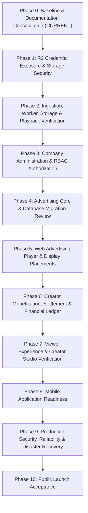

# WATCHTUBE — UNIFIED MASTER COMPLETION & VERIFICATION PLAN

**Document Version:** 1.0.0  
**Effective Date:** November 22, 2026  
**Repository Root:** `D:\watchtube\watchtube`  
**Primary Branch:** `main` (verified at HEAD `1857d1aeaa87e434d67a4c41a0c117acf91c41e5`)  
**Status Authority:** Source of truth for platform completion, verification gates, risk management, and execution phases.

---

## 1. MISSION & SCOPE

The objective of WatchTube is to establish a secure, high-performance, and economically viable video streaming and monetization platform tailored for the East African market (primary launch: Rwanda) and architected for continental scale. The platform supports five distinct user classes:
1. **Viewers:** Stream standard videos and portrait Shorts with low data consumption over cellular networks, search, discover via deterministic recommendations, and engage through comments and subscriptions.
2. **Creators:** Manage channels, upload videos and portrait Shorts, customize thumbnails, track genuine performance metrics, enroll in the WatchTube Partner Program (WTPP), and earn transparent revenue.
3. **Platform Administrators:** A strictly structured governance hierarchy consisting of one `SUPER_ADMIN` (Founder/CEO & Owner) and three designated `ADMIN` partner positions managing creator support cases, moderation queues, approval requests, and partner invitations with granular, role-gated permissions and an immutable audit trail.
4. **Advertisers & Ad Networks:** Provider-independent advertising waterfall delivering VAST pre-rolls, display banners, and direct campaigns with HMAC-SHA256 signed tracking tokens, server-side content eligibility checks, fail-open viewer guarantees, and atomic telemetry replay protection.
5. **Financial Stakeholders:** Provably isolated revenue streams, double-entry immutable ledgers, Rwanda Mobile Money payout integrations (MTN MoMo, Airtel Money), and prospective Shorts monetization rates calculated in integer basis points.

---

## 2. GOVERNING SOURCE-OF-TRUTH DOCUMENTS

The project documentation is maintained as a synchronized, cross-referencing set:

1. **`WATCHTUBE_UNIFIED_MASTER_VERIFICATION_PLAN.md` (This Document):** Central project master plan detailing all 11 workstreams, non-negotiable safety rules, 11 execution phases, risk registers, and verification standards.
2. **`WATCHTUBE_MASTER_COMPLETION_CHECKLIST.md`:** Itemized verification checklist spanning every subsystem with standardized completion statuses (`NOT_STARTED`, `IN_PROGRESS`, `IMPLEMENTED_UNVERIFIED`, `VERIFICATION_FAILED`, `BLOCKED`, `COMPLETE_VERIFIED`).
3. **`WATCHTUBE_MASTER_ROADMAP.md`:** Architectural dependencies, component inventory, and phase execution sequencing from baseline through public launch.
4. **`WATCHTUBE_PROGRESS.md`:** Dated chronological execution log recording exact test commands, build outputs, environment diagnostics, and code inspection evidence.

---

## 3. NON-NEGOTIABLE SAFETY AND INTEGRITY RULES

1. **Change Preservation:** All pre-existing modified files (97 tracked files) and untracked files/directories must be preserved. Never execute `git reset`, `git clean`, destructive checkout, or history rewriting.
2. **Authorization Boundary:** No Git commits or pushes may be made without explicit authorization.
3. **Secret Protection:** Never expose, print, log, or request plaintext secrets, credentials, or encryption keys in terminal output, documentation, or reports.
4. **Database Migration Safety:** No database migrations (`prisma migrate deploy` or `prisma db push`) or DDL/DML statements may be executed against production or non-local environments without explicit, reviewed approval and verified rollback plans.
5. **External Cloud & Provider Safety:** No live Cloudflare R2 resources, DNS records, Upstash Redis clusters, or payment provider configurations may be altered or deleted. Buckets `watchtube-raw-uploads` and `watchtube-media-public` must be preserved.
6. **Rigorous Verification Standard:** A task is never marked complete based on claims, comments, or passing mock unit tests alone. Production-ready claims require real repository code, passing automated tests, integration evidence, security verification, and truth-in-documentation.
7. **Architectural Stability:** Preserve working architecture; do not refactor or rebuild completed features (such as Subscriptions) without documented defect evidence.

---

## 4. WORKSTREAM ARCHITECTURE & STATUS

### WORKSTREAM A — Repository Baseline & Change Preservation
- **Repository Structure:** pnpm Turborepo monorepo at `D:\watchtube\watchtube` with apps (`api`, `web`, `worker`, `mobile`) and packages (`database`, `config`, `types`).
- **Baseline State:** Branch `main`, HEAD `1857d1a`. 97 modified files preserved; all untracked files preserved.
- **Verification Result:** Monorepo builds cleanly across all packages (`@watchtube/database`, `@watchtube/types`, `@watchtube/api`, `@watchtube/worker`, `@watchtube/web`). 284/284 automated tests pass across all packages with zero failures.
- **Database Migrations:** All 7 migrations in `packages/database/prisma/migrations/` deployed cleanly to local PostgreSQL database (`127.0.0.1:5432/watchtube`); verified with `prisma migrate status`.
- **Status:** `COMPLETE_VERIFIED` (for local repository and schema baseline).

### WORKSTREAM B — Cloudflare R2 Security & Credential Exposure
- **Threat Model:** R2 access credentials and third-party secrets were found committed in working-copy `apps/api/.env.example`.
- **Owner Retention Policy:** The account owner explicitly decided to retain existing R2 credentials. Rotation is not treated as a blocking prerequisite.
- **Bucket Invariants:** `watchtube-raw-uploads` (private ingestion bucket) and `watchtube-media-public` (public CDN delivery bucket) must remain intact without deletion or recreation.
- **Diagnostics Evidence:**
  - Local API storage diagnostic (`apps/api/scripts/storage-check.cjs`) repaired and passes with exit code 0 (`{"status":"configured","missing":[]}`).
  - Worker storage diagnostic (`apps/worker/scripts/storage-check.cjs`) repaired and passes with exit code 0 (`{"status":"unconfigured","missing":[...]}`).
  - Unit test in `storage-readiness.test.ts` validates configured status without leaking secret values.
- **Status:** `IMPLEMENTED_UNVERIFIED` (Diagnostics repaired; credentials retained; live API access unverified).

### WORKSTREAM C — Media Ingestion, Transcoding & Playback
- **Ingestion Pipeline:** Owner-scoped presigned upload URL generation (`/api/v1/videos/upload-intent` and `/thumbnail-upload-intent`), host-only signed headers (`X-Amz-SignedHeaders=host`), metadata validation, server-side object verification (`/api/v1/videos/:id/verify`), bounded BullMQ retries (3 attempts with exponential backoff).
- **Upload Lifecycle Decoupling:** In `UploadModal.tsx`, draft metadata creation (`saveMetadata`) is decoupled from thumbnail upload. Thumbnail upload runs alongside video transfer without preventing video upload intent creation or file transfer. Failed uploads preserve the draft ID, allowing retries to reuse the existing draft without duplicate records.
- **Transcoding Pipeline:** Adaptive bitrate HLS encoding for landscape videos (360p, 720p, 1080p) and dedicated portrait ladders for Shorts (360p, 540p, 1080p).
- **Current Evidence:**
  - `storage.service.ts` updated to omit `ContentLength` from `PutObjectCommand`, preventing `content-length` signature mismatches in browser uploads. Tested via `storage-readiness.test.ts` and `loopback-s3-upload-pipeline.test.ts`.
  - Loopback S3 pipeline tests (`loopback-s3-upload-pipeline.test.ts`) verify end-to-end video-only and video-plus-thumbnail uploads with WebP normalization.
  - `apps/worker/src/services/transcode.service.ts` updated to support configurable binary paths via `FFMPEG_PATH` and `FFPROBE_PATH` with automatic fallback checking.
  - Worker media diagnostic `apps/worker/scripts/media-check.cjs` repaired and exits cleanly with code 0 (`{"ffmpeg":true,"ffprobe":true}`).
  - Ingestion and path tests pass across all worker tests (36/36) and API upload tests (281/281).
- **Status:** `COMPLETE_VERIFIED` for local loopback S3 pipeline, media tools, and transcoding logic; `BLOCKED` for live Cloudflare R2 browser uploads until bucket write and CORS permissions are active on the live bucket.

### WORKSTREAM D — Secure Advertising & Monetization
- **Ads Core Architecture:** Provider-independent waterfall engine (`apps/api/src/services/advertising/`) supporting VAST pre-rolls, display banners, and direct sponsorships.
- **Security Features:**
  - Server-side monetization eligibility checks (`eligibility.ts`) enforcing WTPP channel status, public visibility, clear copyright claims, and zero active strikes.
  - Fail-open guarantee: player never blocks video playback on ad timeout, error, or unmonetized state.
  - Dedicated `ADS_TRACKING_SECRET` isolated from `JWT_SECRET` with startup enforcement.
  - Cryptographic HMAC-SHA256 tracking tokens binding `sessionId`, `placement`, `provider`, `adId`, `videoId`, `channelId`, and expiration.
  - Client-submitted revenue strictly forbidden: `grossRevenueCents` forced to `BigInt(0)`.
  - Distributed atomic telemetry replay store: implemented `RedisAdTelemetryNonceStore` with atomic Redis Lua script enforcing duplicate impression detection, lifecycle conflict protection (`AD_COMPLETED` vs `AD_SKIPPED`), and session TTL.
  - Database migration `20261121220000_advertising_lifecycle_telemetry` applied cleanly to local database; schema updated with 8 new lifecycle enums.
- **Status:** `COMPLETE_VERIFIED` (for Ads Core, cryptographic token contracts, and distributed telemetry replay defense).

### WORKSTREAM E — Company Administration & Governance
- **Hierarchy:**
  - `SUPER_ADMIN`: Founder, CEO & Platform Owner. Fully protected against lockout, demotion, suspension, or deletion. Sole access to company financial intelligence (`/ceo/financial-intelligence`), global payout approvals, rate changes, and policy management.
  - Three designated `ADMIN` positions (`ADMIN 1`, `ADMIN 2`, `ADMIN 3` in `AdminPosition` model) for trusted partners. Assigned creator-support responsibilities, permission sets, and operational queues.
  - `USER`: Ordinary viewer and creator accounts with zero administrative privileges.
- **Core Capabilities:**
  - Secure partner invitation workflow with deterministic SHA-256 hashed single-use tokens expiring in 72 hours (`AdminInvitation`).
  - Shared Admin Portal (`AdminDashboard.tsx`) with permission-personalized views.
  - Creator Support Case management (`WT-CASE-YYYYMMDD-XXXX`) with confidential internal notes and activity timelines.
  - Administrative Approval Requests for sensitive operational escalations to the CEO.
  - Immutable audit ledger (`AdminAuditLog`) with automated PII and credential redaction.
  - Database migration `20261121190000_company_administration` deployed cleanly to local database.
- **Status:** `COMPLETE_VERIFIED` (for RBAC contracts, security models, portal components, and local database schema).

### WORKSTREAM F — Viewer Experience
- **Navigation & Discovery:**
  - Home: strict public discovery with bounded recency and accessibility checks.
  - Trending: activity-ranked public content based on 7-day valid views, positive reactions, and comments.
  - For You: personalized recommendation engine (`recommendation.service.ts`) using viewer watch history, completion ratios, likes, dislikes, and creator diversity balancing.
  - Subscriptions: fully implemented chronological subscription feed (preserved without modification).
  - Search: parameterized video and channel search.
- **Playback & Engagement:** Responsive HLS player, threaded cursor-paginated comments, likes/dislikes, watch history tracking, and dark/light themes.
- **Current Evidence:** Web application builds with 35 tests passing; API feed endpoints pass. Real media playback blocked by storage/worker readiness.
- **Status:** `IMPLEMENTED_UNVERIFIED`.

### WORKSTREAM G — Creator Studio
- **Capabilities:** Channel customization (avatar/banner WebP conversion and upload), video metadata editing, audience/category tagging, copyright declarations, custom thumbnail uploads (16:9 standard, 9:16 portrait Shorts), analytics dashboard, and WTPP application workflow with field-bound AES-GCM PII encryption.
- **Shorts Monetization:** Prospectively configurable creator earning rate (default 30.00% / 3,000 bps) with immutable rate-change audit history. Migration `20261120170000_shorts_monetization_rate` applied cleanly.
- **Status:** `COMPLETE_VERIFIED` (for rate model, schema, and API contracts).

### WORKSTREAM H — Financial Systems & Payment Foundations
- **Revenue Separation:** Strict segregation among Subscription revenue, Advertising revenue, Direct sponsorships, Creator earnings, Platform commission, and Escrow holds.
- **Monetization Policy:** Earning allocations derived from verified ad provider settlements, not client telemetry alone. Integer RWF arithmetic with basis-point calculations.
- **Mobile Money Foundations:** Provider-independent payment architecture in `apps/api/src/services/payments/` with typed `MtnMoMoAdapter` and `AirtelMoneyAdapter`, Rwandan phone normalization (`078/079` -> MTN, `072/073` -> Airtel), HMAC-SHA256 signature verification, double-entry ledger invariant guardian, idempotency enforcement, and webhook replay protection; 8 unit tests in `mobile-money-payments.test.ts`. Unconfigured requests return safe 501.
- **Status:** `IMPLEMENTED_UNVERIFIED` (Architecture & contracts verified; live provider sandbox credentials pending).

### WORKSTREAM I — Mobile Applications
- **Repository Asset:** Expo / React Native viewer application in `apps/mobile/`.
- **Verified Logic:** API contracts, feed parsing, cursor comment pagination, session revalidation, and error handling covered by 9 passing tests.
- **Remaining Scope:** Shorts vertical swipe player, authenticated device testing, EAS build configuration, native credentials, and creator studio scope.
- **Status:** `IMPLEMENTED_UNVERIFIED`.

### WORKSTREAM J — Security, Reliability & Production Operations
- **Security Baseline:** Helmet HTTP headers, CORS origin allowlisting, bcrypt password hashing, HTTP-only JWT cookies with role revalidation, Zod input validation, AES-GCM encryption for WTPP tax/PII, and loopback guards preventing local commands from contacting production endpoints.
- **Backup System:** Synthetic encrypted backup prototype (`tools/backup-system/`) with 18 passing tests verifying authenticated AES-GCM streaming encryption, checksums, and safe error handling.
- **Operational Deficits:** Centralized logging, Prometheus metrics, distributed tracing, automated CI/CD deployment pipelines, and disaster recovery drills are not yet provisioned.
- **Status:** `IMPLEMENTED_UNVERIFIED` / `IN_PROGRESS`.

### WORKSTREAM K — Public Launch Readiness
- **Launch Gates:** All 10 preceding workstreams must meet the `COMPLETE_VERIFIED` standard.
- **Status:** `BLOCKED` (Awaiting earlier phase completion).

---

## 5. STANDARDIZED VERIFICATION CRITERIA

Every item in the project completion checklist must strictly maintain one of the following six statuses:

1. `NOT_STARTED`: No functional code or tests exist in the repository.
2. `IN_PROGRESS`: Active development underway; implementation is incomplete.
3. `IMPLEMENTED_UNVERIFIED`: Functional code exists and unit tests pass, but end-to-end integration, live database persistence, external provider, or physical device verification is outstanding.
4. `VERIFICATION_FAILED`: Code exists, but verification testing revealed defects, security vulnerabilities, or invariant violations.
5. `BLOCKED`: Work cannot proceed due to external dependencies, missing credentials, approval gates, or environment limitations.
6. `COMPLETE_VERIFIED`: Implementation verified against all seven criteria:
   - Code path inspected in the repository.
   - Automated tests pass.
   - Integration behavior validated with real dependencies.
   - Security, RBAC, and error-handling requirements confirmed.
   - Documentation accurately reflects behavior.
   - No open critical issues or conflicting statuses.
   - Explicit evidence logged in `WATCHTUBE_PROGRESS.md`.

---

## 6. PHASED EXECUTION SEQUENCE

### Detailed Phase Scope:
- **Phase 0 (Current):** Unified repository baseline, change preservation, full test suite execution (270/270 passing), build validation, and documentation reconciliation.
- **Phase 1:** Confirm R2 credential revocation and rotation with account owners; eliminate hardcoded secrets; verify bucket policies on `watchtube-raw-uploads` and `watchtube-media-public`.
- **Phase 2:** Provision FFmpeg/FFprobe in worker environment; configure replacement R2 worker credentials; execute safe end-to-end video and Short upload, transcode, poster generation, and HLS playback tests.
- **Phase 3:** Review and apply Company Administration database migration `20261121190000_company_administration` to local/staging database; test partner invitation acceptance, support case workflows, and CEO dashboard.
- **Phase 4:** Review Advertising lifecycle migration `20261121220000_advertising_lifecycle_telemetry`; transition in-memory nonce store to durable Redis atomic store; verify multi-instance replay prevention.
- **Phase 5:** Integrate VAST pre-roll player overlay in web `VideoPlayer.tsx` and display banner placements with browser-level fail-open tests.
- **Phase 6:** Build immutable financial earning ledgers, integrate Rwanda Mobile Money APIs (MTN/Airtel), and enforce prospective Shorts rate calculation.
- **Phase 7:** End-to-end verification of all viewer feeds (Home, Trending, For You, Subscriptions) and Creator Studio tools against populated data.
- **Phase 8:** Mobile application device testing, Shorts player integration, and app store release packaging.
- **Phase 9:** Production security auditing, performance load testing, SLO alerts, and clean-machine disaster recovery rehearsals.
- **Phase 10:** Final launch checklist sign-off and public release.

---

## 7. RISK REGISTER & ACTIVE BLOCKERS

| Risk / Blocker ID | Severity | Description | Current Status | Remediation Plan |
|---|---|---|---|---|
| **RISK-R2-CRED** | **CRITICAL** | Raw credentials committed in working tree `apps/api/.env.example`. | Active / Unverified | Verify owner rotation of Cloudflare keys; purge secrets from tracked example templates; re-scope bucket access. |
| **RISK-FFMPEG** | **HIGH** | Worker `media:check` reports FFmpeg and FFprobe unavailable on Windows host. | Active / Blocker | Install and configure certified FFmpeg/FFprobe binaries on developer/worker machine and add to PATH. |
| **RISK-ADS-NONCE** | **HIGH** | Advertising telemetry relies on `InMemoryAdTelemetryNonceStore`, failing across multi-instance API deployments. | Identified / Staged | Implement distributed atomic replay prevention via Redis `SET ... NX EX` or database unique constraint. |
| **RISK-DB-MIG** | **HIGH** | 3 unapplied migrations exist locally: Shorts Rate, Company Administration, and Advertising Lifecycle. | Staged / Pending | Review migration SQL, execute in isolated local database, update Prisma schema, and regenerate client. |
| **RISK-PAYOUT** | **HIGH** | Rwanda Mobile Money payouts return 501; no sandbox client or webhook verification exists. | Staged / Blocked | Implement MTN MoMo and Airtel Money API clients with idempotency keys and webhook signature validation. |
| **RISK-AUTH-LIVE** | **MEDIUM** | Local API connectivity verified, but authenticated session round trip against populated database is untested. | Pending Database | Create safe non-production test accounts to verify login, cookie refresh, and logout flows. |

---

## 8. DOCUMENTATION RECONCILIATION COVENANT

All updates to the WatchTube platform must maintain strict consistency across all four source-of-truth documents. No status may be advanced to `COMPLETE_VERIFIED` in any document without recorded evidence in `WATCHTUBE_PROGRESS.md` and alignment with this master plan.
